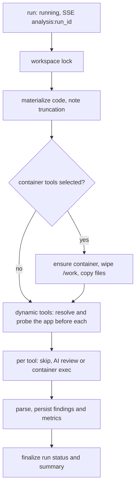

# Analysis pipeline

How an analysis run executes: analyzer workspaces, tool execution, result statuses, the AI reviewer and the rules that keep findings comparable.

## Overview

An `AnalysisRun` analyzes either pasted source code (`source_code`, a `{filename: content}` map) or the stored output of a generation job (`generation_job`), with the tools listed in `tool_slugs`. Each tool produces one `ToolResult`; parsers turn tool output into normalized `Finding` rows (severity, `tool_severity`, category, confidence, file, line, rule, `tool_specific_data`) and, for measuring tools such as radon, jscpd and lizard, a `metrics` JSON payload. See [Severity as reported](#severity-as-reported) for the two severity fields.

Runs are created by:

| Entry point | How it executes |
| --- | --- |
| Analysis page (`/analysis/create`): `POST /api/analysis/runs/` (one app or pasted code; `auto_start` defaults to true) or `POST /api/analysis/runs/batch/` (one run per app, same `launch_id`) | `runner.dispatch_many`: one daemon thread inside the django process runs them one after another |
| Study post-run analysis ([Studies](/docs/STUDIES#clone-ad-hoc-schedules-and-post-runs)) | `runner.execute`, synchronously, one run after another |

Runs do not go through Celery. A run dispatched on a thread dies with the process. While a run is `running`, its thread refreshes `heartbeat_at` every 30 seconds (also during a long tool). A run whose heartbeat is more than 5 minutes old has no live thread, for example after a backend reload, and is reaped: `runner.reap_stale_runs` marks it `failed` with "Interrupted: the backend process executing this run stopped…", and its still-`running` tool results `failed` too. Runs queued by `dispatch_many` stay `pending` until their turn; the queue thread refreshes their `heartbeat_at` too, so a queue that died with its process fails its waiting runs ("Interrupted before it started…") once their heartbeat is 5 minutes old. A `pending` run that was never queued (no heartbeat) is left alone. Reaping happens whenever runs are listed or opened (`GET /api/analysis/runs/`, `GET /api/analysis/runs/<id>/`) and in the System page's "clear stuck analysis" maintenance action. A run that is still beating is never reaped, whatever its age. Re-run an interrupted analysis.

Run statuses: `pending`, `running`, `completed`, `partial`, `failed`, `cancelled`.

### Live progress

Each tool result records `started_at` and `duration_seconds` (none for a tool that was skipped without running). The runner publishes on the `analysis:<run id>` SSE channel:

| Event | Payload | When |
| --- | --- | --- |
| `status` | `status`, `summary`, `error_message` | the run starts, fails, is cancelled or finishes |
| `progress` | `phase`: `waiting_for_workspace`, `preparing`, `running_tools` | between tools (also stored in `summary.phase` while running) |
| `result` | `result`: the tool result as the API returns it | a tool starts and finishes, or is skipped |

`waiting_for_workspace` means another run of the same user holds the workspace (runs of one workspace are serialized). The analysis pages subscribe to these events and poll as a fallback.

## Analyzer workspaces

Container tools never run on the host. Each user gets one long-lived container (`AnalyzerWorkspace`, statuses `absent`, `provisioning`, `ready`, `stopped`, `error`) named `analyzer-<hex>`, started from the `backend/analyzer-base:latest` image. `ensure_base_image` in `services/workspace_service.py` builds that image on first use from `backend/analysis/images/analyzer-base` (python:3.11-slim plus Node.js 20 and coreutils, non-root user `analyzer` with uid 1000, working directory `/work`).

| Property | Value |
| --- | --- |
| Capabilities | all dropped, `no-new-privileges` |
| Limits | 1 GB memory, 1 CPU, 256 PIDs |
| Ports | none published |
| Network | `DOCKER_APPS_NETWORK` when set, else the daemon's default bridge (installs and advisory databases need outbound access) |

The workspace is provisioned lazily, by the first container-tool install or analysis run, or from the **Workspace** tab of the Analyzers page (`POST /api/analyzers/workspace/provision/`, plus `start/`, `stop/` and `DELETE /api/analyzers/workspace/`). Deleting the workspace removes the container and every install record.

Tools are installed into the running container with each tool's `install_cmd` (bounded by `install_timeout`); the first line of `verify_cmd` output becomes the installed version (`services/tool_installer.py`). Installs persist across runs, so only the first run pays the install cost. Package-manager commands are serialized per workspace, a bulk install or "update all" installs its tools one after another on one background thread, and a failed update keeps the previous version usable. AI tools need no install. See the [Analyzer guide](/docs/ANALYZER_GUIDE) for the catalog and its API.

> [!NOTE]
> Wait for the workspace to reach `ready` before firing separate install requests from several tabs or scripts: concurrent requests against a workspace that does not exist yet can each try to provision it.

## Execution flow



`runner.execute`:

1. Marks the run `running` and publishes its status on the `analysis:<run_id>` realtime channel (`/api/realtime/stream`).
2. Takes the workspace lock, a Postgres advisory lock per workspace: runs of one user execute one at a time because they share `/work` and the tools' fixed `/tmp` report paths.
3. Materializes the code. A generation run is always analyzed on its `app` scope: `RunView.files("app")` (starter files plus the model's files; a slot variant also gets its parent's files, tagged `parent`). The scope and `H(sorted analyzed paths)` are recorded on the run (`code_scope`, `code_scope_paths_sha`), and every finding carries its file's origin (`starter`, `authored`, `modified`, `slot`, `parent`), so model or slot attribution happens at stats time, never by filtering the input. Empty files (an empty `__init__.py`) are copied in too, since they shape the package layout the tools see, but an empty file never makes a tool applicable. A truncated generation run (`validity.truncated`) records its termination in `summary.truncated_inputs`, the same rule the reports use. Files inside dependency, cache or scratch directories (`node_modules/`, virtual environments, `__pycache__/`, `.cache/`, `.tmp/`, `tmp/`, ...; `analysis.services.base.NON_SOURCE_DIRS`) are left out of the analyzed tree, of source LOC and of the manifests that attribute dependency advisories; the run records how many in `summary.excluded_paths`.
4. If any selected tool is a container tool: makes sure the container is running (provisioning it if needed), deletes everything under `/work` and copies the files in, owned by uid 1000. If the container cannot be obtained, or the wipe or the copy fails, the whole run fails: stale files would otherwise be scanned as part of this app.
5. Before each dynamic tool, the runner resolves the app's URL again (see the [Analyzer guide](/docs/ANALYZER_GUIDE)) and probes it from the workspace (`curl -sS -o /dev/null --max-time 10 <url>/`; any HTTP status counts as alive). An app that does not answer skips the tool as `app_not_running`. After the tool it probes again, up to twice. If the app stopped answering during the scan, the result is `skipped`/`app_not_running` when the scan found nothing, or `failed` with its findings kept (not counted) when it found something, because a scan of a dead app is never a clean zero.
6. For each slug in `tool_slugs`, in order, creates a `ToolResult` and either skips it (unknown or disabled tool, dynamic tool without a running app, no applicable files), runs the AI reviewer (`services/ai_runner.py`), or renders `run_cmd` (`{target}` -> `/work`, `{url}`, `{config:<name>}`) and executes it in `/work` under `timeout -s KILL <run_timeout>`. A tool that crashes (an unexpected provider response, an unsavable value) fails only its own result (`Internal error: <Type>: <message>`); the run continues with the next tool, and no result is ever left `running`. NUL bytes in tool output are stored as U+FFFD. The AI reviewer is `skipped`/`not_applicable` when the app has no reviewable file (only lockfiles, minified or empty files). It fails, rather than returning a clean zero, when the model returns no content, the provider returns an error, the array holds no finding objects, or no file fits the prompt budget. A review salvaged from a response truncated at `max_tokens` carries a warning. Exit 126/127 are reported as "command not found" only when the shell says so: some tools (osv-scanner) use 127 for their own errors. A SIGKILL well before the timeout is reported as out of memory or killed from outside.
7. Parses stdout with the parser registered under the tool's `parser_key`, records `summary.tool_version` (container tools) and `summary.config` (defaults merged with the user's options), `summary.command_sha` (hash of the rendered command with the app URL normalized to `{url}`, or of the reviewer's prompt) and `summary.parser_sha` (hash of the parser's code), and stores the findings, with paths normalized (`/work/` and `./` prefixes stripped), and the metrics. `summary.patterns_sha` hashes the tool's `file_patterns`, which decide whether an app is not applicable (a true zero) or measured. It is recorded on completed and failed results and on results skipped as not applicable, not for dynamic tools. A skip as not applicable records no `tool_version`, because the build does not decide it. A failed AI review keeps `summary.files_not_reviewed`. `raw_output.stdout_truncated` says the stored stdout was cut at 30,000 characters, so re-parsing it offline sees an incomplete report.
8. Finalizes the run: `failed` when no tool completed and at least one failed, `partial` when some failed, otherwise `completed`. Skipped tools never fail a run, so a run whose tools were all skipped is `completed`; `tools_unmeasured` says how many of its tools measured nothing. `summary` holds `total_findings`, `code_findings`, `dependency_findings` (every `dependency` finding of the known-vulnerability scanners pip-audit, npm-audit, osv-scanner, trivy and retire, packages that do not exist (`nonexistent-*`) included; deptry/depcheck manifest findings count as code) and `runtime_findings` (dynamic tools), `severity_counts` (normalized), `reported_severity_counts` (levels as the tools printed them, case-folded), `unrated_findings` (findings of tools that rate nothing), `metrics_by_tool`, `tools_run`, `tools_completed`, `tools_failed`, `tools_not_applicable`, `tools_unmeasured` (skipped as app not running, unavailable or cancelled) and, when relevant, `truncated_inputs`. A scope that no tool of the run measured (a completed result, or a skip as not applicable) and that has no findings is `null`, not 0: a run without dynamic tools has `runtime_findings: null`, a run whose vulnerability scanners all failed has `dependency_findings: null`. These counters and `tools_not_applicable` / `tools_unmeasured` are recomputed from the stored rows whenever a finished run is read, so runs stored earlier follow the same rules. Each tool result's `summary` carries its own `finding_count`, `severity_counts` and `reported_severity_counts`.

The Analysis list's Tools column shows the tools that measured the code (completed, or skipped as not applicable) over the tools in the run, with k n/a, k failed and k not measured (app not running, tool unavailable, cancelled) underneath. The status cell repeats k not measured, and its tooltip says skipped tools measured nothing. A finished run in which no tool measured anything shows — instead of a 0 finding count (run list, app page, run Overview).

The Analysis list's Findings column shows a finished run's code findings. Dependency advisories and dynamic tools' (runtime) findings are counted apart underneath (+ N advisories · N runtime), and the column sorts by code findings. When no code tool measured the run, the count shows —, never 0. The level chips cover every finding (advisories included), so when a run has advisories or runtime findings the chips sit on their own row marked all:. The run Overview's first KPI reads Code findings (+ N advisories) and opens the Findings tab filtered to code. Its Tools measured subtitle lists failed / not measured / had nothing to read; a tool with no result at all (a run that failed while preparing) counts as not measured, so all measured needs every tool measured. When the agent's final response was cut off, the truncation banner says so (the app may be unfinished). The tool output dialog shows the result's fingerprints (command, parser and patterns sha) and says when the stored stdout was cut at 30,000 characters.

`POST /api/analysis/runs/<id>/cancel/` marks a `pending` or `running` run `cancelled`, and `cancelled` is final: the runner never overwrites it. Cancel also kills the tool that is running. Every tool command carries a `: llmlab-analysis-run:<run_id>;` prefix, and cancel SIGKILLs the process group of every process in the workspace whose command line has that marker. The runner checks for cancellation before each tool and after each tool returns. The killed tool and every tool not yet started are recorded as `skipped` with `summary.skip_reason: cancelled`, which does not count as measured. The run's `summary` still describes what ran before the cancel. An AI review in flight (an HTTP call) cannot be interrupted, so its response is discarded when it arrives. Results of cancelled runs never feed study tables, reports or rankings.

`POST /api/analysis/runs/` with a `generation_job_id` returns 404 unless the job is yours. Staff can analyze any job.

### Runs API

| Endpoint | Purpose |
| --- | --- |
| `GET /api/analysis/runs/` | List with `status` (comma-separated; `active` = pending + running), `search` (name, app, model, stack, ID prefix), `launch_id`, `generation_job_id` (a generation run id), `tool_slug`, `sort` (`created_desc`, `created_asc`, `name_asc`, `duration_desc`, `findings_desc`, `code_findings_desc`: code findings only, counted from the findings so older runs sort too). Items carry the `target` (app, model, stack, or pasted code), `phase` and, for active runs, `progress` (tools done / running, findings so far). |
| `GET /api/analysis/runs/<id>/` | One run with its results; `source_files[]` lists each analyzed file with `lines`, its real line count (an empty file is 0) |
| `GET /api/analysis/runs/stats/` | Run counts per status |
| `POST /api/analysis/runs/` | One run (a job or pasted code); unknown tool slugs are a 400 |
| `POST /api/analysis/runs/batch/` | One run per generation run (at most 100), queued on one thread, sharing one `launch_id` |
| `POST /api/analysis/runs/preview/` | Free dry run: per tool, on how many targets it would run or be skipped (no file it reads, app not running); per target, files, lines and whether its app container runs |
| `POST /api/analysis/runs/<id>/rerun/` | A new run on the same code: all tools, `tool_slugs`, or `only_unmeasured` (failed, cancelled, unavailable, app not running) |
| `POST /api/analysis/runs/bulk/` | `cancel` or `delete` several runs; active runs are never deleted |
| `DELETE /api/analysis/runs/<id>/` | 409 while the run is active (cancel it first) |
| `GET /api/analysis/runs/<id>/results/<result id>/` | One tool's raw output: command, exit code, stored stdout (first 30,000 characters; `stdout_truncated` when cut), target URL |
| `GET /api/analysis/runs/<id>/findings/` | Findings with `tool_slug`, `tool_severity` (a reported label or `unrated`), `category`, `file_path`, `rule_id`, `scope` (`code`: what the model wrote; `source` / `tests`: the code findings outside / inside test files; `dependencies`: known-vulnerability advisories; `runtime`: dynamic tools; empty: all; anything else is a 400), `search`, `sort` (`severity`, `file`, `tool`, `rule`); `group=true` returns one item per issue (the cross-tool clusters of `statistics/services/dedup.py`, built from the filtered findings) with the other reports in `duplicates`, and `findings_total`. Every finding carries `in_tests` |
| `GET /api/analysis/runs/<id>/findings/facets/` | Counts per tool, reported level, category, file and rule (top 50), plus `scopes` (`code`, `dependencies`, `runtime` over all of the run's findings) and `code_parts` (`source`, `tests`: the code findings outside / inside test files; null when no tool measured code). `scope` limits every facet but `scopes`; `tool_slug` limits every facet but `tools` and `scopes` |
| `GET /api/analysis/runs/<id>/context/?scope=study\|mine` | The run in context: the setup behind the app, its source size, test-code findings apart and rule prevalence (see [Run context](#run-context)) |

Facet levels and the `severity` sort are ordered by the tool's own level word (`runs.level_rank`, the same table as the UI's `LEVEL_WORDS`: critical/blocker, then fatal/error/high/severe, major/medium/moderate/warning, low/minor, refactor/convention/style/note, info, unknown; a numeric CVSS label by its band; any other word after those, unrated last), never by the normalized severity.

**Test files.** `in_tests` marks a code finding whose path is a test path (`reports/services/loc.py` `is_test_path`, the study's own rule, applied in Python rather than mirrored in SQL). Dependency advisories and dynamic tools' findings are never test findings: their paths are manifests and URLs. The study tables count test-code issues apart from the app's code issues ([Study tables](/docs/STUDY_TABLES#deduplicated-findings)), and the run page does the same: its Code findings KPI counts the app's source, with the test-file findings listed apart.

### Run context

`GET /api/analysis/runs/<id>/context/` (`api/views/context.py`) puts one run in context, descriptively (counts and n, no tests). It follows the run detail's access rule (your own runs; another user's or a malformed id is a 404, an unknown `scope` a 400) and returns:

| Key | Content |
| --- | --- |
| `job` | The analyzed generation run's setup (from `RunView`): kind, status, outcome, `usable`, model (pk, id, name, canonical slug), task (`task_ref`, slug, title, prose variant), `unit_key`, `stack_ref`, study id and name, condition id and label, stage, `repeat_index` (0-based) and `planned_repeats`, harness and version, `config_fingerprint` and `run_fingerprint` |
| `source_loc` | The app's size by the study's definition (`reports/services/loc.py`): `total`, `files`, `by_layer` (backend, frontend, tests), `test_files`, `other_files` (stored files that are neither source nor in a non-source directory), and `excluded_paths`: the stored files inside `NON_SOURCE_DIRS` (`count`, `sample` of 20, `dirs`), whether this run left them out (`left_out`: true when the run recorded `summary.excluded_paths`; false for a run finalized before that rule, whose tools read those files; null when no tool ran) and `findings_in_excluded` |
| `test_split` | Per tool, the run's code findings in test files and in the app's own source |
| `rule_prevalence` | Per (tool, rule) of this run: `count_in_run`, `rule_name`, `title`, `scope` (`code`, `dependencies` or `runtime`, as the findings API counts it), `issue_class`, and `apps_with_rule` / `apps_measured` over the corpus and `model_apps_with_rule` / `model_apps_measured` over this model's apps in it |
| `scope`, `scopes_available`, `scope_label`, `n`, `model_n`, `self_in_corpus`, `interim`, `notes` | The corpus used and its size |

Prevalence rules:

- **Corpus.** `scope=study` is the current runs (main stage) of the app's study (yours, or any for staff); `scope=mine` every current run of yours (runs outside a study cell, plus each study's current run per cell; `beyond_plan` runs left out). Empty picks the study when the app belongs to one of yours, else `mine`; asking for `study` on an app outside one falls back to `mine` with a note. Retried cells count once, by their current run (`runs.queries.current_runs`).
- **Per-tool latest.** Each app counts with each tool's latest result (`ToolResult.latest_ids_per_job`), as in the study tables.
- **Denominator.** `apps_measured` is the apps whose latest result of that tool measured the code (completed, or skipped as not applicable), never all apps. A failed result is in neither the denominator nor the numerator, even when it kept findings.
- **This run's own results.** When one of this run's results is not the one counted for the app (a later analysis superseded it, or it measured nothing), a note names the tools whose findings the counts may not include. An app that is not in the corpus (a superseded attempt, or no finished analysis) is compared but not counted (`self_in_corpus: false`).
- **Issue class.** A rule's `issue_class` is the dedup class of its findings when they all share one, else empty (a rule such as Nuclei's missing-headers spans one class per header).
- **"of this model"** counts pool every arm of the model in the corpus, and each repeat counts as an app. `interim` is true for a study corpus while the study runs: the counts move as its apps finish.

The run page shows this as the setup line under the title (study › condition › repeat k/N · model · harness · task), the Code KPI (study source LOC, with a note on excluded paths and, for runs from before the exclusion rule, how many findings lie in them), the scope switch and prevalence ("12/12 apps · 4/4 of this model") on Most frequent rules, and the prevalence row of a finding's detail. A finished generation run also shows the app's same-setup group ([Run-to-run variation](/docs/STUDIES#run-to-run-variation)).

## Severity as reported

Tools rate findings in their own words (bandit `HIGH`, ESLint `error`, pylint `convention`, ZAP `Medium`, npm audit `moderate`) or not at all (ruff, flake8, vulture, gitleaks, jscpd, pip-audit, …). Every finding stores both:

- `tool_severity`: the label exactly as the tool printed it, or empty when the tool rates nothing. This is what the analysis pages display; a finding of an unrated tool shows no level.
- `severity`: a normalization to critical / high / medium / low / info. For unrated tools it is a heuristic (for example ruff and flake8 codes are mapped by family). Statistics, study tables and automation thresholds still use it. The legacy reports show the tools' own labels (`reported_levels`, `unrated` when a tool printed none), and the normalized split appears only in keys named `severity_normalized_heuristic`, `by_severity_normalized_heuristic` or `critical_high_normalized`. On screen the normalized level appears only in aggregates labelled "normalized (heuristic)": the Statistics Severity distribution, the dashboard Finding severity donut, and the model Results tab level chips and Crit/High/Med/Low columns, where findings of unrated tools are counted as unrated and dependency advisories form their own group. A single finding, rule or top finding shows only the level its tool printed.

Heuristic secret detectors are not normalized to high: detect-secrets' `Secret Keyword` is low (the heuristic Bandit rates LOW as B105/B106); its high-entropy detectors and Gitleaks' `generic-api-key` are medium; provider-specific detectors (AWS keys, private keys, GitHub/Stripe/Slack tokens, …) stay high. ESLint rules about raw HTML, `target="_blank"`, `javascript:` URLs and code evaluation (`react/no-danger`, `react/no-danger-with-children`, `react/jsx-no-target-blank`, `react/jsx-no-script-url`, `no-eval`, `no-implied-eval`, `no-new-func`, `no-script-url`) are category `security` (normalized medium); `react/no-unescaped-entities` and `react/display-name` are normalized low. `tool_severity` is unchanged in every case.

Exports follow the same rule: findings CSV/JSON carry `tool_severity` and a column named `normalized_severity`, and the SARIF level follows the tool's label (`none` for unrated tools).

Parsers also store what the tools report about each finding in `tool_specific_data` under standard keys: `rule_name`, `docs_url`, `references`, `cwe`, `owasp`, `end_line`, `end_column`, `fix`, `tool_confidence`; for dependency vulnerabilities `package`, `installed_version`, `fixed_versions`, `vuln_id`, `aliases`, `cvss_score`, `cvss_vector`, `manifest`; for scanners `url`, `method`, `param`, `evidence`, `attack`, `instances`, `other_info`; `secret_type` (never the secret), `complexity`, `function`, `nloc`, and `duplicate_of` for clones. Older tool-specific keys (trivy `fixed_version`, osv `fix_versions`, jscpd `second_file`) are kept next to them.

## What a tool result means

A tool that measured nothing must never pass for a clean result, because zero findings reads as "no defects" in every comparison. Each `ToolResult` is one of:

| Status | Meaning | Counts as measured? |
| --- | --- | --- |
| `completed` | The tool ran and its report parsed. Zero findings is a real zero. | Yes |
| `skipped`, `summary.skip_reason: not_applicable` | The app has none of the files the tool reads (no `requirements*.txt` for pip-audit, no `.js` for ESLint; empty files do not count), or, for the AI reviewer, no reviewable file. | Yes (the true count is zero) |
| `skipped`, `skip_reason: app_not_running` | A dynamic tool, and the run analyzes pasted code, the app's container was not running, or the app did not answer the probe before the scan (or stopped answering during a scan that found nothing). | No |
| `skipped`, `skip_reason: unavailable` | The tool is unknown or disabled in the catalog. | No |
| `skipped`, `skip_reason: cancelled` | The run was cancelled before this tool ran, or while it ran (the tool was killed). | No |
| `failed` | Killed (exit 137: `run_timeout`, out of memory or killed from outside), not installed (exit 126/127 with the shell's "not found" message), a non-zero exit with nothing parsed, no parser registered for the `parser_key`, a parser exception, a cut-off or missing JSON report, every manifest of a multi-manifest tool failed, the workspace was unavailable, an app that stopped answering during a scan that found something, an internal error while running or storing the tool, or an AI review that returned no usable findings array (see [The AI reviewer](#the-ai-reviewer)). | No |

A `completed` result can still carry `summary.warnings`, for example when one of several `requirements.txt` files could not be audited, or when the AI reviewer had to leave files out. Every container result stores the exact command and exit code in `raw_output` (`command`, `exit_code`, the first 30,000 characters of stdout with `stdout_truncated`, and `target_url` for dynamic tools), the installed tool version in `summary.tool_version`, the effective options in `summary.config`, and `summary.command_sha` (the rendered command with the app URL normalized to `{url}`, or the reviewer's prompt), `summary.parser_sha` (the parser's code) and `summary.patterns_sha` (the file patterns), so findings stay attributable after the workspace or the parser is updated. The runs API returns each result's `summary`, `metrics` and `error_message`; `raw_output` stays on the row (visible in the Django admin).

When a dependency cannot be resolved, pip-audit and npm audit audit nothing for that manifest. The run command echoes the resolver errors as `!! ` lines, and the parser turns them into `nonexistent-package` findings (high severity: the hallucinated-dependency or "slopsquatting" pattern, since anyone can register that name) or `nonexistent-version` findings (medium), next to a "not analyzed" warning for the manifest. pip stops at the first unresolvable requirement, so at most one is reported per file.

These findings are always stored. If at least one other manifest of the app was audited, the result is `completed` with the warning. If no manifest could be audited (the common case of a single `requirements.txt` or `package.json`), the result is `failed`: the vulnerability audit did not run, so the result is not a measurement. Its error message and `summary.warnings` name the unresolvable requirement, and the `nonexistent-*` findings are stored on the failed result anyway (`summary.finding_count`, `summary.severity_counts`), so they appear in the run's findings and in `summary.total_findings` and `summary.dependency_findings`.

> [!NOTE]
> Study tables count a tool only for apps it measured, so a failed audit is never read as zero vulnerabilities. For the same reason, the `nonexistent-*` findings on such a failed result do not reach the common-instrument tables: pip-audit or npm-audit appears under `coverage.tools_partial` with a `failed` count. To count hallucinated dependencies in every app, export with `--all-tools` or read the findings directly.

## The AI reviewer

`llm_review` is the one tool with `kind: ai`. Instead of a container command, `ai_runner.py` sends the code to an LLM with temperature 0.2 and asks for a JSON array of findings.

- **Model.** The tool's `model` option (default `anthropic/claude-opus-5.5`) and `max_tokens` (default 8000). A model id that exists in the user's model catalog resolves through the inference layer, which covers OpenRouter and local endpoints ([Local models](/docs/LOCAL_MODELS)); any other id is sent to OpenRouter with the run owner's API key, using the same key resolution as generation.
- **Input.** Files are introduced by `# ===== <filename> =====` markers, source files first. Lockfiles, `.min.` bundles and empty files are skipped (an app with nothing else is `not_applicable`), files are never cut mid-way, and the bundle stops at 60,000 characters; files that do not fit are listed in `summary.files_not_reviewed` and in a warning. When no file fits at all, the result fails.
- **Output.** Severities and categories are normalized to the platform vocabulary (`moderate` -> `medium`; categories `security`, `quality`, `performance`, `style`, `best_practice`). Complete findings are salvaged from a response cut off at `max_tokens`, with a warning that findings after the cut are missing. A response with no parsable array, an empty response, a provider error or an array that holds no finding objects is a `failed` result, never a clean one.
- **Status of its findings.** They land in the same `Finding` table and are exportable like the rest, but they are opinions, not measurements: study tables keep them out unless `include_ai` is set, the review sample puts them on their own sheet, and rankings collect them apart from the empirical score.

## Measurement rules for comparisons

- **Partial or unreadable output is never a clean result.** A JSON report followed by stderr text is still read (the first complete JSON value counts); output with no JSON report, or whose report is cut off (a JSON value that runs into the end of the output), fails the tool: an inner object of a cut-off report is never read as an empty report. A multi-manifest tool's section that holds JSON other than that tool's report (npm's `{"message": "request to … failed"}` when the advisory endpoint is unreachable) counts as not analyzed, like an empty section. What a tool says it could not scan becomes a warning on the result (`summary.warnings`), and a failure when it scanned nothing: Bandit's and Semgrep's per-file errors (Semgrep's `paths.skipped` only for real gaps such as size limits or parser failures; Semgrep runs with `--x-ignore-semgrepignore-files`, so its built-in ignore list, which skips `test/` and `tests/`, does not apply), ESLint's fatal "Parsing error" messages (never stored as findings), lizard finding no function in files it should read, files radon could not parse (an error when none parsed), Ruff syntax errors (one high `syntax-error` finding per file, follow-up errors dropped), files Vulture could not parse (Python's own warnings on stderr, such as `SyntaxWarning: invalid escape sequence`, are not gaps: the file parsed), and ESLint inline directives that name a rule the configuration does not load ("Definition for rule … was not found": a note, never a finding). A mypy run stopped by a blocking error (syntax error, duplicate module) fails, with its findings kept on the failed result.
- **Scanner noise.** DAST: ZAP informational alerts (risk 0), Nuclei hits Nuclei rates `info` and Wapiti level-0 vulnerabilities are category `best_practice`, not `security`. The exception is a CORS misconfiguration (`issue_key` `cors-misconfiguration`), which stays `security`. A missing header that another scanner rates Low or Medium still clusters as security. A missing Strict-Transport-Security header on a plain-http URL (Nuclei, ZAP 10035) is dropped, because HSTS only applies over https. ZAP passive hits that repeat on SPA-fallback routes (`/`, `/robots.txt`, `/sitemap.xml`) with the same set of evidence are one finding showing every evidence, with a `urls` list. Informational ZAP hits inside content-hashed build output (Vite `/assets/<name>-<8-char hash>`, CRA `/static/js|css/<name>.<8 hex>`) are dropped (higher-risk ones are kept with `build_asset: true`); hand-written files are not treated as bundles. jscpd reads `.jsx`/`.tsx` as one token stream (no double-counted clones), and overlapping duplicate clones are dropped.
- **Common instrument set.** Study tables (`statistics/services/study.py`, used by the study report, `GET /api/statistics/study/breakdowns/` and `export_study_tables`) count findings only from tools that *measured* every analyzed app in scope. The `coverage` block lists `tools_common` and, under `tools_partial`, each dropped tool with `apps_measured`, `apps_missing` and a count per reason (`failed`, `app_not_running`, ...). Without this, an app where Semgrep timed out, or that was not running for the DAST scanners, would look cleaner than its peers. Pass `common_tools_only=false` (CLI: `--all-tools`) to count everything. See [Study tables](/docs/STUDY_TABLES).
- **Code issues per kLOC.** Dependency advisories, runtime (DAST-only) issues and test code are not counted in per-kLOC densities (they describe packages, the running app, or code that is not the delivered app), and an advisory is the model's only in a version it chose; see `dependency_added` in [Study tables](/docs/STUDY_TABLES).
- **Source LOC.** Per-kLOC rates divide by source LOC (`reports/services/loc.py`): non-blank lines that do not start with the file type's comment marker, in `.py`, `.js`, `.jsx`, `.ts`, `.tsx`, `.mjs`, `.cjs`, `.vue`, `.svelte`, `.css`, `.scss`, `.html` and `.sh` files, excluding `.min.` bundles and `node_modules/`. Lockfiles, manifests, docs and configs are not code the model wrote; a generated `package-lock.json` alone can outweigh the whole app. Test code (`is_test_path`: test directories, test modules, `*.test.*`/`*.spec.*` files, test setup and smoke scripts) is left out of the denominator and counted apart as `test_loc`. The generation-time `metrics.lines_of_code` is used only as a fallback (rankings, the Statistics page's Lines of code tile, model insights) for legacy jobs without stored code.
- **Cross-tool deduplication** (`statistics/services/dedup.py`) merges one defect reported by several tools: Bandit, Ruff `S` rules and Semgrep; the lint rules Ruff, flake8, Pylint, Vulture, Mypy and ESLint share; the secret scanners; eslint-react's `react/no-danger` and the eslint-security rules that Semgrep also covers (eval, child processes, non-literal and unsafe regular expressions, pseudo-random bytes, non-literal file paths); the known-vulnerability scanners (pip-audit, npm audit, osv-scanner, Trivy, retire.js), which match on the vulnerable package within one project directory and then on the advisory under any of its ids (`aliases` holds every id of the advisory, `vuln_id` first, so a PYSEC, GHSA and CVE id of one advisory meet while two advisories of one package stay apart); radon (rank D–F) and lizard (`CCN`) on one over-complex function; the syntax error Ruff, flake8, Pylint and Mypy each report on one file they could not parse; and DAST findings about the same missing security header or CORS problem. pip-audit may return one advisory as two OSV records that alias each other (werkzeug PYSEC-2026-1860 and PYSEC-2026-3417); the parser merges them into one finding whose `aliases` holds every id.
- **Radon blocks.** Radon lists each method twice in `cc -j` (top level and inside its class); each block is counted once in `total_blocks`, `average_complexity` and `rank_distribution`.
- **Defaults that keep counts about the code.** Four are per-user options, recorded per result in `summary.config`:
  - Bandit skips B104 (the template requires binding `0.0.0.0` in the container);
  - Semgrep excludes `python.flask.security.audit.app-run-param-config.avoid_app_run_with_bad_host`, the same bind (`exclude_rules`);
  - Pylint disables `import-error`, the docstring messages, `too-few-public-methods` and `unused-argument`;
  - npm audit counts production dependencies only.

  The rest are fixed in each tool's `run_cmd`:
  - Vulture ignores framework entry points (route, validator and hook decorators) and signature-mandated names.
  - ESLint marks JSX-referenced components as used (ESLint and eslint-react both assume React 19.2, the builtin stacks' release, in `settings.react.version`).
  - deptry maps PyPI names to their import names (`PyJWT=jwt`, `python-multipart=multipart|python_multipart`, `argon2-cffi=argon2`, `email-validator=email_validator`, `pwdlib`, …) so the stacks' pinned packages are not reported as missing or unused. It also maps the modules a framework installs to that framework (`Flask=flask|werkzeug|itsdangerous|jinja2|click|blinker|markupsafe`, `Flask-SQLAlchemy=flask_sqlalchemy|sqlalchemy`, `fastapi=fastapi|starlette|pydantic|typing_extensions`) and never reports runtime-only packages as unused (`--per-rule-ignores DEP002=uvicorn|gunicorn|hypercorn|python-multipart|email-validator|bcrypt|simple-websocket|psycopg2|psycopg2-binary|pymysql`).
  - depcheck ignores test tooling wired up through the vitest config (vitest, `@vitest/*`, jsdom, happy-dom, `@testing-library/*`).
  - Stylelint allows the Tailwind 4 at-rules (theme, source, utility, variant, custom-variant, plugin, reference) and the `theme()`/`screen()` functions.
  - Semgrep scans test directories like every other tool. ESLint runs with `--no-eslintrc`, Ruff and flake8 with `--isolated`, Pylint and Perflint with `--rcfile=/dev/null` and mypy with `--config-file=`, so a config file the app ships cannot change what is measured. Inline suppressions such as `# noqa`, `# type: ignore` and `eslint-disable` still apply, and djlint cannot be isolated by a flag.
  - Pylint is pinned to 4.1.*.
  - Ruff and mypy keep their caches out of `/work` (mypy runs from the app root with `--explicit-package-bases`, so multi-module apps type-check).
  - osv-scanner checks declared versions only (`--no-resolve`). It leaves out packages that only dev dependencies reach (osv's `dependency_groups` contains `dev` but not `optional`), matching `npm audit --omit=dev` and Trivy's default. Packages osv tags `["dev", "optional"]` are kept and tagged: for npm lockfile v2+ osv prints that pair both for a dev tool's optional platform binary and for npm's `devOptional` packages, which can ship as optional dependencies of production packages, and the two cannot be told apart. Every parsed osv result records `metrics.dev_only_advisories_skipped` (0 when nothing was left out) and, when non-zero, `dev_only_packages_skipped` (`name@version` -> advisories). osv's `tool_severity` is the advisory's own label (GitHub's `MODERATE` etc.) or unrated, never a CVSS number (that is `cvss_score`); its normalized severity follows the label, else the max CVSS score. osv's exit 1 ("vulnerabilities found") is treated as success; output without a JSON report (exit 127 general error, 128 no package source it can read) is a failed result, never a clean zero.
  - djLint lints `.html`, `.jinja`, `.jinja2` and `.j2` templates (one pass per extension) and ignores H030/H031 (meta description, meta keywords).
  - Nuclei's tech-detect and ZAP's fingerprint alert 10109 are dropped as non-defects, and jscpd, codespell and the AI reviewer skip lockfiles and minified bundles.
- **Legacy reports.** Model analysis, task comparison and study-conditions reports follow the same rules. Finding counts use only the tools that measured every analyzed run in the report (`coverage`; a note names the tools left out and counts the analyzed runs that no tool measured, which are left out of the counts). A row with no measured run shows `-`/null, never 0 findings, and gets no empirical score. `weighted_score`, `weighted_per_kloc` and `critical_high_normalized` (formerly `critical_high`) count code findings only (no dependency advisories, dynamic-scanner findings or test code), over the non-test source LOC of the same analyzed runs. `findings_total` counts every counted finding, and `code_findings_total` / `dependency_findings_total` split it. The template comparison's weight sensitivity scores each model on its analyzed runs, with repeats of one app averaged first, as /rankings does. `success_rate` is completed / finished jobs: queued or running jobs (`in_flight_jobs`) are left out, and it is null when nothing has finished. Tool analysis lists every tool that executed, with executions by outcome and `findings_per_measured_execution` (a tool skipped as not applicable is a measured zero); cancelled runs are left out. The study-conditions report carries `report_version: 3` (v3 runs and tasks). In the comprehensive report, `platform.total_findings` is null when there is no analysis run (unmeasured, not 0).

## Changes to counting rules

These are bug fixes to metric definitions, not new metrics. Results and reports already stored keep their old values: a tool result changes when its app is re-analyzed, and a report when it is generated again. A frozen analysis plan's JSON is never modified; its metrics (`issues_per_kloc`, `security_per_app`, …) simply take the corrected definitions.

- Dependency advisories of the known-vulnerability scanners are no longer code issues: they are left out of code-issue counts, per-kLOC densities, security bounds, code rankings and the empirical score, and reported apart, split into model-added and inherited (starter-pinned or transitive); a vulnerable version the model pinned itself is the model's, so attribution compares package and version. deptry and depcheck manifest findings stay code issues.
- Test code (`is_test_path`) is left out of code issues and of the LOC denominator, and counted apart.
- Issues only dynamic scanners reported are runtime issues, counted once per issue class per app and left out of code issues and per-kLOC densities.
- Nuclei `info` hits and Wapiti level-0 vulnerabilities are no longer `security`; HSTS findings on plain-http URLs are dropped; ZAP SPA-fallback duplicates are merged.
- osv-scanner advisories in packages only dev dependencies reach are no longer counted; packages osv tags `["dev", "optional"]` are still counted (only dev-only packages are left out). An osv run that printed no report is a failed result instead of a clean zero.
- djLint H030/H031 (meta description, meta keywords) are no longer reported, and djLint lints `.jinja`, `.jinja2` and `.j2` templates as well as `.html`.
- Radon counts each block once; pip-audit's split records of one advisory are one finding; ESLint "Definition for rule … was not found" directive artifacts are no longer findings; heuristic secret detectors are no longer normalized to high; mypy's ORM base-class errors are dropped (see Known limits).

## Known limits

- ESLint, eslint-security and eslint-react read `.js`, `.jsx`, `.cjs` and `.mjs` only. `.ts`/`.tsx` files reach only Semgrep and Lizard, and `.vue`/`.svelte` single-file components are counted in LOC but linted by no tool, which understates issue density for those stacks.
- DAST crawls only what is linked from the start page. ZAP's spider and Wapiti's crawler do not run JavaScript, and Nuclei requests only its templates' paths, so the API endpoints of a React or Vue single-page app are not exercised and DAST results are mostly header checks. Study tables count them as runtime issues, apart from code issues.
- osv-scanner and Trivy read npm dependencies only from a lockfile; a `package.json` without one is listed in the result's warnings. Retire.js reads only `.js` files and `bower.json`: a library loaded from a CDN by a script tag is not checked.
- Mypy runs without the app's dependencies installed, so an ORM base class held in a variable is `Any`. `Name "db.Model" is not defined` and the `valid-type` + `Invalid base class` pair on a `declarative_base()` model class are dropped and counted in a warning on the result; other errors that involve third-party types can still be missed.
- deptry reads `[tool.deptry]` and PEP 621 dependencies from a `pyproject.toml` the app ships; it is not isolated from it.
- Dependency audits resolve unpinned requirements at analysis time, against the advisory databases of that day. Compare apps analyzed in the same period, or re-analyze them together.
- Tools installed from release binaries (Trivy, osv-scanner, Gitleaks, Hadolint, Nuclei, ZAP's runtime) download `linux-amd64`/`x86_64` builds and do not install on an arm64 Docker host.

## Before analysing or re-analysing

Tool definitions live in `backend/analysis/data/tools/*.yaml`, but runs read them from the `AnalyzerTool` rows. Rows are re-seeded only after `migrate` (container start) or by `docker exec llmlab-django-1 /entrypoint python manage.py seed_analysis_tools` (`just manage seed_analysis_tools`), while parser code reloads live (except in the executor, which runs study post-run analyses and needs a restart). After changing any tool YAML (`run_cmd`, `file_patterns`, `parser_key`, ...), run `seed_analysis_tools` before starting or re-running analyses, or new parsers will run against old commands (for example, nuclei scans with no hits would fail for lack of the `llmlab-done` line). `backend.analysis.seeding.stale_tools()` lists the tools whose rows differ from their YAML (see [Seeding](/docs/ANALYZER_GUIDE#seeding)).

Before re-analysing apps after a tool-catalog change, re-record the installed tool versions once per running workspace. Version detection used to keep a banner line: shellcheck recorded `ShellCheck - shell script analysis tool`, perflint the host `pylint 3.3.9`, npm audit the catalog pin `10`. In a Django shell:

```python
from backend.analysis.models import AnalyzerWorkspace
from backend.analysis.services import tool_installer

[print(ws.id, tool_installer.redetect_versions(ws)) for ws in AnalyzerWorkspace.objects.filter(container__isnull=False)]
```

It needs each workspace container running (it raises otherwise and never starts one), runs each installed tool's verify command, and keeps the recorded version when verify fails. It returns `{slug: (old, new)}` for the versions it changed. Without it, new results still record the banner text, and the first reinstall then changes the recorded version of an unchanged build, which trips `mixed_tool_versions`.

## Where results go

Findings and metrics feed the Statistics page, [model rankings](/docs/ARCHITECTURE), reports and the [study tables](/docs/STUDY_TABLES). Rankings, the study tables, the study report, the legacy reports (model analysis, task comparison, study conditions), the model page insights and the manual review sample count **one result per (generation run, tool)** (`ToolResult.latest_ids_per_job`): the latest result from a finished run, where a result that measured the app (`completed`, or `skipped` as `not_applicable`) wins over a later one that did not (`failed`, `app_not_running`). Re-analyzing never double-counts, and re-running one tool, or only the AI reviewer, replaces just that tool's findings instead of discarding the app's other results. The legacy reports run the study tables' `issue_breakdowns` once over the whole report, so every row is measured with one instrument set (`coverage` in the report). The review sample uses completed results only. The tool-analysis report spans every run by design (cancelled runs left out). `AnalysisRun.latest_ids_per_job` (the newest completed or partial run per job) is a run-level view only: after a partial re-run it holds just the re-run tools. Only execution accounting's per-run figures (`apps.analyzed`, `analysis_runs.latest`) use it. The Statistics dashboard's overview, severity and top-findings tiles count the findings of every run.

Raw findings of every run are downloadable as CSV, JSON or SARIF from `/api/export/findings.csv`, `/api/export/findings.json` and `/api/export/findings.sarif`. Each row says whether it is the counted result (`is_latest`), and `?latest_only=true` exports only the counted results ([API reference](/docs/api-reference)).

For the tool catalog, the YAML format and how to add a tool, see the [Analyzer guide](/docs/ANALYZER_GUIDE).
