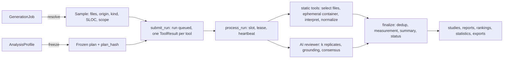

# Analysis pipeline

How the analysis engine turns a generated app into a measurement: sample resolution, the pinned analyzer image and its per-tool containers, strict tool outcomes, normalization and deduplication, the AI reviewer, durable execution, provenance and artifacts.

The engine lives in `backend/analysis/engine/` and is built for research: a failed tool never reads as clean code, missing data is `None` (never 0), the analysed app cannot configure its own scanners, and two runs are comparable exactly when their frozen `plan_hash` is equal. Running a study on top of it is covered in the [Research guide](/docs/RESEARCH_GUIDE), the formal definitions in [Analysis methodology](/docs/ANALYSIS_METHODOLOGY), and the tool catalog in the [Analyzer guide](/docs/ANALYZER_GUIDE).

## Overview



| Model | What it holds |
| --- | --- |
| `AnalysisProfile` | A named, versioned profile config (tools, reviewer, scope, outcomes). Content is immutable per version; system profiles are seeded from `data/profiles/*.yaml`. |
| `AnalysisRun` | One target analysed under one frozen `plan` (`plan_hash`): `target_meta`, the sample manifest and hash, `status`, `is_complete`, `summary`, `measurement`. `purpose` is `research` (a study), `adhoc` or `canary` (tool self-test). |
| `ToolResult` | One planned tool of a run: status, failure reason, argv, exit code, duration, tool version, image reference, config hash, coverage, metrics, diagnostics, artifacts. |
| `ReviewSample` | One AI review replicate: status, seeds, coverage, usage and cost, artifacts. |
| `Finding` | A normalized finding: severity, category, CWE, file and line origin, measured scope, `counted`, `is_ai`, grounding, `issue_key`, fingerprint. |
| `AnalysisStudy` | A pre-registered study: targets, frozen plan, protocol, runs and the post-run report ([Research guide](/docs/RESEARCH_GUIDE)). |

## Sample resolution and scope

`engine/sample.py` (`sample-v2`) resolves a target into the exact files analysed. It never invents files: unknown result shapes raise `SampleUnavailable`, extensions are never appended, and arbitrary `result_data` keys never become files.

| Job mode | Files | Origin |
| --- | --- | --- |
| agent | `result_data["files"]` plus the workspace manifest (sha256-verified) | `added`, `modified` or `scaffold`, from the manifest |
| scaffolding | `result_data["files"]` (the LLM's code blocks) | `authored` |
| custom | code blocks of `result_data["content"]` (a block without a file name is skipped with a warning) | `authored` |
| legacy | `backend_code` / `frontend_code` only, as `app.py` / `frontend/src/App.jsx` | `authored` |
| inline | pasted files, as given | `authored` |

- **Origins.** Platform-owned build files (`Dockerfile`, `.dockerignore`, `docker-compose.yml`) get origin `platform`: tools may scan them, but they never count for the model. A `modified` agent file is diffed line by line (`difflib`, autojunk off) against the scaffold the agent started from (the job's pinned stack, reseeded with generation's own seeding), so its unchanged lines are `scaffold`. The baseline is trusted only when it reproduces every `scaffold` file of the manifest byte for byte; otherwise modified files are attributed whole, and the manifest records it (`attribution: whole`).
- **Kinds.** Every file gets a language (from its name only) and a kind: `source`, `config`, `manifest`, `lockfile`, `doc`, `asset`, `build`, `env` or `other`. The default scope excludes lockfiles, minified or build output and binaries, each with an `exclude_reason`.
- **Measured scope is per line.** Counted findings and measured SLOC cover exactly the lines whose origin is in the plan's `measured_origins` (default `authored`, `added`, `modified`), in files whose kind is in `measured_kinds` (default `source`). Numerator and denominator always cover the same code.
- **Quality flags.** `target_meta` snapshots the job's identity (model, harness, stack, app, experiment, condition, repeat, seed, fingerprints) and its quality: `truncated` (generation output cut at the output cap), `run_stopped` (an agent run ended at a run-level limit, still a valid sample unless a study opts out), `empty_output`, validity notes and the functional result. Only the conformance evaluator's own record counts as functional data. The runtime smoke probe is a different instrument and never stands in for it.
- **Hashes.** `sample_hash` is sha256 over sorted `path\0sha256\n` of the included files. Before executing, `load_sample` re-resolves the target and fails the run with `sample_changed` when the code or its line attribution changed since submission.

Suppression markers (`# noqa`, `# nosec`, `# type: ignore`, `# pylint: disable`, `# mypy:`, `eslint-disable`, `nosemgrep`, `gitleaks:allow`, `pragma: allowlist secret`, `@ts-ignore`, `lizard forgive`, `jscpd:ignore-start`, `codespell:ignore`, …) are counted on measured lines and reported as an outcome. They never hide findings, because every adapter ignores or neutralizes them (see below).

## The analyzer image and tool containers

One image, `backend/analysis/images/analyzer/`, holds every static tool. Everything is exactly pinned and baked at build time, so nothing is installed or downloaded when an app is scanned. The tag is `llmlab/analyzer:<sha12>`, the content hash of the image directory (`sandbox.image_tag()`, the same algorithm as the agent images), so any edit of a pin, config or rule selection is a new tag. The last build step writes `/opt/analyzer/manifest.json`: every tool's real version (checked against the pins; a mismatch fails the build) and the lock, binary, rule-pack and config hashes. The executor freezes the tag and the manifest digest into every plan.

Build it from **Analysis → Tools**, with `POST /api/analysis/image/build/`, or with `just manage analysis_build_image` (`--check` only reports). With `ANALYSIS_BUILD_IMAGE_ON_DEMAND` (default on) a run builds it when it is missing. A plan whose tag is gone and whose definition has changed fails with `ImageUnavailable`; it never silently runs on another toolchain.

Per run, a labelled volume holds the sample. Per tool, `sandbox.run_tool` starts a **fresh, ephemeral container** on the `apps-dind` daemon:

| | |
| --- | --- |
| user | uid/gid 10001, no capabilities, `no-new-privileges` |
| root filesystem | read-only |
| `/src` | the sample, mounted read-only |
| `/tmp` | tmpfs and working directory; `HOME`, `XDG_*` and every cache live here |
| `/out` | a fresh volume per container; tools write their reports here |
| network | none |
| limits | the spec's `mem_limit` and `timeout_s`; `ANALYSIS_TOOL_NANO_CPUS`, `ANALYSIS_TOOL_PIDS_LIMIT`, `ANALYSIS_TOOL_TMPFS_SIZE`; stdout and stderr capped at `ANALYSIS_OUTPUT_CAP_BYTES` each, `/out` at `ANALYSIS_OUT_DIR_CAP_BYTES` |

Everything is removed in a `finally`. Runs never share a working directory, so one app's report can never be served for another.

**Isolation.** Each adapter passes the selected files explicitly (never "scan /src"). It uses the image's baked configuration and the tool's isolation flags (`--isolated`, `--no-config-lookup`, `--ignore-nosec`, `--disable-noqa`, `--ignore-disables`, …). Some tools honour in-file markers and have no switch to ignore them; those run on staged copies with the markers neutralized (line numbers kept). An analysed app therefore cannot configure, narrow or silence its own scanner. The per-tool flags are in the [Analyzer guide](/docs/ANALYZER_GUIDE#isolation).

**Capacity.** The apps daemon is shared with sample apps, agent sandboxes and evaluations. Before a container starts, the executor waits until the memory limits of every running container on the daemon, plus this tool's, fit `ANALYSIS_DIND_MEMORY_BUDGET` (default `3500m`). It waits at most `ANALYSIS_CAPACITY_WAIT_SECONDS` (default 1800) and heartbeats while it waits.

## Tool outcomes

A tool result is exactly one of:

| Status | Meaning |
| --- | --- |
| `succeeded` | The tool ran, exited as its contract allows, and its output parsed strictly. Zero findings here is a real zero. |
| `not_applicable` | No file in scope for this tool (e.g. no Python for bandit). Distinct from success: nothing was measured. |
| `failed` | Not a trustworthy result. `failure_reason` is one of `tool_error`, `oom`, `parse_error`, `infra_error`, `unavailable`, `invalid_config`, `invalid_output`, `budget`. |
| `timed_out` | The tool hit its timeout (`failure_reason: timeout`). |
| `skipped` | Never executed because the run aborted. |
| `cancelled` | The run was cancelled. |

Adapters (`engine/adapters/<slug>.py`) implement `select_files`, `invocation` and `interpret`. They raise `ToolFailure` for anything that is not a trustworthy result: an exit code outside the tool's declared set, an exit code that disagrees with the report (ruff exit 1 with an empty report), unparseable or capped output, a missing report file, death by signal or OOM, a missing binary. A tool that analysed none of its selected files has failed; it has not found "0 findings".

| Exit codes accepted | Tools |
| --- | --- |
| `0` only (findings do not change the exit code) | semgrep, gitleaks, jscpd, radon, lizard, hadolint, detect-secrets, deptry, depcheck (255 = issues, per project) |
| `0`, `1` = findings | ruff, bandit, eslint, mypy, flake8, shellcheck, htmlhint |
| tool-specific | codespell `{0, 65}`, stylelint `{0, 2}`, vulture `{0, 3}` (1 only with per-file errors); pylint and perflint use a bit mask where bit 32 (usage error) fails |

**Coverage.** Every result records the files in scope, the files scanned, the files the tool could not parse (`unparseable`), the files it skipped and why (a file type it cannot read, a path its built-in defaults always exclude) and the files it analysed only in part. Parse errors become coverage, never findings.

Infrastructure failures (daemon down, SDK errors, a pruned image) are retried up to `ANALYSIS_MAX_ATTEMPTS`. Tool failures are deterministic and never retried automatically.

## Normalization and deduplication

`engine/normalize.py` (`norm-v2`) maps each raw finding onto one vocabulary using the versioned tables in `backend/analysis/data/mappings/` (`severity.yaml`, `categories.yaml`, `cwe.yaml`, `rule_equivalence.yaml`):

- **Severity** (`critical | high | medium | low | info`) is an impact level from the tool's table, never a configuration level such as ESLint's 2/1. Semgrep's impact × likelihood matrix wins when a rule declares both. Ruff `S###` rules take the equivalent bandit default, a proxy that a merged bandit finding overrides. Secrets on example or test files, or with placeholder values, drop to `low`.
- **Category** comes from the tool and rule (`security`, `secrets`, `bug`, `type`, `maintainability`, `dead_code`, `duplication`, `complexity`, `style`, `container`, `dependency`, `other`). **CWE** comes from the tool, else from the curated table.
- **Origin and scope**: the origin of the finding's line, and `in_measured_scope`.
- **`counted`** (static): in scope, not a parse error, and not an uncounted category. `style` is uncounted unless the plan sets `outcomes.count_style`; `complexity` and `duplication` unless it sets `outcomes.count_metric_findings`. AI findings start uncounted; only consensus counts them.
- **Fingerprint**: sha256 of tool, rule family, path and the whitespace-normalized source line, so it is stable under line shifts.
- **Redaction**: a `secrets` finding never carries code, and credential-looking values in any snippet are masked, so exports never contain a plaintext secret.

`engine/dedup.py` (`dedup-v2`) then clusters counted static findings into **issues** (`issue_key`). Findings of different tools join when they are in the same file within a 2-line window and share a CWE or a rule-equivalence class; one tool never merges across lines. The algorithm and the tables are in [Analysis methodology](/docs/ANALYSIS_METHODOLOGY#deduplication).

## Measurement and outcomes

At finalize, `measurement.compute(run)` (`measure-v2`) builds `AnalysisRun.measurement`, the one record every consumer reads. `measurement.outcomes()` turns it into named outcomes such as `static_issues_per_kloc`, `security_issues_per_kloc`, `ai_consensus_per_kloc`, `complexity_max`, `duplication_pct` and `functional_pass_rate`; the full table is in [Analysis methodology](/docs/ANALYSIS_METHODOLOGY#outcomes). The NA rules:

- **Availability.** A tool is OK when it succeeded or was not applicable. `static.available` is false when a required static tool is not OK, when an optional one is not OK that could have reported counted findings on the measured code, when no static tool ran OK, or when an integrity check fails. Per category, `category_available[c]` is false when a tool that can emit `c` is not OK. Outcomes over an unavailable scope are `None`.
- **Parseability.** When more than `outcomes.max_unparseable_share` (default 0.1) of the measured SLOC sits in files some static tool could not parse, the static outcomes are NA (`unparseable_code`). Broken code would otherwise look clean.
- **Integrity.** Every finding's line origin is checked against the stored attribution, and its mapping digest against the plan's `mapping_hashes`. A mismatch (`attribution_mismatch`, `mapping_drift`) makes the affected densities NA.
- **Density** is `count / measured KLOC`, and `None` below `outcomes.min_sloc_for_density` (default 50) measured SLOC.
- **AI** outcomes are NA when the reviewer was not shown every measured file. Cost and tokens are `None` when unknown and a lower bound (`cost_complete: false`) when partly known, never 0.

`AnalysisRun.summary` (schema 2) is the UI view: tool counts by status, `complete`, counted static findings and severities (`None` when no static tool succeeded), AI consensus findings, issues, SLOC, cost, warnings, and a structured `problems` list (`[{slug, tool_slug, status, failure_reason, required, message}]`, one entry per tool that did not end OK).

**Run status.**

- `completed`: every required tool succeeded or was not applicable. Only these runs have `is_complete` true.
- `partial`: the run finished, but a required tool failed or timed out.
- `failed`: the sample could not be resolved or verified (`sample_changed`), infrastructure failed past retries, no tool succeeded, the running code no longer implements the frozen procedure (`procedure_drift`), or the finalize stage failed (`measurement_failed`).
- `cancelled`: cancellation was requested.

## The AI reviewer

The AI reviewer (`ai_review`, `engine/reviewer/`) is configured by the profile's `reviewer` block. Its findings are **opinions**: they are kept apart from static measurements, grounded against the code, replicated, and counted only by consensus.

| Key | Default | Meaning |
| --- | --- | --- |
| `engine` | `single_shot` | `single_shot` (structured calls over line-numbered code) or `agent` (a coding-agent harness explores a read-only copy) |
| `harness` | null | Agent engine only: `opencode`, `mini-swe-agent` or `aider` (ask mode), with `harness_options` |
| `model` | `deepseek/deepseek-v4.1-flash` | Any OpenRouter model, or a local model; `ANALYSIS_DEFAULT_REVIEW_MODEL` sets the default |
| `samples` (k) | 3 | Replicates per review |
| `temperature` | 0.2 | null means the provider default |
| `reasoning_effort` | null | `none` … `max` (OpenRouter's vocabulary); accepted only when the model offers it |
| `max_output_tokens` | 32000 | Bounds reasoning plus answer; a truncated replicate fails |
| `max_replacements` | null (= k) | Extra replicates allowed to replace failed ones |
| `include_origins` / `include_kinds` | model origins / `source, config, manifest, env` | What the reviewer is shown; must cover the measured scope |
| `chunk_char_budget` | 300000 | Largest chunk of rendered code per call (smaller when the model's context requires it) |
| `budget` | $0.50, 40 requests, 900 s | **Per replicate** |

**Single-shot engine.** Files are sorted, then shuffled with a recorded per-replicate seed (derived from `seed_base`, the sample hash and the replicate index, and also sent as the LLM `seed` when the model honours one). They are rendered with line numbers (`  12| code`) and packed into chunks; a file larger than a chunk is split by line ranges. Each chunk gets one call asking for the `findings-v1` JSON schema: strict `json_schema` with the chunk's paths as the `file` enum when the model supports structured outputs, else `json_object` or prompt mode plus local validation. An invalid answer gets exactly one repair call. `finish_reason == "length"` makes the replicate `truncated`, and empty content, error bodies and refusals fail it. Nothing is cut silently: coverage lists the files sent, split and not sent. The budget is checked before every call.

**Agent engine.** One replicate is one sandbox built from generation's harness images and LLM gateway (key custody, pinned model, budget, call log). The sandbox holds the included files as a disposable read-only `/workspace`, a versioned review brief (`data/review/agent-brief-v1.md`) and the findings schema. The document comes back as a file (opencode, mini-swe-agent) or as the final answer (aider) and goes through the same validation. A review counts only when the harness ended by itself within budget (or declared `review_complete` before a stop) and shows that it read at least one file under review. An optional finalizer call can turn a final answer into the schema once (`repaired`). Sandbox memory is `ANALYSIS_REVIEW_SANDBOX_MEM_LIMIT` (1g); there is no network except the gateway. The agent engine needs a tool-calling OpenRouter model.

**Grounding.** Every AI finding cites a file, a line range and up to three verbatim evidence lines. It is graded `exact` (evidence within ±3 lines of the cited range), `relocated` (evidence found elsewhere in the file; the lines are moved), `ungrounded`, `invalid_file` or `out_of_range`. Only exact and relocated findings can be counted.

**Replicates, quorum and consensus.** Quorum and threshold are one rule: a strict majority of the k *planned* replicates (`k // 2 + 1`, so 2 of 3). A review succeeds when that many replicates succeeded, and a cluster of findings is consensus when that many replicates reported it. A failed replicate therefore votes for nothing, and a review with a failed replicate can only count fewer issues, never more. Findings cluster across replicates by file, by place (the lines the evidence occupies, within 3 lines) and by weakness (the same CWE when both carry one, else the same category). The representative of a consensus cluster carries the cluster's majority severity, and it is `counted` when it is grounded, in the measured scope and of a counted category. Agreement is the mean pairwise Jaccard index of the replicates' cluster sets.

**Replacement and resume.** A replicate that failed for a sample-level reason (`truncated`, `invalid_output`, `empty_output`, `incomplete_review`, `api_error`) is replaced by a new replicate with the next index and its own seed, up to the frozen `max_replacements`. Credential, credit, configuration, budget, timeout and infrastructure failures and cancellation are never replaced. Each replicate is stored as soon as it finishes. A review costs money, so the executor never re-runs one automatically. A review that an attempt left running is failed as interrupted, and the known spend of its stored replicates is recorded as a lower bound. A user **retry** keeps the succeeded replicates (rows, findings, artifacts, spend) and runs only the missing ones, with new indexes, so no replicate is paid twice or reuses a seed.

**Local models.** The reviewer can also use a model served by one of your local endpoints (Ollama or OpenAI-compatible; see [Local models](/docs/LOCAL_MODELS)). The call goes through the platform's inference path. `inference.access.resolve_access` checks that the endpoint is enabled and visible to you and that the model still serves the weights the plan froze. The call is then queued as an `LLMRequest` with `source="analysis"`, which is claimed after experiment traffic. Compared with OpenRouter models:

- only the single-shot engine is available (the agent sandbox's gateway speaks only OpenRouter), and there is no provider routing;
- there are no structured outputs: Ollama uses JSON mode and OpenAI-compatible servers prompt mode, both validated locally against the schema. A reasoning effort is selectable only on Ollama models that report thinking, and then only `none`;
- the frozen plan records the endpoint, the exact weights (`reviewer.model.local.digest`) and pricing 0. Cost is a known 0.0, not missing data;
- when the endpoint's weights change, the review fails with `model_unavailable`. Freeze a new plan: other weights are another instrument.

`GET /api/analysis/reviewer/models/?q=` lists the models you can configure (the catalog plus your visible local models). `GET /api/analysis/reviewer/model-capabilities/{model}` says what the reviewer can ask of one model.

The executor and the AI preflight resolve the frozen model's access the same way (`reviewer.client.resolve_review_access`): an OpenRouter model needs the run owner's key, a local model needs an endpoint visible to the owner that still serves the frozen weights (`model_unavailable` otherwise; preflight blocks with `reviewer_model_unavailable`).

The prompt (`review-v1`) and schema (`findings-v1`) live in `data/review/`. Their sha256 hashes are frozen into the plan, and the reviewer refuses to run when the files no longer match. Every call is recorded as an artifact: the request without credentials, the raw response, usage, provider and finish reason.

## Profiles and frozen plans

A profile config has four blocks (`engine/plan.py`):

```json
{"tools":    [{"slug": "ruff", "required": true, "config": {"select": "E9,F,B,S,PLE"}}],
 "reviewer": {"enabled": true, "required": true, "engine": "single_shot", "samples": 3},
 "scope":    {"measured_origins": ["authored", "added", "modified"], "measured_kinds": ["source"],
              "line_attribution": true, "exclude_globs": ["**/node_modules/**"],
              "exclude_kinds": ["lockfile", "build", "asset"], "max_file_bytes": 524288},
 "outcomes": {"severity_weights": {"critical": 10, "high": 5, "medium": 2, "low": 1, "info": 0},
              "count_style": false, "count_metric_findings": false,
              "min_sloc_for_density": 50, "max_unparseable_share": 0.1}}
```

Validation collects every problem with a dotted field path (`422` from the API). Saving changed content creates version + 1 of the slug; identical content keeps the version. The system profiles:

| Profile | Tools | AI reviewer |
| --- | --- | --- |
| `research-default` | the 14 default tools (codespell and hadolint optional) | single-shot, k = 3, required |
| `static-only` | the same 14 tools | none |
| `security-focus` | bandit, semgrep, eslint, gitleaks, detect-secrets | single-shot, k = 3 |
| `quick-check` | ruff, semgrep, eslint, gitleaks (not a research instrument) | none |
| `agentic-review` | the 14 default tools | agent engine, opencode, k = 1 |

`freeze_plan` resolves a profile into a **frozen plan**. It records each tool's version (from the image manifest), `spec_hash` and `config_hash`; the analyzer image tag and manifest digest; the reviewer's resolved model (canonical slug, context window, capabilities, pricing snapshot), params, prompt and schema hashes, harness version and image tags; the scope; the outcomes; `mapping_hashes`; and `engine_versions` (`sample-v2`, `sloc-v2`, `norm-v2`, `dedup-v2`, `measure-v2`). `plan_hash` is sha256 over the content that decides comparability. It leaves out the source profile, timestamps, display names and order, and the pricing snapshot, so an identical config from two profiles is comparable.

**Drift checks.** A plan only means something if runs execute the procedure it froze. Before anything runs, `plan.procedure_drift` compares the plan's tool spec hashes, engine stage versions and mapping hashes with the running code. A tool whose spec changed fails with `procedure_drift`. A changed engine stage or mapping table fails the whole run, and the mapping tables are checked again before each tool is normalized and before the AI review. Study launch and retries refuse early with `409 procedure_drift`.

## Durable execution

A run is a database state machine (`engine/executor.py`).

- **Submit.** `submit_run` checks ownership (your own jobs; staff any), resolves the sample, stores the manifest, hash and `target_meta`, creates one pending `ToolResult` per planned tool (AI last) and enqueues the run on commit. An unresolvable target is a `400`.
- **Dispatch.** The Celery task `analysis.process_run` (`acks_late`, `reject_on_worker_lost`, soft limit `ANALYSIS_TASK_SOFT_TIME_LIMIT` of 4 h) runs it when a worker answers a cached ping; otherwise a daemon thread in the calling process does (`ANALYSIS_USE_CELERY`).
- **Slots.** `ANALYSIS_MAX_CONCURRENT_RUNS` (default 2) Postgres advisory locks are held on the worker's connection and released by the database if the process dies. Without a free slot the run is re-enqueued with a countdown.
- **Lease and heartbeat.** The run is claimed with `select_for_update(skip_locked=True)`. Every later write is conditional on still owning `lease_owner`, so a worker that lost its lease can never overwrite the new owner's results. A heartbeat every `ANALYSIS_HEARTBEAT_SECONDS` (15) bumps the run and the running tool and polls the cancel flag.
- **Idempotent tools.** Re-running a tool first deletes its previous findings.
- **Cancel** (`POST /runs/{id}/cancel/`) is cooperative and final: containers are killed, and a cancelled run is never overwritten.
- **Retry** (`POST /runs/{id}/retry/`, optional `{"tools": [...]}`) resets failed, timed-out, cancelled and skipped tools to pending. Succeeded and not-applicable results keep their findings, an AI review resumes from its stored replicates, and a run that failed in finalize is measured again. Each retry keeps the spend of the attempts it replaces (`diagnostics.prior_attempts`).
- **Reconcile** runs from the `analysis-reconcile` beat entry every minute, from `just manage analysis_reconcile`, and opportunistically from the API. A `running` run whose heartbeat is older than `ANALYSIS_STALE_SECONDS` (180) has its running tool reset and is requeued, or fails with `infra_error` after `ANALYSIS_MAX_ATTEMPTS` (3). A `queued` run untouched for 5 minutes is re-dispatched. Containers and volumes of runs that are not live are reaped.

Progress is published best-effort on the `analysis:<run_id>` SSE channel (status and per-tool transitions); the UI also polls.

## Artifacts

The raw stdout, stderr and report files of every tool, and every AI call or agent transcript, are kept (gzip, with the sha256 of the raw bytes) under `<root>/analysis_runs/<run id>-<HMAC>/` (`engine/artifacts.py`). A result can therefore be audited or re-parsed without re-running the tool. `<root>` is `ANALYSIS_ARTIFACTS_ROOT` when set (the production compose file sets a private volume that nginx does not serve), else `MEDIA_ROOT`. The HMAC of the run id under `SECRET_KEY` keeps a known run id from naming a file. Artifacts are served only by the owner-scoped, sha-verified `GET /api/analysis/runs/{id}/artifacts/{result_id}/{name}`.

## Where results go

Every consumer reads the stored measurements of canonical runs; none recounts raw `Finding` rows with rules of its own. The consumers are studies and their reports ([Research guide](/docs/RESEARCH_GUIDE)), the reports-app study and experiment reports and the statistics study tables ([Study tables](/docs/STUDY_TABLES)), rankings, the dashboards, webhooks and the GitHub export. A job's canonical run is its latest finished run under one frozen plan (`measurement.canonical_run_ids`). Rankings and reports choose that plan explicitly (`plan_hash`) or by the rule "most jobs with a static measurement", and they list every job they could not measure instead of counting it as zero findings. Experiment post-runs analyse their jobs through the same engine ([Experiments](/docs/EXPERIMENTS#post-run)). Per-run exports: `GET /api/analysis/runs/{id}/export.{json,csv,sarif}`.

## Settings

| Setting | Default | Effect |
| --- | --- | --- |
| `ANALYSIS_MAX_CONCURRENT_RUNS` | 2 | Runs analysed at once across every process |
| `ANALYSIS_DIND_MEMORY_BUDGET` | `3500m` | Memory tool containers may reserve on the apps daemon (every running container counts) |
| `ANALYSIS_STALE_SECONDS` / `ANALYSIS_HEARTBEAT_SECONDS` | 180 / 15 | When a running run is presumed dead / the heartbeat interval |
| `ANALYSIS_MAX_ATTEMPTS` | 3 | Executions of a run or tool before an infrastructure failure is final |
| `ANALYSIS_CAPACITY_WAIT_SECONDS` | 1800 | How long a tool waits for daemon memory before it fails as `infra_error` |
| `ANALYSIS_USE_CELERY` | true | Use Celery when a worker answers, else a thread |
| `ANALYSIS_TASK_SOFT_TIME_LIMIT` | 14400 | Ceiling of one run task, in seconds |
| `ANALYSIS_DEFAULT_REVIEW_MODEL` | `deepseek/deepseek-v4.1-flash` | Default reviewer model |
| `ANALYSIS_REVIEW_SANDBOX_MEM_LIMIT` | `1g` | Memory of the agent-engine review sandbox |
| `ANALYSIS_ARTIFACTS_ROOT` / `ANALYSIS_ARTIFACTS_DIR` | `""` / `analysis_runs` | Artifact storage (an empty root means `MEDIA_ROOT`) |
| `ANALYSIS_TOOL_NANO_CPUS`, `ANALYSIS_TOOL_PIDS_LIMIT`, `ANALYSIS_TOOL_TMPFS_SIZE` | 1 CPU, 512, `512m` | Per tool container limits |
| `ANALYSIS_OUTPUT_CAP_BYTES` / `ANALYSIS_OUT_DIR_CAP_BYTES` | 16 MiB / 128 MiB | Captured output caps; exceeding one fails the tool |
| `ANALYSIS_BUILD_IMAGE_ON_DEMAND` | true | Build the image when a run needs it |
