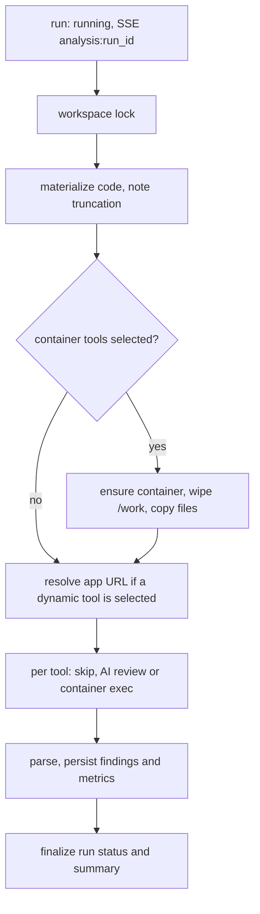

# Analysis pipeline

How an analysis run executes: analyzer workspaces, tool execution, result statuses, the AI reviewer and the rules that keep findings comparable.

## Overview

An `AnalysisRun` analyzes either pasted source code (`source_code`, a `{filename: content}` map) or the stored output of a generation job (`generation_job`), with the tools listed in `tool_slugs`. Each tool produces one `ToolResult`; parsers turn tool output into normalized `Finding` rows (severity, `tool_severity`, category, confidence, file, line, rule, `tool_specific_data`) and, for measuring tools such as radon, jscpd and lizard, a `metrics` JSON payload. See [Severity as reported](#severity-as-reported) for the two severity fields.

Runs are created by:

| Entry point | How it executes |
| --- | --- |
| Analysis page (`/analysis/create`): `POST /api/analysis/runs/` (one app or pasted code; `auto_start` defaults to true) or `POST /api/analysis/runs/batch/` (one run per app, same `batch_id`) | `runner.dispatch_many`: one daemon thread inside the django process runs them one after another |
| Experiment post-run analysis ([Experiments](/docs/EXPERIMENTS)) | `runner.execute`, synchronously, one job after another |
| Automation pipeline `analysis` steps ([Automation guide](/docs/AUTOMATION_GUIDE)) | `runner.execute`, synchronously |

Runs do not go through Celery. A run dispatched on a thread dies with the process. While a run is `running`, its thread refreshes `heartbeat_at` every 30 seconds (also during a long tool). A run whose heartbeat is more than 5 minutes old has no live thread, for example after a backend reload, and is reaped: `runner.reap_stale_runs` marks it `failed` with "Interrupted: the backend process executing this run stopped…", and its still-`running` tool results `failed` too. Runs queued by `dispatch_many` stay `pending` until their turn; the queue thread refreshes their `heartbeat_at` too, so a queue that died with its process fails its waiting runs ("Interrupted before it started…") once their heartbeat is 5 minutes old. A `pending` run that was never queued (no heartbeat) is left alone. Reaping happens whenever runs are listed or opened (`GET /api/analysis/runs/`, `GET /api/analysis/runs/<id>/`) and in the System page's "clear stuck analysis" maintenance action. A run that is still beating is never reaped, whatever its age. Re-run an interrupted analysis.

Run statuses: `pending`, `running`, `completed`, `partial`, `failed`, `cancelled`.

### Live progress

Each tool result records `started_at` and `duration_seconds` (none for a tool that was skipped without running). The runner publishes on the `analysis:<run id>` SSE channel:

| Event | Payload | When |
| --- | --- | --- |
| `status` | `status`, `summary`, `error_message` | the run starts, fails, is cancelled or finishes |
| `progress` | `phase`: `waiting_for_workspace`, `preparing`, `running_tools` | between tools (also stored in `summary.phase` while running) |
| `result` | `result`: the tool result as the API returns it | a tool starts and finishes, or is skipped |

`waiting_for_workspace` means another run of the same user holds the workspace (runs of one workspace are serialized). The analysis pages subscribe to these events and poll as a fallback.

## Analyzer workspaces

Container tools never run on the host. Each user gets one long-lived container (`AnalyzerWorkspace`, statuses `absent`, `provisioning`, `ready`, `stopped`, `error`) named `analyzer-<hex>`, started from the `backend/analyzer-base:latest` image. `ensure_base_image` in `services/workspace_service.py` builds that image on first use from `backend/analysis/images/analyzer-base` (python:3.11-slim plus Node.js 20 and coreutils, non-root user `analyzer` with uid 1000, working directory `/work`).

| Property | Value |
| --- | --- |
| Capabilities | all dropped, `no-new-privileges` |
| Limits | 1 GB memory, 1 CPU, 256 PIDs |
| Ports | none published |
| Network | `DOCKER_APPS_NETWORK` when set, else the daemon's default bridge (installs and advisory databases need outbound access) |

The workspace is provisioned lazily, by the first container-tool install or analysis run, or from the **Workspace** tab of the Analyzers page (`POST /api/analyzers/workspace/provision/`, plus `start/`, `stop/` and `DELETE /api/analyzers/workspace/`). Deleting the workspace removes the container and every install record.

Tools are installed into the running container with each tool's `install_cmd` (bounded by `install_timeout`); the first line of `verify_cmd` output becomes the installed version (`services/tool_installer.py`). Installs persist across runs, so only the first run pays the install cost. Package-manager commands are serialized per workspace, a bulk install or "update all" installs its tools one after another on one background thread, and a failed update keeps the previous version usable. AI tools need no install. See the [Analyzer guide](/docs/ANALYZER_GUIDE) for the catalog and its API.

> [!NOTE]
> Wait for the workspace to reach `ready` before firing separate install requests from several tabs or scripts: concurrent requests against a workspace that does not exist yet can each try to provision it.

## Execution flow

`runner.execute`:

1. Marks the run `running` and publishes its status on the `analysis:<run_id>` realtime channel (`/api/realtime/stream`).
2. Takes the workspace lock, a Postgres advisory lock per workspace: runs of one user execute one at a time because they share `/work` and the tools' fixed `/tmp` report paths.
3. Materializes the code. A job's `result_data.files` map is used as-is; older scaffolding/custom jobs contribute their `backend`, `backend_code`, `frontend`, `frontend_code` and `content` strings, with an extension added from the key (`backend_code` -> `.py`, `frontend_code` -> `.jsx`, `frontend` -> `.js`, otherwise `.py`). Parts cut off at generation time (`backend_truncated`, `frontend_truncated`) are recorded in the run's `summary.truncated_inputs`, so syntax errors at the cut are not mistaken for model defects.
4. If any selected tool is a container tool: makes sure the container is running (provisioning it if needed), deletes everything under `/work` and copies the files in, owned by uid 1000. If the container cannot be obtained, or the wipe or the copy fails, the whole run fails: stale files would otherwise be scanned as part of this app.
5. If any selected tool is dynamic, resolves the app's URL once (see the [Analyzer guide](/docs/ANALYZER_GUIDE)).
6. For each slug in `tool_slugs`, in order, creates a `ToolResult` and either skips it (unknown or disabled tool, dynamic tool without a running app, no applicable files), runs the AI reviewer (`services/ai_runner.py`), or renders `run_cmd` (`{target}` -> `/work`, `{url}`, `{config:<name>}`) and executes it in `/work` under `timeout -s KILL <run_timeout>`.
7. Parses stdout with the parser registered under the tool's `parser_key`, records `summary.tool_version` (container tools) and `summary.config` (defaults merged with the user's options), and stores the findings, with paths normalized (`/work/` and `./` prefixes stripped), and the metrics.
8. Finalizes the run: `failed` when no tool completed and at least one failed, `partial` when some failed, otherwise `completed`. Skipped tools never fail a run, so a run whose tools were all skipped is `completed`. `summary` holds `total_findings`, `severity_counts` (normalized), `reported_severity_counts` (levels as the tools printed them, case-folded), `unrated_findings` (findings of tools that rate nothing), `metrics_by_tool`, `tools_run`, `tools_completed`, `tools_failed` and, when relevant, `truncated_inputs`. Each tool result's `summary` carries its own `finding_count`, `severity_counts` and `reported_severity_counts`.

`POST /api/analysis/runs/<id>/cancel/` marks a `pending` or `running` run `cancelled`, and `cancelled` is final: the runner never overwrites it. Cancel also kills the tool that is running. Every tool command carries a `: llmlab-analysis-run:<run_id>;` prefix, and cancel SIGKILLs the process group of every process in the workspace whose command line has that marker. The runner checks for cancellation before each tool and after each tool returns. The killed tool and every tool not yet started are recorded as `skipped` with `summary.skip_reason: cancelled`, which does not count as measured. The run's `summary` still describes what ran before the cancel. An AI review in flight (an HTTP call) cannot be interrupted, so its response is discarded when it arrives. Results of cancelled runs never feed study tables, reports or rankings.

`POST /api/analysis/runs/` with a `generation_job_id` returns 404 unless the job is yours. Staff can analyze any job.

### Runs API

| Endpoint | Purpose |
| --- | --- |
| `GET /api/analysis/runs/` | List with `status` (comma-separated; `active` = pending + running), `search` (name, app, model, stack, ID prefix), `batch_id`, `generation_job_id`, `tool_slug`, `sort` (`created_desc`, `created_asc`, `name_asc`, `duration_desc`, `findings_desc`). Items carry the `target` (app, model, stack, or pasted code), `phase` and, for active runs, `progress` (tools done / running, findings so far). |
| `GET /api/analysis/runs/stats/` | Run counts per status |
| `POST /api/analysis/runs/` | One run (a job or pasted code); unknown tool slugs are a 400 |
| `POST /api/analysis/runs/batch/` | One run per job (at most 100), queued on one thread |
| `POST /api/analysis/runs/preview/` | Free dry run: per tool, on how many targets it would run or be skipped (no file it reads, app not running); per target, files, lines and whether its app container runs |
| `POST /api/analysis/runs/<id>/rerun/` | A new run on the same code: all tools, `tool_slugs`, or `only_unmeasured` (failed, cancelled, unavailable, app not running) |
| `POST /api/analysis/runs/bulk/` | `cancel` or `delete` several runs; active runs are never deleted |
| `DELETE /api/analysis/runs/<id>/` | 409 while the run is active (cancel it first) |
| `GET /api/analysis/runs/<id>/results/<result id>/` | One tool's raw output: command, exit code, stored stdout (first 30,000 characters), target URL |
| `GET /api/analysis/runs/<id>/findings/` | Findings with `tool_slug`, `tool_severity` (a reported label or `unrated`), `category`, `file_path`, `rule_id`, `search`, `sort` (`severity`, `file`, `tool`, `rule`) |
| `GET /api/analysis/runs/<id>/findings/facets/` | Counts per tool, reported level, category, file and rule (top 50) |

## Severity as reported

Tools rate findings in their own words (bandit `HIGH`, ESLint `error`, pylint `convention`, ZAP `Medium`, npm audit `moderate`) or not at all (ruff, flake8, vulture, gitleaks, jscpd, pip-audit, …). Every finding stores both:

- `tool_severity`: the label exactly as the tool printed it, or empty when the tool rates nothing. This is what the analysis pages display; a finding of an unrated tool shows no level.
- `severity`: a normalization to critical / high / medium / low / info. For unrated tools it is a heuristic (for example ruff and flake8 codes are mapped by family). Statistics, study tables, reports and automation thresholds still use it.

Parsers also store what the tools report about each finding in `tool_specific_data` under standard keys: `rule_name`, `docs_url`, `references`, `cwe`, `owasp`, `end_line`, `end_column`, `fix`, `tool_confidence`; for dependency vulnerabilities `package`, `installed_version`, `fixed_versions`, `vuln_id`, `aliases`, `cvss_score`, `cvss_vector`, `manifest`; for scanners `url`, `method`, `param`, `evidence`, `attack`, `instances`, `other_info`; `secret_type` (never the secret), `complexity`, `function`, `nloc`, and `duplicate_of` for clones. Older tool-specific keys (trivy `fixed_version`, osv `fix_versions`, jscpd `second_file`) are kept next to them.

## What a tool result means

A tool that measured nothing must never pass for a clean result, because zero findings reads as "no defects" in every comparison. Each `ToolResult` is one of:

| Status | Meaning | Counts as measured? |
| --- | --- | --- |
| `completed` | The tool ran and its report parsed. Zero findings is a real zero. | Yes |
| `skipped`, `summary.skip_reason: not_applicable` | The app has none of the files the tool reads (no `requirements*.txt` for pip-audit, no `.js` for ESLint). | Yes (the true count is zero) |
| `skipped`, `skip_reason: app_not_running` | A dynamic tool, and the run analyzes pasted code or the app's container was not running. | No |
| `skipped`, `skip_reason: unavailable` | The tool is unknown or disabled in the catalog. | No |
| `skipped`, `skip_reason: cancelled` | The run was cancelled before this tool ran, or while it ran (the tool was killed). | No |
| `failed` | Killed (exit 137: `run_timeout` or out of memory), not installed (exit 126/127), a non-zero exit with nothing parsed, no parser registered for the `parser_key`, a parser exception, every manifest of a multi-manifest tool failed, the workspace was unavailable, or an AI response that was not a findings array. | No |

A `completed` result can still carry `summary.warnings`, for example when one of several `requirements.txt` files could not be audited, or when the AI reviewer had to leave files out. Every container result stores the exact command and exit code in `raw_output` (`command`, `exit_code`, the first 30,000 characters of stdout, and `target_url` for dynamic tools), the installed tool version in `summary.tool_version` and the effective options in `summary.config`, so findings stay attributable after the workspace is updated. The runs API returns each result's `summary`, `metrics` and `error_message`; `raw_output` stays on the row (visible in the Django admin).

When a dependency cannot be resolved, pip-audit and npm audit audit nothing for that manifest. The run command echoes the resolver errors as `!! ` lines, and the parser turns them into `nonexistent-package` findings (high severity: the hallucinated-dependency or "slopsquatting" pattern, since anyone can register that name) or `nonexistent-version` findings (medium), next to a "not analyzed" warning for the manifest. pip stops at the first unresolvable requirement, so at most one is reported per file.

These findings are always stored. If at least one other manifest of the app was audited, the result is `completed` with the warning. If no manifest could be audited (the common case of a single `requirements.txt` or `package.json`), the result is `failed`: the vulnerability audit did not run, so the result is not a measurement. Its error message and `summary.warnings` name the unresolvable requirement, and the `nonexistent-*` findings are stored on the failed result anyway (`summary.finding_count`, `summary.severity_counts`), so they appear in the run's findings and in `summary.total_findings`.

> [!NOTE]
> Study tables count a tool only for apps it measured, so a failed audit is never read as zero vulnerabilities. For the same reason, the `nonexistent-*` findings on such a failed result do not reach the common-instrument tables: pip-audit or npm-audit appears under `coverage.tools_partial` with a `failed` count. To count hallucinated dependencies in every app, export with `--all-tools` or read the findings directly.

## The AI reviewer

`llm_review` is the one tool with `kind: ai`. Instead of a container command, `ai_runner.py` sends the code to an LLM with temperature 0.2 and asks for a JSON array of findings.

- **Model.** The tool's `model` option (default `anthropic/claude-opus-5.5`) and `max_tokens` (default 8000). A model id that exists in the user's model catalog resolves through the inference layer, which covers OpenRouter and local endpoints ([Local models](/docs/LOCAL_MODELS)); any other id is sent to OpenRouter with the run owner's API key, using the same key resolution as generation.
- **Input.** Files are introduced by `# ===== <filename> =====` markers, source files first. Lockfiles and `.min.` bundles are skipped, files are never cut mid-way, and the bundle stops at 60,000 characters; files that do not fit are listed in `summary.files_not_reviewed` and in a warning.
- **Output.** Severities and categories are normalized to the platform vocabulary (`moderate` -> `medium`; categories `security`, `quality`, `performance`, `style`, `best_practice`). Complete findings are salvaged from a response cut off at `max_tokens`; a response with no parsable array is a `failed` result, never a clean one.
- **Status of its findings.** They land in the same `Finding` table and are exportable like the rest, but they are opinions, not measurements: study tables keep them out unless `include_ai` is set, the review sample puts them on their own sheet, and rankings collect them apart from the empirical score.

## Measurement rules for comparisons

- **Common instrument set.** Study tables (`statistics/services/study.py`, used by the study report, `GET /api/statistics/study/breakdowns/` and `export_study_tables`) count findings only from tools that *measured* every analyzed app in scope. The `coverage` block lists `tools_common` and, under `tools_partial`, each dropped tool with `apps_measured`, `apps_missing` and a count per reason (`failed`, `app_not_running`, ...). Without this, an app where Semgrep timed out, or that was not running for the DAST scanners, would look cleaner than its peers. Pass `common_tools_only=false` (CLI: `--all-tools`) to count everything. See [Study tables](/docs/STUDY_TABLES).
- **Source LOC.** Per-kLOC rates divide by source LOC (`reports/services/loc.py`): non-blank lines that do not start with the file type's comment marker, in `.py`, `.js`, `.jsx`, `.ts`, `.tsx`, `.mjs`, `.cjs`, `.vue`, `.svelte`, `.css`, `.scss`, `.html` and `.sh` files, excluding `.min.` bundles and `node_modules/`. Lockfiles, manifests, docs and configs are not code the model wrote; a generated `package-lock.json` alone can outweigh the whole app. The generation-time `metrics.lines_of_code` is used only as a fallback in rankings, for legacy jobs without stored code.
- **Cross-tool deduplication** (`statistics/services/dedup.py`) merges one defect reported by several tools: Bandit, Ruff `S` rules and Semgrep; the lint rules Ruff, flake8, Pylint, Vulture, Mypy and ESLint share; the secret scanners; eslint-react's `react/no-danger` and the eslint-security rules that Semgrep also covers (eval, child processes, non-literal and unsafe regular expressions, pseudo-random bytes, non-literal file paths); the known-vulnerability scanners (pip-audit, npm audit, osv-scanner, Trivy, retire.js), which match on the vulnerable package within one project directory because each names the advisory differently (PYSEC/GHSA/CVE); and DAST findings about the same missing security header or CORS problem.
- **Defaults that keep counts about the code.** Three are per-user options, recorded per result in `summary.config`: Bandit skips B104 (the template requires binding `0.0.0.0` in the container); Pylint disables `import-error`, the docstring messages, `too-few-public-methods` and `unused-argument`; npm audit counts production dependencies only. The rest are fixed in each tool's `run_cmd`: Vulture ignores framework entry points (route, validator and hook decorators) and signature-mandated names, ESLint marks JSX-referenced components as used, Ruff and mypy keep their caches out of `/work` (mypy runs from the app root with `--explicit-package-bases`, so multi-module apps type-check), osv-scanner checks declared versions only (`--no-resolve`), Nuclei's tech-detect and ZAP's fingerprint alert 10109 are dropped as non-defects, and jscpd, codespell and the AI reviewer skip lockfiles and minified bundles.

## Known limits

- ESLint, eslint-security and eslint-react read `.js`, `.jsx`, `.cjs` and `.mjs` only. `.ts`/`.tsx` files reach only Semgrep and Lizard, and `.vue`/`.svelte` single-file components are counted in LOC but linted by no tool, which understates issue density for those stacks.
- Dependency audits resolve unpinned requirements at analysis time, against the advisory databases of that day. Compare apps analyzed in the same period, or re-analyze them together.
- Tools installed from release binaries (Trivy, osv-scanner, Gitleaks, Hadolint, Nuclei, ZAP's runtime) download `linux-amd64`/`x86_64` builds and do not install on an arm64 Docker host.

## Where results go

Findings and metrics feed the Statistics page, [model rankings](/docs/ARCHITECTURE), reports and the [study tables](/docs/STUDY_TABLES). Rankings, the study tables and the study report count **one result per (generation job, tool)** (`ToolResult.latest_ids_per_job`): the latest result from a finished run, where a result that measured the app (`completed`, or `skipped` as `not_applicable`) wins over a later one that did not (`failed`, `app_not_running`). Re-analyzing never double-counts, and re-running one tool, or only the AI reviewer, replaces just that tool's findings instead of discarding the app's other results. The legacy report generators, the model page insights, execution accounting (per run by design) and the review sample still pick the latest finished run per job (`AnalysisRun.latest_ids_per_job`). The Statistics dashboard's overview, severity and top-findings tiles count the findings of every run. Raw findings are downloadable as CSV, JSON or SARIF from `/api/export/findings.csv`, `/api/export/findings.json` and `/api/export/findings.sarif` ([API reference](/docs/api-reference)).

For the tool catalog, the YAML format and how to add a tool, see the [Analyzer guide](/docs/ANALYZER_GUIDE).
