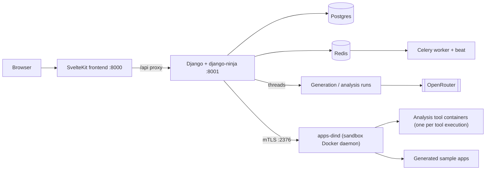

# Architecture

How the pieces fit together: the Django API, the SvelteKit frontend, the Docker surfaces for untrusted code, and where each kind of work runs.

## System overview

The browser only ever talks to the SvelteKit server, which proxies `/api` to Django. Django owns all state (Postgres) and publishes progress events to Redis, which the frontend consumes over an SSE stream.

## Backend apps

Fifteen Django apps under `backend/`, one responsibility each:

| App | Role |
| --- | --- |
| `users`, `tokens`, `credentials` | Accounts (allauth headless, MFA), Bearer API tokens, encrypted provider keys |
| `llm_models` | Model catalog synced from OpenRouter |
| `generation` | Generation jobs and templates — see [Generation process](/docs/GENERATION_PROCESS) |
| `analysis` | The analysis engine: tool catalog and pinned analyzer image, profiles and frozen plans, runs, findings, measurements, studies — see [Analysis pipeline](/docs/ANALYSIS_PIPELINE) |
| `statistics`, `rankings`, `reports` | Aggregations, model scoring/benchmarks, saved reports (`rpt_` public IDs) |
| `runtime` | Runs generated apps as Docker containers; routing and proxying |
| `realtime` | SSE event stream backed by Redis pub/sub |
| `export` | CSV / JSON / SARIF downloads |
| `automation` | Pipelines, batches, cron schedules |
| `docs`, `system` | This docs viewer; staff-only system snapshots |

## Request path and auth

The REST API is a single django-ninja `NinjaAPI` mounted at `/api` (`config/api.py`), with two interchangeable auth schemes: Bearer API tokens (`backend/tokens/auth.py`) and Django session cookies. The interactive OpenAPI UI at `/api/docs` is staff-only. One endpoint lives outside ninja because it streams: `GET /api/realtime/stream` (`config/urls.py`).

Views raise HTTP errors directly; services raise `backend.common.exceptions.*`, mapped to `{"detail": ...}` responses by the exception handler in `config/api.py`.

## Execution model: threads vs Celery

The load-bearing nuance of this codebase:

- **Interactive generation runs execute on daemon threads inside the django process** (`backend/common/threading.dispatch_in_thread`, used by `generation/services/dispatcher.py`). The stack works with no Celery worker at all — but in-flight runs die if the django container restarts.
- **Analysis runs are a durable database state machine** (`analysis/engine/executor.py`): the Celery task `analysis.process_run` runs them when a worker answers, else a daemon thread does. Leases, heartbeats and a reconcile beat entry requeue a run whose worker died, so a restart delays a run instead of losing it — see [Analysis pipeline](/docs/ANALYSIS_PIPELINE#durable-execution).
- **Celery handles automation**: pipeline runs (`run_pipeline_task`), batches, and the schedule tick (`run_scheduler_tick` via beat). If the broker is unreachable, automation falls back to a daemon thread too.

Details in [Background services](/docs/BACKGROUND_SERVICES).

## Docker surfaces

Django never touches the host Docker daemon. Locally it drives `apps-dind`, a sandbox Docker-in-Docker service, over mutual TLS (`APPS_DOCKER_HOST=tcp://apps-dind:2376`, client cert from `APPS_DOCKER_CERT_PATH`), and two kinds of containers run nested inside it:

1. **Analysis tool containers** — every static tool of every run executes in its own ephemeral container from the pinned analyzer image `llmlab/analyzer:<content hash>` (`backend/analysis/images/analyzer`): no network, read-only root filesystem, non-root, the sample mounted read-only, a fresh `/out` volume, memory and time limits. Nothing is installed at scan time, and containers are removed after each tool. AI reviews on the agent engine run in their own sandbox behind the LLM gateway.
2. **Generated sample apps** — each completed generation job can be built and started as its own container by the `runtime` app. Locally an app's port is published only inside `apps-dind`, and Django's path proxy (`/apps/<name>/`) forwards to `apps-dind:<app_port>`; in production `AppSubdomainProxyMiddleware` serves each app at `<container>.<APPS_DOMAIN>` behind Traefik — see [Deployment guide](/docs/deployment-guide).

`apps-dind` fences its nested containers off from private address space (the stack's own network with Postgres/Redis/Django, other host networks, cloud metadata) with `DOCKER-USER` rules set by `compose/local/apps-dind/entrypoint.sh`; public internet stays open for package installs. Replies to connections Django opens into an app still flow.

The local stack is the compose project `llmlab`. Every service has a memory/CPU/PID cap and `oom_score_adj: 500`, so on a shared host the stack throttles itself and is the OOM killer's first pick. `apps-dind`'s cap (4 GB, 4 CPUs) covers all nested apps together. Inside it, logs rotate, build cache is capped at 5 GB, images unused for a week are pruned hourly, and removing an app also deletes its image. The devcontainer has no host Docker socket: its `docker` CLI is pointed at `apps-dind` too.

## Data flow

A full experiment is: generate an app per model → run it → analyze it → compare.

1. A generation job calls OpenRouter with the job owner's key and writes structured code artifacts.
2. An analysis run executes a frozen analysis plan against that code: normalized `Finding` rows, per-tool results and one stored `measurement` per run.
3. Studies, statistics, rankings, and reports read the measurement of each job's canonical run under one plan (`plan_hash`), and everything is downloadable via the export endpoints ([API reference](/docs/api-reference)).

## Scoring: measurement vs. decision aid

Rankings keep two kinds of numbers strictly apart (`backend/rankings/services/`):

- **Empirical quality (measured).** The severity-weighted density of counted static
  *issues* (deduplicated across tools, model-written lines only) per KLOC of measured
  SLOC, read from each job's canonical analysis run under one frozen plan, and blended
  with the functional (conformance) pass rate. AI-reviewer findings are opinions with
  their own run-to-run variance, so they never enter this score — they are reported
  separately as `ai_findings`. Each score carries `n_trials` and between-trial spread;
  a single completed trial is an anecdote, not a result. Rows carry the plan they were
  measured under and `SCORING_VERSION` (`empirical-v2`).
- **MSS (decision aid).** An opinionated composite of model metadata — adoption,
  public benchmarks, cost, accessibility — with asserted weights. Useful for picking
  a model, but not a measurement made here. **Composite** blends MSS with empirical
  quality when local measurements exist.

Because the baseline severity weights (`SEVERITY_WEIGHTS` in
`rankings/services/constants.py`) are asserted rather than derived, the platform also
reports a sensitivity analysis: the empirical ranking is recomputed under the
alternative schemes in `SEVERITY_WEIGHT_SCHEMES` and compared with Kendall's tau plus
the list of rank swaps (`GET /api/rankings/sensitivity/`, also embedded in
template-comparison and comprehensive reports). Tau near 1.0 across schemes means the
ordering does not hinge on the particular weight choice.

The functional pass rate is the hidden conformance suite's, recorded by the
evaluator. The runtime smoke probe (`/api/health` plus the template's declared GET
endpoints) only shows that an app starts and responds; it is a different, more lenient
instrument and never stands in for the conformance rate. A job without a conformance
result has a missing pass rate, never 0%. The statistics page's model comparison
delegates to the same rankings aggregation, so the two pages cannot disagree.

Every job also carries `prompt_hash`/`bundle_key`, and rankings/statistics/reports
accept them as optional filters — a comparison across models is only valid if every
model was generated from the same prompt version; without an explicit filter, jobs
from different template edits on the same app are pooled together silently. See
[Experiments](/docs/EXPERIMENTS) for running a designed, apples-to-apples comparison.
