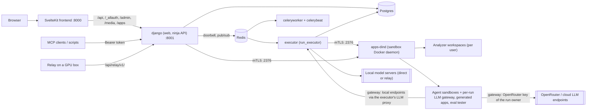

# Architecture

How the pieces fit together: the Django API, the SvelteKit frontend, the executor, the Docker sandbox for untrusted code, the per-run LLM gateway, and where each kind of work runs.

## System overview

The browser only talks to the SvelteKit server, which proxies `/api/`, `/_allauth/`, `/admin/`, `/media/` and `/apps/` to Django (`frontend/src/hooks.server.ts`). Django owns all state in Postgres; Redis carries executor doorbells, Celery messages and the pub/sub events behind the SSE stream.

## Backend apps

Nineteen Django apps under `backend/` (plus `backend/contrib/sites` and the non-app helpers in `backend/common/`):

| App | Role |
| --- | --- |
| `users` | Accounts (allauth headless, MFA), first-run admin bootstrap, profile and activity |
| `tokens` | Personal API tokens (`llml_…`) with optional scopes |
| `credentials` | Encrypted per-user provider keys: OpenRouter, Hugging Face, GitHub |
| `llm_models` | Model catalog (OpenRouter sync plus models served by your endpoints), enrichment, per-model insights — see [Models reference](/docs/MODELS_REFERENCE) |
| `inference` | LLM endpoints (OpenRouter, Ollama, OpenAI-compatible; direct or via relay), relay protocol and tokens, the internal LLM proxy — see [Local models](/docs/LOCAL_MODELS) |
| `execution` | The executor process: scheduler, lanes, pools, leases, reconciliation, capacity — see [Execution](/docs/EXECUTION) |
| `generation` | v3 sample generation: the versioned library (tasks, stacks, starters, styles, guidance, prompts, presets, eval suites, detectors), studies (design, plan, cells, schedules, post-runs), runs with their frozen manifests, attempts, files and evaluations, slot mode and pattern analysis — see [Studies](/docs/STUDIES), [Generation process](/docs/GENERATION_PROCESS) |
| `analysis` | Analyzer tool catalog, per-user workspaces, runs, findings — see [Analysis pipeline](/docs/ANALYSIS_PIPELINE) |
| `human_eval` | Human-evaluation tasks over generated apps: design, participants (invite links, access codes, restricted evaluator accounts), allocation, the participant portal, hosting apps for testers, results and exports — see [Human evaluation](/docs/HUMAN_EVALUATION) |
| `statistics` | Dashboard and study aggregates — see [Study tables](/docs/STUDY_TABLES) |
| `rankings` | Model Selection Score (MSS v2), study model selection and its snapshots, empirical score, severity-weight sensitivity |
| `reports` | Saved reports (`rpt_` public IDs) |
| `runtime` | Builds and runs generated apps as containers; the `/apps/<name>/` proxy and subdomain middleware |
| `realtime` | SSE stream over Redis pub/sub, per-channel authorization |
| `export` | CSV / JSON / SARIF downloads, review-sample ZIPs |
| `integrations` | MCP server, cloud provider presets, GitHub export, notification webhooks — see [Integrations](/docs/INTEGRATIONS) |
| `docs` | This docs viewer (Markdown from `docs/`) |
| `system` | Staff-only host, container, Redis, Celery and DB snapshots plus maintenance actions |
| `automation` | Retired pipelines and schedules. Its models and tables remain, but its API router is unmounted; its `generate` step launches an ad-hoc study (`study.launch.launch_adhoc`). Scheduling and post-run analysis belong to studies. |

## Request path and auth

The REST API is one django-ninja `NinjaAPI` mounted at `/api/` (`config/api.py`) with two auth schemes, Bearer API tokens (`backend/tokens/auth.py`) and Django session cookies. Some routers accept only the session (see [API reference](/docs/api-reference#authentication)). The OpenAPI UI (`/api/docs`) and schema (`/api/openapi.json`) are staff-only.

Plain Django views live outside ninja in `config/urls.py`:

| Path | What |
| --- | --- |
| `/api/realtime/stream` | SSE stream (async view; ninja cannot stream) |
| `/api/relay/v1/…` | Relay protocol for local-model relays (`backend/inference/relay/urls.py`) |
| `/api/mcp`, `/api/mcp/t/<token>` | MCP server (`backend/integrations/mcp/views.py`) |
| `/apps/<name>/<path>` | Reverse proxy to a running generated app (`backend/runtime/proxy.py`) |
| `/_allauth/`, `/accounts/` | allauth headless and browser flows |

Views raise ninja `HttpError`; services raise `backend.common.exceptions.*`, which the exception handler in `config/api.py` maps to `{"detail": ...}` responses.

## Where work runs

| Work | Runs in | Started by |
| --- | --- | --- |
| Every generation run (agentic sandboxes, slot calls), evaluation, re-evaluation | `executor` service, worker pools `sandbox`, `llm`, `eval` | `backend/generation/study/launch.py` creates the runs and their manifests; `backend/execution/api.py` queues them after commit and rings the `executor:wake` doorbell |
| Study schedules (cron top-up, add replicates, clone and run) and post-runs (analyze then report, or pattern analysis) | `executor`, pools `schedule` and `post` (ticked every 30 s) | `backend/generation/study/automation.py` |
| LLM calls to direct endpoints (one pump thread per concurrency slot), the internal LLM proxy for agent gateways | `executor` | `backend/inference/pump.py`, `backend/inference/proxy_server.py` |
| LLM calls to relay endpoints | Queued as `LLMRequest` rows. The relay on the GPU box claims them by long-polling `/api/relay/v1/poll` on `django` | `backend/inference/relay/` |
| Interactive analysis runs, workspace provisioning and tool installs, container build/start/stop actions, report generation | Daemon threads inside the `django` process (`backend/common/threading.py:dispatch_in_thread`) | `analysis/services/runner.py`, `analysis/api/views/workspace.py`, `analysis/api/views/installed.py`, `runtime/services/container_service.py`, `reports/services/report_service.py` |
| Webhook delivery and the 60 s webhook sweep, Hugging Face catalog enrichment, OpenRouter per-call stats after a run | Celery worker, beat (`django_celery_beat` database scheduler) | `backend/integrations/tasks.py`, `backend/llm_models/tasks.py`, `backend/generation/tasks.py` |

Consequences:

- The web process never runs a generation run. If the executor is down, runs stay queued (the UI shows the executor as offline) and resume when it returns. Exactly one executor runs. It holds a Postgres advisory lock, uses leases so runs survive restarts, and has no autoreload: restart it to pick up backend changes, draining first. See [Execution](/docs/EXECUTION).
- Thread-dispatched work dies with the `django` container: a restart or autoreload during an interactive analysis run or a report kills it. A report's generation thread starts only once its row is committed. A report left pending for 10 minutes or generating for 1 hour is marked failed ("Interrupted…") the next time reports are listed or opened. The system page has maintenance actions to clear stuck runs.
- Celery is only needed for notifications, enrichment and the post-run OpenRouter stats fetch. Without a worker, webhooks and stats fetches queue up and the Hugging Face pass is skipped.

Details of each service are in [Background services](/docs/BACKGROUND_SERVICES).

## Docker surfaces

Locally, no service touches the host Docker daemon. Django and the executor drive `apps-dind`, a Docker-in-Docker sandbox, over mutual TLS (`APPS_DOCKER_HOST=tcp://apps-dind:2376`, client cert from `APPS_DOCKER_CERT_PATH`). Nested inside it run:

1. **Analyzer workspaces**: one long-lived, hardened container per user, built from `backend/analyzer-base:latest` (`backend/analysis/images/analyzer-base`). Tools are installed once and reused. Each run's code is copied into `/work` after the previous run's files are wiped. Dynamic tools (e.g. ZAP, Nuclei, Wapiti) scan only a running container of the analyzed app belonging to the run's owner.
2. **Agent sandboxes**: where a coding-agent harness (opencode, mini-swe-agent, aider, ...; see [Harnesses](/docs/HARNESSES)) builds an app from the starter. The agent container's only network peer is its run's **LLM gateway** sidecar, which enforces the model, sampling, routing and budget, writes the per-call log and is the only egress (package registries under `network_policy=packages`, the dependency caches). OpenRouter calls go out from the gateway with the run owner's key; calls to local endpoints go through the executor's internal LLM proxy on the internal `llmproxy` network (`LLM_PROXY_ADDR`, default `172.30.99.2:8090`). See [LLM gateway](/docs/GATEWAY) and [Generation process](/docs/GENERATION_PROCESS).
3. **Generated apps**: built and run for evaluation (the EvalSuite v2 tester, probes and adherence checker run against the app on an internal network; see [Evaluation](/docs/EVALUATION)) and on demand by the `runtime` app for clicking through and dynamic analysis.

How apps are reached depends on the routing mode: `APPS_PROXY_PATH` (local default, Django proxies `/apps/<name>/` to `apps-dind:<port>`), `APPS_SUBDOMAIN_PROXY` (`AppSubdomainProxyMiddleware` serves `<name>.<APPS_DOMAIN>`), or the Traefik bridge (`TRAEFIK_DYNAMIC_DIR` + `DOCKER_APPS_NETWORK`, used by `docker-compose.production.yml`). See [Deployment guide](/docs/deployment-guide).

`apps-dind` fences its nested containers off from private address space (the stack's own network, other host networks, cloud metadata) with `DOCKER-USER` rules in `compose/local/apps-dind/entrypoint.sh`. Public internet stays open for package installs, and the only private exception is the gateway egress subnet to the LLM proxy. Replies to connections Django opens into an app still flow.

> [!WARNING]
> `docker-compose.production.yml` has no `apps-dind`: Django and the executor mount the host `/var/run/docker.sock`, and apps run on the `llm_apps` network. Local-model agent runs are therefore off there (`LLM_LOCAL_AGENT_RUNS` defaults to `bool(APPS_DOCKER_HOST)`).

The local stack is the compose project `llmlab`. Every service has a memory/CPU/PID cap and `oom_score_adj: 500`, so on a shared host the stack throttles itself and is the OOM killer's first pick. `apps-dind`'s cap (`APPS_DIND_MEM_LIMIT`, default 4 GB, 4 CPUs) covers all nested containers together, and the executor's slot settings are validated against it. Sample builds use a persistent BuildKit cache (5 GB), retain immutable images for evaluation/preview reuse (seven days, 5 GB), and start fresh containers. Preview cache misses share evaluation slots; the builder stops after each build to release idle RAM. Hourly GC protects referenced images. Legacy per-app images are removed with their app. The devcontainer has no host Docker socket: its `docker` CLI points at `apps-dind` too. See [Sample builds](/docs/SAMPLE_BUILDS).

## Data flow

A study generates samples for every cell of its frozen plan (condition × unit × repeat), evaluates them, analyzes them and compares the conditions. See [Studies](/docs/STUDIES).

1. **Plan.** The resolver pins every library level (`slug@v#hash12`), renders every prompt, resolves the effective budget policy and the environment (harness image, gateway mode, sandbox), and computes the CRN seeds, the block order and each cell's identity keys. Launch writes one run per cell with its frozen manifest and queues it after commit.
2. **Generate.** The executor claims runs block by block under the study's budget. An `app_agentic` run starts a sandbox from the starter, the harness and its LLM gateway; the collector stores the final tree (`RunFile` rows, `tree_hash`) and the outcome. Slot runs (`slot_single_shot`, `slot_agent`) regenerate one target of a frozen parent app and assemble the variant. See [Generation process](/docs/GENERATION_PROCESS) and [Slot mode](/docs/SLOT_MODE).
3. **Evaluate.** The eval stage locks dependencies, builds and starts the app in `apps-dind` and runs the suite's functional checks, security probes and adherence checks, writing an append-only `RunEvaluation` and the run's `metrics["eval"]` (`agent_pass_rate`, stated/unstated pass rates). A measurement that did not happen is "not measured", never 0. See [Evaluation](/docs/EVALUATION).
4. **Analyze.** An analysis run executes the selected tools against the run's tree and persists normalized `Finding` rows (with each tool's own severity label) plus per-tool metrics. A study's `analysis` post-run does this automatically; slot studies get a `patterns` post-run ([Pattern analysis](/docs/PATTERNS)).
5. **Compare.** Study results, statistics, rankings and reports read each cell's **current run** (`runs.queries.current_runs`: the first usable run; beyond-plan runs and pilot cells never count) and one result per run and tool: the latest one that measured the app (see [Analysis pipeline](/docs/ANALYSIS_PIPELINE#where-results-go)). Everything is downloadable through the export endpoints ([API reference](/docs/api-reference#export-endpoints)).

## Scoring: measurement vs. decision aid

Rankings keep two kinds of numbers apart (`backend/rankings/services/`):

- **Empirical quality (measured).** Severity-weighted code issues per KLOC of source code, blended with the functional pass rate. Counted: each compared run's latest result per tool, only from tools that measured every compared app (`instrument_set`), excluding dependency advisories of the known-vulnerability scanners (`dependency_findings`), dynamic-tool findings (`runtime_findings`) and findings in test code (`test_findings`); repeats of an app in one condition are averaged before the per-model aggregate. Findings from AI-kind tools (`AnalyzerTool.kind == "ai"`, e.g. the LLM reviewer) are opinions with their own run-to-run variance. They never enter this score and are reported separately as `ai_findings`. Each score carries `n_trials` and spread over apps (stdev of per-app mean density and pass rate, `variance.n_apps`). The weighted density is squashed to 0..1 against `EMPIRICAL_DENSITY_CAP` = 50 weighted code issues per KLOC (that density scores 0). It was 150 while densities still counted dependency advisories (~48-132/KLOC), which squeezed code-only densities (~6-32/KLOC) into 0.94-0.97. The order by density is unchanged, but because the pass rate is blended in, models whose density and pass rate disagree can change places. Counts nothing measured are null, not 0: `findings`, `dependency_findings`, `runtime_findings` and `test_findings` of a model with no measured app, `dependency_findings` when no advisory scanner is in the instrument set, and `runtime_findings` when no dynamic tool is. `avg_duration` is null when no run completed. `conditions_pooled` counts the study conditions a model's row pools, and `pooling_note` flags rows that mix several (harness or prompt-profile arms); the study reports compare conditions separately. These counting rules are bug fixes to the metric's definition; stored results are unchanged until recomputed. A single completed trial is an anecdote, not a result.
- **MSS (decision aid, v2).** The Model Selection Score decides which models a study generates with; it is not a measurement made here. Every model is first collapsed to one canonical row (variants, dated snapshots, preview builds and local route copies merged; routers, aliases and `:batch` rows dropped) and must pass hard eligibility filters (a paid route today, tool calling, context of at least 128k tokens, text in and out, generally available, released in the last 12 months, the newest of its product line, popularity and price evidence present). A failed filter is an exclusion with a reason code, never a low score. MSS is a weighted sum on fixed goalposts of **popularity** 0.40 (OpenRouter Data API, 28 days, geometric mean of token share and estimated spend share, off-list days left-censored), **price** 0.30 (log cost of one reference OpenCode run at first-party list prices with cache prices), **capability** 0.20 (LMArena WebDev rating) and **recency** 0.10. A missing component is left out and the weights renormalised, never scored 0; `mss_coverage` says how much weight was present. The study selection stratifies by price tier (exactly 3 frontier, 3 mid, 4 budget) and ranks inside each tier by **MSS_tier** (popularity 0.45, capability 0.30, price re-normalised inside the tier 0.15, recency 0.10), under a quality floor, vendor/open-weight/Claude quotas and hard per-route budgets; a fixed-seed sensitivity analysis reports how stable each pick is. Method, formulas and references: [MSS v2](/docs/design/MSS_V2) (`docs/design/MSS_V2.md`). **Composite** blends MSS with empirical quality when local measurements exist; a model without an MSS has no composite.

The baseline severity weights (`SEVERITY_WEIGHTS` in `rankings/services/constants.py`) are asserted, not derived. To account for that, the platform reports a sensitivity analysis: the empirical ranking is recomputed under the alternative schemes in `SEVERITY_WEIGHT_SCHEMES` and compared with Kendall's tau and the list of rank swaps (`GET /api/rankings/sensitivity/`, also embedded in task-comparison and comprehensive reports). Tau near 1.0 across schemes means the ordering does not hinge on the weight choice.

The functional pass rate is the latest evaluation's `agent_pass_rate` (`metrics["eval"]`, written by the eval stage from `RunEvaluation`); only usable runs contribute it. The preview smoke probe (`POST /api/runtime/jobs/{run_id}/smoke/`: `/api/health` plus the task's declared GET endpoints) is a preview diagnostic stored on the container and never overwrites a metric. The statistics page's model comparison uses the same rankings aggregation, so the two pages cannot disagree.

Every run carries its identity keys (`task_hash`, `treatment_hash`, `prompt_hash`, `config_fingerprint`, `run_fingerprint`), computed once by `identity.compute_keys` at plan time and frozen in the run's manifest. Rankings and the statistics model comparison accept `prompt_hash` and `config_fingerprint` as optional filters. A comparison across models is only valid when the compared runs share the treatment and prompts; a study guarantees it by construction (pinned levels, CRN-paired seeds, a fixed block order). See [Studies](/docs/STUDIES).
