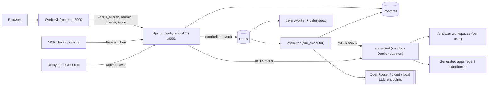

# Architecture

How the pieces fit together: the Django API, the SvelteKit frontend, the executor, the Docker sandbox for untrusted code, and where each kind of work runs.

## System overview

The browser only talks to the SvelteKit server, which proxies `/api/`, `/_allauth/`, `/admin/`, `/media/` and `/apps/` to Django (`frontend/src/hooks.server.ts`). Django owns all state in Postgres; Redis carries executor doorbells, Celery messages and the pub/sub events behind the SSE stream.

## Backend apps

Eighteen Django apps under `backend/` (plus `backend/contrib/sites` and the non-app helpers in `backend/common/`):

| App | Role |
| --- | --- |
| `users` | Accounts (allauth headless, MFA), first-run admin bootstrap, profile and activity |
| `tokens` | Personal API tokens (`llml_…`) with optional scopes |
| `credentials` | Encrypted per-user provider keys: OpenRouter, Hugging Face, GitHub |
| `llm_models` | Model catalog (OpenRouter sync plus models served by your endpoints), enrichment, per-model insights — see [Models reference](/docs/MODELS_REFERENCE) |
| `inference` | LLM endpoints (OpenRouter, Ollama, OpenAI-compatible; direct or via relay), relay protocol and tokens, the internal LLM proxy — see [Local models](/docs/LOCAL_MODELS) |
| `execution` | The executor process: scheduler, lanes, pools, leases, reconciliation, capacity — see [Execution](/docs/EXECUTION) |
| `generation` | Jobs (agent, scaffolding, custom; legacy copilot), templates, stacks, blocks, profiles, packages, presets, evaluation, experiments with their schedules and post-runs — see [Generation process](/docs/GENERATION_PROCESS), [Experiments](/docs/EXPERIMENTS) |
| `analysis` | Analyzer tool catalog, per-user workspaces, runs, findings — see [Analysis pipeline](/docs/ANALYSIS_PIPELINE) |
| `statistics` | Dashboard and study aggregates — see [Study tables](/docs/STUDY_TABLES) |
| `rankings` | Model scores, benchmarks, severity-weight sensitivity |
| `reports` | Saved reports (`rpt_` public IDs) |
| `runtime` | Builds and runs generated apps as containers; the `/apps/<name>/` proxy and subdomain middleware |
| `realtime` | SSE stream over Redis pub/sub, per-channel authorization |
| `export` | CSV / JSON / SARIF downloads, review-sample ZIPs |
| `integrations` | MCP server, cloud provider presets, GitHub export, notification webhooks — see [Integrations](/docs/INTEGRATIONS) |
| `docs` | This docs viewer (Markdown from `docs/`) |
| `system` | Staff-only host, container, Redis, Celery and DB snapshots plus maintenance actions |
| `automation` | Retired pipelines, batches and schedules. Its models, tables and Celery tasks remain, but its API router is unmounted and `/automation` in the UI redirects to `/experiments`. Scheduling and post-run analysis now belong to experiments. |

## Request path and auth

The REST API is one django-ninja `NinjaAPI` mounted at `/api/` (`config/api.py`) with two auth schemes, Bearer API tokens (`backend/tokens/auth.py`) and Django session cookies. Some routers accept only the session (see [API reference](/docs/api-reference#authentication)). The OpenAPI UI (`/api/docs`) and schema (`/api/openapi.json`) are staff-only.

Plain Django views live outside ninja in `config/urls.py`:

| Path | What |
| --- | --- |
| `/api/realtime/stream` | SSE stream (async view; ninja cannot stream) |
| `/api/relay/v1/…` | Relay protocol for local-model relays (`backend/inference/relay/urls.py`) |
| `/api/mcp`, `/api/mcp/t/<token>` | MCP server (`backend/integrations/mcp/views.py`) |
| `/apps/<name>/<path>` | Reverse proxy to a running generated app (`backend/runtime/proxy.py`) |
| `/_allauth/`, `/accounts/` | allauth headless and browser flows |

Views raise ninja `HttpError`; services raise `backend.common.exceptions.*`, which the exception handler in `config/api.py` maps to `{"detail": ...}` responses.

## Where work runs

| Work | Runs in | Started by |
| --- | --- | --- |
| Every generation job (agent sandboxes, scaffolding and custom LLM calls), evaluation, re-evaluation | `executor` service, worker pools `sandbox`, `llm`, `eval` | `backend/generation/services/dispatcher.py` → `backend/execution/api.py` writes rows and rings the `executor:wake` doorbell |
| Experiment schedules (cron top-up, add replicates, clone and run) and post-runs (analyze, then report) | `executor`, pools `schedule` and `post` (ticked every 30 s) | `backend/generation/services/experiment_automation.py` |
| LLM calls to direct endpoints (one pump thread per concurrency slot), the internal LLM proxy for agent gateways | `executor` | `backend/inference/pump.py`, `backend/inference/proxy_server.py` |
| LLM calls to relay endpoints | Queued as `LLMRequest` rows. The relay on the GPU box claims them by long-polling `/api/relay/v1/poll` on `django` | `backend/inference/relay/` |
| Interactive analysis runs, workspace provisioning and tool installs, container build/start/stop actions, report generation | Daemon threads inside the `django` process (`backend/common/threading.py:dispatch_in_thread`) | `analysis/services/runner.py`, `analysis/api/views/workspace.py`, `analysis/api/views/installed.py`, `runtime/services/container_service.py`, `reports/services/report_service.py` |
| Webhook delivery and the 60 s webhook sweep, Hugging Face catalog enrichment | Celery worker, beat (`django_celery_beat` database scheduler) | `backend/integrations/tasks.py`, `backend/llm_models/tasks.py` |

Consequences:

- The web process never runs a generation job. If the executor is down, jobs stay queued (the UI shows the executor as offline) and resume when it returns. Exactly one executor runs. It holds a Postgres advisory lock, uses leases so jobs survive restarts, and has no autoreload: restart it to pick up backend changes, draining first. See [Execution](/docs/EXECUTION).
- Thread-dispatched work dies with the `django` container: a restart or autoreload during an interactive analysis run or a report kills it. The system page has maintenance actions to clear stuck runs.
- Celery is only needed for notifications and enrichment. Without a worker, webhooks queue up and the Hugging Face pass is skipped.

Details of each service are in [Background services](/docs/BACKGROUND_SERVICES).

## Docker surfaces

Locally, no service touches the host Docker daemon. Django and the executor drive `apps-dind`, a Docker-in-Docker sandbox, over mutual TLS (`APPS_DOCKER_HOST=tcp://apps-dind:2376`, client cert from `APPS_DOCKER_CERT_PATH`). Nested inside it run:

1. **Analyzer workspaces**: one long-lived, hardened container per user, built from `backend/analyzer-base:latest` (`backend/analysis/images/analyzer-base`). Tools are installed once and reused. Each run's code is copied into `/work` after the previous run's files are wiped. Dynamic tools (e.g. ZAP, Nuclei, Wapiti) scan only a running container of the analyzed app belonging to the run's owner.
2. **Agent sandboxes**: where a coding agent builds an app. The sandbox's gateway reaches LLMs through the executor's internal LLM proxy on the internal `llmproxy` network (`LLM_PROXY_ADDR`, default `172.30.99.2:8090`).
3. **Generated apps**: built and run for evaluation (hidden conformance suite, on an internal network) and on demand by the `runtime` app for clicking through and dynamic analysis.

How apps are reached depends on the routing mode: `APPS_PROXY_PATH` (local default, Django proxies `/apps/<name>/` to `apps-dind:<port>`), `APPS_SUBDOMAIN_PROXY` (`AppSubdomainProxyMiddleware` serves `<name>.<APPS_DOMAIN>`), or the Traefik bridge (`TRAEFIK_DYNAMIC_DIR` + `DOCKER_APPS_NETWORK`, used by `docker-compose.production.yml`). See [Deployment guide](/docs/deployment-guide).

`apps-dind` fences its nested containers off from private address space (the stack's own network, other host networks, cloud metadata) with `DOCKER-USER` rules in `compose/local/apps-dind/entrypoint.sh`. Public internet stays open for package installs, and the only private exception is the gateway egress subnet to the LLM proxy. Replies to connections Django opens into an app still flow.

> [!WARNING]
> `docker-compose.production.yml` has no `apps-dind`: Django and the executor mount the host `/var/run/docker.sock`, and apps run on the `llm_apps` network. Local-model agent runs are therefore off there (`LLM_LOCAL_AGENT_RUNS` defaults to `bool(APPS_DOCKER_HOST)`).

The local stack is the compose project `llmlab`. Every service has a memory/CPU/PID cap and `oom_score_adj: 500`, so on a shared host the stack throttles itself and is the OOM killer's first pick. `apps-dind`'s cap (`APPS_DIND_MEM_LIMIT`, default 4 GB, 4 CPUs) covers all nested containers together, and the executor's slot settings are validated against it. Inside `apps-dind`, logs rotate, build cache is capped at 5 GB, images unused for a week are pruned hourly, and removing an app also deletes its image. The devcontainer has no host Docker socket: its `docker` CLI points at `apps-dind` too.

## Data flow

An experiment generates an app per model, evaluates it, analyzes it and compares the results.

1. A generation job calls its model's endpoint through the executor. OpenRouter calls use the job owner's key; see [Models reference](/docs/MODELS_REFERENCE#api-key-resolution). The job writes its code artifacts.
2. Evaluation builds and runs the app in `apps-dind` and grades it with the hidden conformance suite, writing `metrics.functional`.
3. An analysis run executes the selected tools against that code and persists normalized `Finding` rows plus per-tool metrics. For experiments, the post-run does this automatically.
4. Statistics, rankings and reports aggregate over findings and jobs, counting one result per job and tool: the latest one that measured the app (see [Analysis pipeline](/docs/ANALYSIS_PIPELINE#where-results-go)). Everything is downloadable through the export endpoints ([API reference](/docs/api-reference#export-endpoints)).

## Scoring: measurement vs. decision aid

Rankings keep two kinds of numbers apart (`backend/rankings/services/`):

- **Empirical quality (measured).** Severity-weighted findings from the deterministic container tools only, normalized per KLOC of generated code and blended with the functional pass rate. Findings from AI-kind tools (`AnalyzerTool.kind == "ai"`, e.g. the LLM reviewer) are opinions with their own run-to-run variance. They never enter this score and are reported separately as `ai_findings`. Each score carries `n_trials` and between-trial spread (stdev of per-job findings density and pass rate). A single completed trial is an anecdote, not a result.
- **MSS (decision aid).** An opinionated composite of model metadata (adoption, public benchmarks, cost, accessibility) with asserted weights. It helps when picking a model but is not a measurement made here. **Composite** blends MSS with empirical quality when local measurements exist.

The baseline severity weights (`SEVERITY_WEIGHTS` in `rankings/services/constants.py`) are asserted, not derived. To account for that, the platform reports a sensitivity analysis: the empirical ranking is recomputed under the alternative schemes in `SEVERITY_WEIGHT_SCHEMES` and compared with Kendall's tau and the list of rank swaps (`GET /api/rankings/sensitivity/`, also embedded in template-comparison and comprehensive reports). Tau near 1.0 across schemes means the ordering does not hinge on the weight choice.

The functional pass rate is `metrics.functional.pass_rate`. Evaluation writes it from the conformance suite. A manual re-probe (`POST /api/runtime/jobs/{job_id}/smoke/`, `/api/health` plus the template's declared GET endpoints) overwrites it with the weaker smoke result. The statistics page's model comparison uses the same rankings aggregation, so the two pages cannot disagree.

Every job also carries `prompt_hash`/`bundle_key`, and rankings, statistics and reports accept them as optional filters. A comparison across models is only valid if every model was generated from the same prompt version. Without an explicit filter, jobs from different template edits on the same app are pooled together. See [Experiments](/docs/EXPERIMENTS) for running a designed, apples-to-apples comparison.
