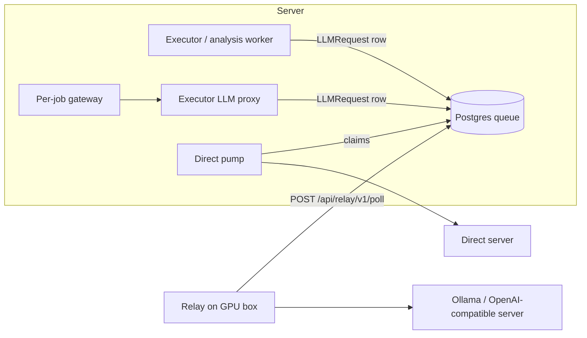

# Local models: endpoints, the relay and direct servers

LLM Lab runs experiments on models you host yourself (Ollama or any OpenAI-compatible server such as vLLM, llama.cpp server or LM Studio) through endpoints, next to the built-in OpenRouter endpoint.

Every place models run is an **endpoint** (`/endpoints` in the UI, `/api/inference/endpoints/` in the API). This page covers setup, the settings that matter for fair experiments, how requests flow, the security model and troubleshooting. Execution internals (the executor, slots, retries, the timeout chain) are in [Execution](/docs/EXECUTION); how experiments use endpoints is in [Experiments](/docs/EXPERIMENTS). The OpenRouter catalog itself is covered in [Models reference](/docs/MODELS_REFERENCE).

## 1. Two ways to connect

| | **Relay** (recommended) | **Direct** |
|---|---|---|
| Who can create it | any user (up to 100 relay endpoints per non-staff owner) | staff only |
| Network | the GPU box dials out over HTTPS; works behind NAT and firewalls | the executor container calls `base_url`; the host must route to it (e.g. Tailscale on the host) |
| What runs on the GPU box | `relay/llmlab_relay.py` next to the model server | only the model server |
| Credentials | endpoint-scoped relay tokens (rotatable, revocable; at most 20 live per endpoint for non-staff) | optional API key, stored encrypted |

Both feed the same durable request queue (`LLMRequest`), so caps, priorities and cancellation behave identically.

## 2. Add a relay endpoint

1. **Endpoints → Add endpoint** (`/endpoints/new`) is a three-step wizard: **Server** (kind: Ollama or OpenAI-compatible; relay or direct), **Settings** (name, slug, slots, limits, timeouts; see the table below) and **Connect**.
2. On Connect the relay token is shown **once**. Store it in a file with mode 0600; it is never placed in a command line.
3. Follow the install instructions on the same step (Python, Docker or systemd; later also on the endpoint's **Tokens** tab). Every command verifies the script's sha256. The commands point at `LLMLAB_PUBLIC_URL` (or, when unset, the scheme and host of your request). See `relay/README.md`.
4. The page turns green when the relay connects and lists the discovered models ("N models · M with tools"). A **Test** button probes the server.

### Endpoint settings

| Field | Default | Meaning |
|---|---|---|
| `slug` | from the name | `^[a-z0-9][a-z0-9-]{1,38}$`; `openrouter` and `local` are reserved. Immutable: it is part of every model id (`local-<slug>/<model>`) and of the fingerprint. |
| `kind` | | `ollama` or `openai_compatible`. |
| `connection` | `relay` | `relay` or `direct` (staff). |
| `api_flavor` | `native` | Ollama only: `native` (`/api/chat`) or `openai` (`/v1/chat/completions`). OpenAI-compatible endpoints are always `openai`. |
| `max_concurrency` (slots) | 1 | In-flight upstream requests, 1..256. |
| `max_active_jobs` | null (= slots) | Job cap: running jobs on this endpoint, 1..256. |
| `max_resident_models` (K) | null (unlimited) | Models the server holds at once, 1..64. |
| `request_timeout_s` | 900 | Per upstream call, 30..7200; drives the [timeout chain](/docs/EXECUTION#timeout-chain-local-models). |
| `keep_alive` | `30m` | Ollama `keep_alive` sent with each request. |
| `num_ctx_cap` | 32768 | Ollama: effective `num_ctx = min(model context, cap)`. |
| `assume_tools` | false | OpenAI-compatible servers report no capabilities; this sets the default tool flag. |
| `enabled` | true | Disabled endpoints claim nothing. |
| `visibility` | `private` | `shared` is staff-only (see Sharing). |

### Ollama settings on the GPU box

```ini
# sudo systemctl edit ollama
[Service]
Environment="OLLAMA_HOST=127.0.0.1:11434"      # keep Ollama on localhost; the relay is local
Environment="OLLAMA_NUM_PARALLEL=<slots>"      # = the endpoint's max_concurrency and the relay's --parallel
Environment="OLLAMA_MAX_LOADED_MODELS=<K>"     # = the endpoint's max resident models
Environment="OLLAMA_KEEP_ALIVE=30m"
```

- **Slots.** `max_concurrency` is enforced by the server when a request is claimed, for scaffolding calls, agent calls, probes and AI-review calls together. A relay session's capacity is the smaller of its `--parallel` and the endpoint's slots. Match both to `OLLAMA_NUM_PARALLEL`. For strict reproducibility use 1: Ollama batches parallel requests, which can break seed determinism.
- **Residency (K).** The scheduler never starts a model that would exceed K resident models on the endpoint (`residency_wait`). An experiment's `execution_options.max_resident_models` can only tighten it. With the `blocked` order (the `auto` default for a finite K) each model's cells run back to back, so a model loads once per repeat block. `interleaved` maximises temporal fairness but reloads models constantly when K is small (the composer warns `model_thrash_risk`).
- **Warm-up (prefetch).** For Ollama, before a lane's next model starts, the executor sends one `/api/generate` with an empty prompt and admits the job once the model is loaded, so load time never counts against an agent's wall clock (`execution.prefetch_load_s` records it). Turn it off per experiment with `execution_options.warmup: false`.
- **`num_ctx` and VRAM.** Ollama's default context is small; LLM Lab always sends `options.num_ctx = min(model context, endpoint num_ctx cap)` (or a per-model override). Large contexts cost VRAM: if a load fails with "requires more system memory" the run gets `upstream_oom`; lower the cap or K. The relay's `--max-num-ctx` clamps it locally as a last resort. The effective `num_ctx` is part of the run fingerprint; agent runs below 16 384 tokens get the `num_ctx_small` warning.
- **API flavor.** `native` (default for Ollama) uses `/api/chat`, which honours `num_ctx`, `keep_alive` and every sampling option. `openai` uses `/v1/chat/completions` and cannot set `num_ctx`; then set `OLLAMA_CONTEXT_LENGTH` on the server yourself (the preview warns `num_ctx_server_default`).

### One endpoint per machine

Slots and K describe one machine, so create one endpoint per GPU box. A second relay on the same endpoint (different `relay_id`, e.g. a second box by mistake, or a replacement) connects as **standby**: it gets no work and takes over when the active relay disconnects or times out (120 s). To spread models over several boxes, create an endpoint per box and use **Balance across endpoints** in the composer's Models section.

## 3. Direct endpoints (staff)

A direct endpoint is called from the executor container. `base_url` is the server root (e.g. `http://100.101.102.103:11434`). It is validated against SSRF rules (`backend/inference/security.py`):

- http/https only, no credentials, query or fragment in the URL;
- compose service names (`postgres`, `redis`, `django`, `apps-dind`, `executor`, `frontend`, …), `localhost` and metadata hosts are rejected (`INFERENCE_BLOCKED_HOSTS`);
- every resolved address must not be loopback, link-local, multicast, reserved, inside a network the executor is attached to, the Docker host (default gateway), one of `INFERENCE_HOST_PUBLIC_IPS` or in `INFERENCE_EXTRA_BLOCKED_CIDRS`;
- private, CGNAT and LAN addresses (Tailscale is `100.64.0.0/10`) need an explicit `INFERENCE_DIRECT_ALLOWED_TARGETS` entry `cidr:port`, e.g. `INFERENCE_DIRECT_ALLOWED_TARGETS=100.64.0.0/10:11434`;
- public addresses are allowed on any port except 22, 25, 2375, 2376, 5432 and 6379.

At call time the host is re-resolved and re-validated on every connection, the socket connects to the vetted IP (no DNS rebinding), redirects are never followed and TLS verifies the original hostname. The executor has no `extra_hosts`; `host.docker.internal` is not a supported target. Pumps in the executor refresh the model list every 120 s (or on **Refresh models**); a direct endpoint without a fresh inventory for 10 minutes counts as offline.

## 4. Models

Discovered models appear in the model picker grouped by endpoint, as `local-<endpoint>/<model>`, free and priced 0. Each row records the exact served name (`qwen2.5-coder:32b`), the digest of its weights, family, parameter size and quantization, and the capabilities Ollama reports (`tools`, `vision`, `thinking`). Models with no `tools` capability cannot drive tool-calling harnesses (the preview blocks with `models_without_tools`); Aider works with any model. On the endpoint's **Models** tab you can hide models, override `num_ctx` or the tool flag, rename the display name, run a one-token test against a model and (Ollama) unload it. A link from there opens the composer with those models preselected.

**Digest changes.** When a model's weights change upstream (`ollama pull`), the old digest is kept in the model's history and every running experiment with pending runs that froze the old digest is paused (`digest_changed`). Resume with "accept digest drift" (pending runs are re-frozen and the results are flagged as mixed) or clone the experiment. Nothing ever runs on different weights than its snapshot recorded: the relay is only given requests for `(name, digest)` pairs it currently serves (`model_not_served` otherwise).

**Fingerprints.** A local run's fingerprint includes `llm_source = {kind, api_flavor, served name, digest, num_ctx}` and the model id embeds the endpoint slug, so the same weights on two machines are two conditions (`same_digest_multiple_endpoints`; no cross-endpoint pooling). OpenRouter runs are unchanged.

## 5. How a call flows



- **Scaffolding / repairs / AI review:** the executor (or the analysis worker) creates an `LLMRequest` row and waits; the endpoint's active relay claims it on its next long-poll (`POST /api/relay/v1/poll`, 25 s), runs it against the local server and posts the result. For a direct endpoint, a pump thread in the executor claims and runs it.
- **Agent runs:** the agent talks to its per-job gateway exactly as with OpenRouter. For local models the gateway is the `llm-gateway-local` overlay, which forwards to the executor's internal LLM proxy (an internal Docker network; a narrow firewall exception allows only the gateway egress network to reach it, on one IP and port). The proxy turns each call into an `LLMRequest`, built from the job's frozen snapshot, and answers when the relay delivers. Streaming harnesses get synthesized SSE with keep-alive pings; non-streaming harnesses ride a 504 re-attach chain, so a long queue never breaks a run.
- **Timeouts** form one chain derived from the endpoint's request timeout (default 900 s): request deadline 3300 s, gateway socket 1200 s, proxy wait 1140 s, harness client 6060 s (see [Execution](/docs/EXECUTION#timeout-chain-local-models)).
- **Priorities.** A request's claim order is its priority plus a source offset: experiment calls (agent proxy, scaffolding, warm-up) 0, probes −20, AI-review analysis and inventory −40. An experiment's priority is copied to its requests.
- **Attempts.** A request has at most 3 attempts; a request body is cleared on completion, and responses are cleared once consumed or by the daily purge.

### Failure handling

| Situation | What happens |
|---|---|
| Relay offline | Jobs wait (`endpoint_offline`); the launch preview warns. |
| Relay restarts mid-request | The request returns to the queue (attempt +1) and runs again; the run records a relay interruption. |
| A poll response is lost (proxy restart) | Claims carry a 60 s ack lease; unacknowledged claims return to the queue within a minute without using an attempt. |
| Cancel | The relay is told within one poll and closes the upstream socket; Ollama stops generating. |
| Network blip (< ~2 min) | The relay retries every few seconds while requests run; its session (120 s TTL) survives and running generations finish. |
| Endpoint disabled | Relays stay connected and idle (polling every 15 s); nothing is claimed. |
| Repeated infra failures | Three within 5 minutes open the endpoint's circuit for 60 s (`circuit_open`). |

## 6. Tokens and sessions

- Format `llr_<prefix>.<secret>`; only a sha256 of the secret is stored. The prefix identifies the token in the UI.
- **Rotate** creates a new token; the old one keeps working for the grace period (`grace_minutes`, default 1440 = 24 h, 0..10080 = 7 days). Replace the token file and send the relay `SIGHUP` (`systemctl reload llmlab-relay`), or just restart it.
- **Revoke** takes effect immediately: its sessions end, their requests return to the queue and the relay aborts its running generations and exits with code 3 (systemd will not restart it; Docker with `--on-unauthorized wait` idles).
- The endpoint's Overview tab lists sessions with role (active / standby), hostname, version, client IP, capacity and last-seen time, and flags a new hostname for a token. A new IP or hostname is worth a look.

### Client IP trust

Relays reach Django through Caddy and the SvelteKit proxy, which appends to `X-Forwarded-For`. Django takes the **right-most** hop that is not in `TRUSTED_PROXY_CIDRS` (set it to the frontend container and Caddy addresses). Requests that bypass Caddy (the directly published frontend port) can only spoof hops to the left of the frontend's own entry, so the recorded IP is trustworthy only for traffic through Caddy. Production adapter-node needs `BODY_SIZE_LIMIT` ≥ 16M for agent-sized results.

## 7. Sharing

Endpoints are private. Staff can mark one **shared**; then every user can run models on it. Non-owners must tick a consent note in the composer ("Prompts and generated code … pass through machines run by …"; preview issue `foreign_endpoint`) and never see operational details: base URL, key prefix, sessions, IPs, hostnames and errors are shown only to the owner and staff (REST and live updates, where non-owners get the `endpoint:<id>:public` channel).

## 8. Security model

- The relay holds no secrets except its own token and runs only allowlisted inference paths; the script is pinned by sha256 and never self-updates.
- A stolen token lets an attacker read prompts and answer requests for that endpoint's runs. Mitigations: endpoint-scoped tokens, 0600 token files, instant revocation, session visibility.
- The relay protocol is rate-limited per token (`RELAY_RATE_LIMIT_PER_S`, 20/s; 429) and caps bodies (8 MB, 32 MB decompressed; 413 `too_large` / `too_complex`).
- The internal LLM proxy accepts only per-job signed tokens that name the job and attempt, valid only while that attempt holds a live lease; endpoint access is re-checked for agent jobs.
- Direct endpoints are staff-only and SSRF-validated on every connection.

## 9. API

Endpoint routes are under `/api/inference/`; endpoints you cannot see are 404, mutations need the owner or staff.

| Route | Purpose |
|---|---|
| `GET/POST /endpoints/` | list visible endpoints / create (a relay endpoint's first token is returned once) |
| `GET/PATCH/DELETE /endpoints/{id}/` | detail / update (`slug` immutable, `api_key: ""` clears the key) / delete (409 `in_use` once it has runs or requests: disable it instead) |
| `POST /endpoints/{id}/refresh/` | request a model inventory resync |
| `POST /endpoints/{id}/test/`, `GET …/test/{request_id}/` | probe (`/api/version` or `/v1/models`, or a one-token chat with `model_id`) and its result |
| `POST /endpoints/{id}/unload/` | unload a model (Ollama, `keep_alive: 0`) |
| `GET /endpoints/{id}/models/`, `PATCH …/models/{pk}/` | discovered models (`?include_hidden`) / hide, `num_ctx_override`, tool flag, display name |
| `GET/POST /endpoints/{id}/tokens/`, `POST …/tokens/{tid}/rotate/`, `POST …/tokens/{tid}/revoke/` | relay tokens |
| `GET /endpoints/{id}/sessions/` | relay sessions |
| `GET /endpoints/{id}/metrics/?minutes=` | per-minute in-flight time, completions, tokens and errors (5..1440 minutes, default 60) |
| `GET /endpoints/{id}/install/` | install commands with the server URL, slots and sha256 filled in |

The relay protocol lives outside the ninja API at `/api/relay/v1/` (relay token as `Authorization: Bearer llr_…`):

| Route | Purpose |
|---|---|
| `POST hello` | open a session (version check: 426 below `RELAY_MIN_VERSION`; 409 `kind_mismatch`); active or standby |
| `POST inventory` | push the model list (≤ 500 models) and loaded models |
| `POST poll` | long-poll (25 s) for claims; carries in-flight acks |
| `POST requests/<id>/result` | deliver a result |
| `POST bye` | end the session |
| `GET relay.py`, `GET Dockerfile`, `GET llmlab-relay.service` | the relay files, with `X-Relay-Version` and `X-Relay-Sha256` headers |

## 10. Troubleshooting

| Symptom | Check |
|---|---|
| `--check` fails on the server | URL (https), token file contents, `--ca-file` for a private CA |
| `401` / exit code 3 | token revoked, expired after rotation, or the wrong file |
| `409 kind_mismatch` | `--kind` differs from the endpoint's kind |
| `426` | the relay is older than `RELAY_MIN_VERSION`: fetch and verify the new script |
| `429` | the relay exceeds the per-token rate limit (`RELAY_RATE_LIMIT_PER_S`) |
| Endpoint stays offline | relay logs; the relay must reach `https://<server>/api/relay/v1/hello` |
| Models listed but jobs wait (`model_not_served`) | the model was removed or re-pulled with other weights; see Digest changes |
| Jobs wait with `residency_wait` | K is reached; raise `max_resident_models` (and `OLLAMA_MAX_LOADED_MODELS`) or use the `blocked` order |
| `upstream_oom` | lower the `num_ctx` cap or max resident models |
| Runs hit their wall clock | slow hardware: raise the agent wall clock or the request timeout (the preview warns `wall_clock_tight`); watch tokens/s on the endpoint page |
| Relay polls but never gets work | the session is `standby` (another relay holds the endpoint) or the endpoint is disabled |

More general problems are in [Troubleshooting](/docs/TROUBLESHOOTING).
