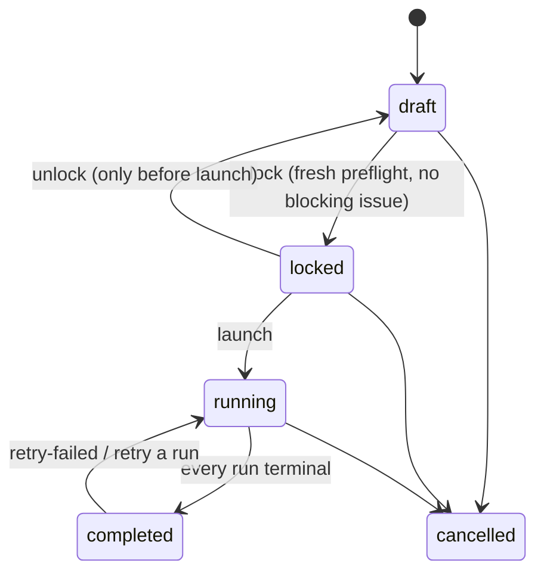

# Research guide

How to run a pre-registered analysis study: choose targets, a profile and exclusion rules, design the comparison, read the pre-run report, lock the protocol, launch, follow progress, generate the post-run report, export a replication package, and read the statistics. Ends with a worked example from a real end-to-end run.

A study (`AnalysisStudy`, under **Analysis → Studies**) analyses a set of generated apps under **one frozen analysis plan**, so every number in its report comes from comparable measurements. The engine underneath is described in [Analysis pipeline](/docs/ANALYSIS_PIPELINE); the definitions (SLOC, scope, mappings, outcomes, statistics) are in [Analysis methodology](/docs/ANALYSIS_METHODOLOGY).

## Lifecycle



| Step | API (`/api/analysis/`) | What happens |
| --- | --- | --- |
| Create | `POST /studies/` | A draft; the `research-default` profile is pinned when none is given |
| Edit | `PATCH /studies/{id}/` | Draft only |
| Preflight | `POST /studies/{id}/preflight/` | The pre-run report, stored on the study; nothing is mutated |
| Lock | `POST /studies/{id}/lock/` | Re-runs the preflight with a freshly frozen plan, refuses on any blocking issue, then freezes `plan` + `plan_hash` and the protocol + `protocol_hash` |
| Unlock | `POST /studies/{id}/unlock/` | Back to draft before launch; the frozen plan and protocol are discarded |
| Launch | `POST /studies/{id}/launch/` | Verifies both hashes, the analyzer image and the procedure, then submits one run per eligible protocol target in the background |
| Progress | `GET /studies/{id}/progress/` | Targets × tools status matrix, counts, cost so far, stale and capacity hints |
| Retry | `POST /studies/{id}/retry-failed/`, `POST /runs/{id}/retry/` | Requeues failed, partial and cancelled runs |
| Cancel | `POST /studies/{id}/cancel/` | Cancels active runs cooperatively; the study ends `cancelled` |
| Report | `POST /studies/{id}/report/` (202), `GET /studies/{id}/report/`, `GET /studies/{id}/report.md` | Builds the post-run report from stored data in the background |
| Protocol | `GET /studies/{id}/protocol/`, `GET /studies/{id}/protocol.md` | The frozen pre-registration and its sha256 |
| Export | `GET /studies/{id}/export/{tables.zip, replication.zip, findings.csv, runs.csv}` | Tidy tables and the replication package (after launch) |

## 1. Targets

`target_spec` selects completed generation jobs. Only your own jobs are targets; staff may reference another user's experiment, batch or jobs explicitly, but a `filter` spec always selects the requester's own jobs.

```json
{"kind": "experiment", "experiment_id": "<uuid>", "condition_ids": [3, 4], "app_slugs": ["crud_todo_list"]}
{"kind": "batch", "batch_id": "<uuid>"}
{"kind": "jobs", "job_ids": ["<uuid>", "..."]}
{"kind": "filter", "filters": {"model_ids": [11], "modes": ["agent"], "harnesses": ["opencode"],
                               "stacks": ["flask-react"], "app_slugs": [], "created_after": "2026-10-01"}}
```

`POST /targets/resolve/` (body `{target_spec, exclusion_rules?, profile_id?, page, per_page}`) previews the candidate jobs with their eligibility and sample totals, plus `eligible_total`, `excluded_total` and `excluded_by_reason` across all pages. `GET /targets/options/` lists the experiments, batches, models, harnesses, stacks and apps you can choose from.

## 2. Profile

The profile decides the instrument: which tools (and which are required), the AI reviewer, the measured scope and the outcome rules. Use a system profile (`research-default` for static tools plus a 3-replicate AI review, `static-only` to avoid LLM cost) or your own under **Analysis → Profiles**. Profiles are versioned; the study freezes the exact version into its plan at lock. See [Analysis pipeline](/docs/ANALYSIS_PIPELINE#profiles-and-frozen-plans).

## 3. Exclusion rules

`exclusion_rules` decide which targets are eligible. Defaults:

| Rule | Default | Excludes |
| --- | --- | --- |
| `exclude_invalid` | true | Agent jobs whose validity says `exclude` |
| `exclude_empty_output` | true | Jobs where the model wrote no source file (nothing authored, added or modified) |
| `exclude_truncated` | true | Generation output cut off (`finish_reason=length`, truncation flags) |
| `exclude_run_limits` | false | Agent runs that stopped at a run-level limit (timeout, budget, memory cap). They are valid samples; excluding them biases comparisons toward models that finish quickly, so keep this for sensitivity analyses |
| `min_measured_sloc` | 0 | Apps below this many measured SLOC (`below_min_sloc`) |
| `require_functional` | false | Apps without a known conformance result (`functional_unknown`) |

A switched-off rule still reports its flag as a warning. Reasons appear per target (`no_code`, `empty_output`, `truncated`, `run_stopped`, `invalid`, `truncation_unknown`, `functional_unknown`, `whole_file_attribution`, …) with a severity of `exclude`, `warn` or `info`.

## 4. Design and research questions

`analysis_design` (defaults in brackets):

| Key | Meaning |
| --- | --- |
| `group_by` [`["model"]`] | The factor(s) compared: `model`, `condition`, `harness`, `mode`, `stack`, `app`; a list is crossed |
| `block_by` [`"app"`] | The blocking factor (or null). Replicates of one app are correlated, so the app is the natural block |
| `primary_outcome` [`static_issues_per_kloc`] | The confirmatory outcome |
| `outcomes` [null = all] | Outcomes the report analyses |
| `alpha` [0.05], `correction` [`holm`], `exploratory_correction` [`bh`] | Significance level and the multiple-comparison corrections (`holm`, `bh`, `none`) |
| `bootstrap_resamples` [10000], `effect_ci_resamples` [2000], `ci_level` [0.95], `seed` [0] | Resampling; the seed makes every interval reproducible |
| `cell_aggregate` [`mean`] | How replicates of one (group, block) cell are aggregated (`mean` or `median`) |

`research_questions` is a list of `{id, text, kind: confirmatory|exploratory, hypothesis?, outcome|outcomes?}`. A confirmatory question may name the outcomes it tests; they join the primary outcome in the confirmatory family (corrected with `correction`), and they must be outcomes the design analyses. Everything else is exploratory (corrected with `exploratory_correction`).

**Defaults from an experiment.** When `target_spec.kind` is `experiment` and that experiment's [analysis plan](/docs/STUDY_TABLES#pre-registered-analysis-plan) was frozen at launch, a new study takes the plan's research questions, `alpha`, `correction` and primary outcome for anything the create request leaves unset. Only metrics with the same definition map (`pass_rate` → `functional_pass_rate`, `issues_per_kloc` → `static_issues_per_kloc`); a question on any other metric becomes exploratory and says why. The create response's `defaults_applied` records what was taken (`experiment_id`, `analysis_plan_hash`, `frozen_at`, `unmapped_metrics`, `applied`). Explicit values always win.

## 5. Preflight: the pre-run report

The preflight resolves every target exactly as the executor will and reports, without changing anything:

- **targets**: per target its group and block, eligibility with reasons, files, total and measured SLOC by language and origin, `sample_hash`, and per tool whether it will run or is not applicable (`tool_list`, `tool_files`);
- **applicability** per tool, in plan order;
- **image**: the analyzer tag, whether it is built, the daemon state;
- **tools**: version and status (`ready`, `image_missing`, `canary_failed`, `canary_unknown`) with the latest canary verdict for the plan's exact configuration;
- **reviewer**: engine, harness, model and whether it is known, structured outputs, tool calling, key present, samples, and a cost estimate (low / expected / high, per target);
- **estimates**: tool executions, AI calls, wall time, AI cost;
- **comparability**: mixed prompt hashes, bundle keys, stacks, modes or harnesses that are not a grouping factor;
- **design**: the cell structure (`complete_blocks`, `n_groups`, `min_group_size`, `balanced`).

Issues are `blocking` (the lock refuses): `no_plan`, `empty_plan`, `tool_unavailable`, `no_targets`, `no_eligible_targets`, `resolver_error`, `docker_unavailable`, `image_missing`, `image_changed`, a planned tool's `canary_failed`, `reviewer_key_missing` (OpenRouter model, no key), `reviewer_model_unavailable` (local model whose endpoint is not visible to you, disabled, or now serves other weights), `reviewer_model_unknown`, `reviewer_tool_calling`. `warnings`: `targets_excluded`, `sample_warnings`, `tool_disabled`, `canary_config_untested`, `canary_unknown`, `incomplete_blocks`, `reviewer_output_cap`, `reviewer_budget`, plan notes. `info`: `single_group`, `reviewer_json_fallback`, `reviewer_budget_worst_case`. A platform failure while resolving a target is blocking, because silently excluding targets would bias the study. Run it from the study page or `POST /studies/{id}/preflight/`.

## 6. Lock and launch

**Lock** freezes the plan and the protocol: study metadata, research questions, target spec and the resolved targets with eligibility, exclusion rules, design, the frozen plan (toolchain manifest, image, configs, hashes), the reviewer, canary results, outcomes and their families, the analysis plan (tests, α, corrections, effect sizes, resamples), estimates, comparability notes, anticipated threats, the platform git SHA and timestamps. `protocol_hash` is its sha256; `GET /studies/{id}/protocol.md` renders it as thesis-ready Markdown.

**Launch** re-verifies the protocol and plan hashes and the analyzer image, and refuses with `409 procedure_drift` when the running code no longer implements the frozen procedure (tool specs, engine stage versions, mapping tables). It then submits one run per eligible protocol target in the background. Targets that cannot be submitted (job deleted, code changed since lock) are recorded in `preflight.launch.skipped`, never silently dropped. The submission is idempotent: calling launch again resumes an interrupted one. Runs belong to the study owner, whose key pays for AI reviews.

## 7. Progress, retries, cancel

`GET /studies/{id}/progress/` (the study page polls it) returns the targets × tools matrix, counts per status, the cost so far (including earlier attempts of retried tools; `cost.complete` false when a figure is a lower bound), and stale, queue and capacity hints. A study completes when its launch is done and every run is terminal.

`retry-failed` requeues failed, partial and cancelled runs (a run with nothing retryable is skipped); a single run can be retried with `POST /runs/{id}/retry/`. Retries keep succeeded tool results and resume AI reviews from their stored replicates. Retry and launch both refuse with `409 procedure_drift` if the code changed underneath the plan.

## 8. The post-run report

`POST /studies/{id}/report/` builds the report from stored data only (runs, tool results, review samples, findings, measurements) in the background; poll `GET /studies/{id}/report/`, read `GET /studies/{id}/report.md`. It is deterministic (`report_hash` over its content), schema-versioned and linked to `protocol_hash` and `plan_hash`. A report generation is refused (`409 protocol_integrity` / `plan_integrity`) when the stored protocol or plan fails its own hash. A stored report is marked stale when a study run changed after it was generated, or when the canonical analysis set changed (a run or target job deleted).

**Counting rules.** One canonical run per target: the latest finished run under the study's plan hash. The analysis set holds canonical runs that finished (`completed` or `partial`), match the plan, and whose target was eligible in the protocol; everything else is attrition and is reported. Every value comes from `measurement.outcomes()`; a `None` is missing data (complete-case analysis per outcome, with `n_missing`).

| Section | Contents |
| --- | --- |
| `overview` | Key figures: targets planned / with run / analysed, complete runs, groups, primary omnibus result, deviation counts |
| `deviations` | Everything that differs from the protocol: failed, cancelled or unfinished runs, launch skips, ineligible or unplanned runs, superseded runs, required tool failures, image, plan, tool version, reviewer model or prompt, engine version or platform changes, `procedure_drift`, `procedure_unverified`, `research_questions_changed`, `protocol_integrity` |
| `data_quality` | Funnel (targets → eligible → with run → analysed → all required tools OK → primary outcome available), attrition per group, exclusions, run status, tool health (status counts, success rate, file coverage, parse-error rate, failure reasons), outcome NA counts, AI sample status and grounding |
| `sample` | SLOC and files per group and language |
| `descriptives` | Per group and outcome: n, n_missing, mean with bootstrap CI, median, IQR; Wilson intervals for binary outcomes |
| `findings_profile` | Counted issues by category, severity, CWE and rule per group |
| `inferential` | Omnibus tests with effect sizes, pairwise comparisons with adjusted p-values and effect sizes |
| `ai_reliability` | Replicate success, Krippendorff's α, Jaccard, grounding, AI vs static overlap, counted AI findings by category |
| `tool_overlap` | Pairwise Jaccard of tools' issue sets and each tool's unique contributions (UpSet series) |
| `cost` | AI review and generation spend, tokens and tool time per group; cost per counted AI finding |
| `provenance` | The exact toolchain, reviewer, plan and runs behind every number |

Missing values print as `NA`, never 0.

## 9. Reading the statistics

- **Design.** With `block_by` set and every group present in every block (a *complete* design, decided at lock), the tests are blocked: per-(group, block) cell values (replicates aggregated by `cell_aggregate`), a **Friedman** test with **Kendall's W**, and pairwise **Wilcoxon signed-rank** tests with the matched-pairs rank-biserial correlation. Otherwise the tests are independent: **Kruskal–Wallis** with **ε² = H / (n − 1)** and pairwise **Mann–Whitney U**. Blocked designs also get an unblocked Kruskal–Wallis sensitivity table. A run without a known block is never paired.
- **Effect sizes.** **Cliff's δ** (with a bootstrap CI for the primary outcome) and its magnitude (negligible < 0.147 ≤ small < 0.33 ≤ medium < 0.474 ≤ large), and **Vargha–Delaney Â12**. Report the effect, not only the p-value: with a handful of apps per group, a "large" δ with a CI spanning 0 is no evidence either way.
- **Multiplicity.** Pairwise p-values are Holm-adjusted within an outcome. Omnibus p-values are adjusted with `correction` (Holm) across the confirmatory family (primary outcome plus outcomes named by confirmatory questions) and with `exploratory_correction` (Benjamini–Hochberg) across the rest. Only confirmatory results support claims; exploratory ones suggest the next study.
- **Undefined is not zero.** A test over values that are all tied is reported as undefined with a note, never as p = 1.
- **AI reliability.** Krippendorff's α (nominal) over per-(target, file, category) presence across replicates: ≥ 0.8 reliable, ≥ 0.667 tentative, below that unreliable. Low α means the reviewer's individual findings are noisy; the consensus count is still defined, but treat AI findings as opinions and validate a sample by hand ([Study tables → manual review sample](/docs/STUDY_TABLES#manual-review-sample)).
- **Densities** divide by measured SLOC (model-written source lines) and are NA below `min_sloc_for_density`, so small apps do not produce extreme rates.

## 10. Exports and the replication package

After launch, `GET /studies/{id}/export/<name>`:

- `tables.zip`: tidy CSVs `runs`, `tool_executions`, `findings`, `issues`, `review_samples`, `measurements`, `outcomes`, using exactly the report's target selection (`canonical` / `in_analysis` flags);
- `findings.csv`, `runs.csv`: single tables;
- `replication.zip`: the tables, the locked protocol, the stored report (JSON and Markdown, never rebuilt at export), the frozen plan, a codebook, a README and `SHA256SUMS`. Deterministic: the same data gives the same bytes.

CSV conventions: UTF-8, comma separated, a header row; an empty cell is missing data (NA), never zero; booleans are `true` / `false`; lists and objects are JSON. Cells hold untrusted text (code snippets, AI prose) verbatim; `?escape=true` prefixes cells starting with `= + - @` for spreadsheet safety (the replication package always stays verbatim; import cells as text).

## 11. Threats to validity

The protocol lists the anticipated threats and the report the observed ones:

| Kind | Threat | Mitigation in the pipeline |
| --- | --- | --- |
| construct | Static findings are not vulnerabilities; tools produce false positives | Raw findings, deduplicated issues and grounded AI consensus reported separately; precision estimated on a labelled sample |
| construct | Platform or scaffold code attributed to the model | Line-level origin attribution; only authored, added and modified lines are measured |
| internal | A failed or timed-out tool read as clean code | Explicit tool statuses; a failed tool makes its outcomes NA |
| internal | LLM nondeterminism (generator and reviewer) | Replicates per cell, k review replicates with consensus, recorded seeds and providers |
| internal | The procedure changing mid-study | Frozen plan, `procedure_drift` refusals, deviations for image, tool, reviewer or engine changes |
| external | App specs, stacks and model snapshots limit generalisation | The protocol records the exact specs, stacks and model snapshots |
| conclusion | Multiple comparisons, small samples | Pre-registered primary outcome, Holm / BH adjustment, effect sizes with intervals, n and n_missing everywhere |

Choose apps over repeats when you need power: the app is the unit that varies, repeats of one app are correlated.

## Studies, experiment plans and the Study Report

Three pieces of the platform pre-register or report analyses; they are independent but connected:

| | Analysis study (this guide) | Experiment analysis plan | Study Report (reports app) |
| --- | --- | --- | --- |
| Where | **Analysis → Studies** | `Experiment.analysis_plan`, frozen at launch with `analysis_plan_hash` | **Reports → New → Study Report**, `study_report` type |
| Pre-registers | Targets, frozen engine plan (`plan_hash`), design, research questions, confirmatory outcomes (`protocol_hash`) | Research questions, primary and secondary metrics (`deploy_rate`, `pass_rate`, `functional_passed`, `unique_issues_per_app`, `issues_per_kloc`, `security_per_app`, `cost_per_app`), α, correction, ranking weights | — |
| Statistics | Omnibus + pairwise tests across groups (above) | — | Funnel, deduplicated issue tables, security bounds, correlations, TOPSIS/WSM ranking, planned comparisons vs the experiment's baseline |
| Analysis data | Its own runs under one plan | — | Each job's canonical v2 run under one plan (`plan_hash` setting, else the plan measuring the most jobs) |

- A study targeting an experiment with a frozen plan takes that plan's questions, α, correction and primary outcome as defaults (above). The two hashes stay independent; the experiment plan hash is returned in `defaults_applied` but not stored on the study.
- An experiment's post-run analysis ([Experiments → Post-run](/docs/EXPERIMENTS#post-run)) submits v2 runs under one frozen plan and records its hash (`post_run.progress.analysis_plan_hash`, also listed by `GET /api/analysis/plans/?experiment_id=` as `experiment_post_run`). Pass that hash to the Study Report (`plan_hash`) or a study's targets to analyse exactly those measurements.
- Only `pass_rate` and `issues_per_kloc` have a v2 outcome with the same definition. Deploy rates, per-app counts and generation cost stay with the Study Report ([Study tables](/docs/STUDY_TABLES)).

## Worked example

From the end-to-end verification run (real generated apps, real DeepSeek reviews): study *E2E: harness comparison on real apps*, target `kind: filter` over every completed job, profile `research-default` (14 static tools, single-shot reviewer `deepseek/deepseek-v4.1-flash`, k = 3, temperature 0.2, budget $0.50 per replicate), `group_by: harness`, no blocking factor.

- **Research questions.** RQ1 (confirmatory): do coding-agent harnesses differ in static issue density? RQ2 (exploratory): how reliable is the AI reviewer across replicates?
- **Preflight.** 13 targets resolved, 11 eligible: one with `no_code`, two with `empty_output` (a target can carry several reasons; `functional_unknown` and `truncation_unknown` were warnings). Groups: aider 3, opencode 5, mini-swe-agent 2, and `(none)` 1 (a job without a harness). All 14 tools `ready` with passed canaries. Estimates: 143 tool executions, 33 AI calls, AI cost $0.248 expected ($0.071–$3.70), 13 350 measured SLOC, ~18 minutes.
- **Lock.** Plan hash `743d15ba…2448`, protocol hash `f9e64bfc…336a`.
- **Run.** 11 runs: 10 completed, 1 partial (the AI review of one aider app failed: deviation `required_tool_failed`, so its AI outcomes are NA and its static outcomes still count).
- **Report.** Design independent: Kruskal–Wallis on the primary outcome gave H = 1.85, df 3, p = 0.603, ε² = 0.185 (no difference detected; four groups of 1–5 apps have little power). High+ issues were all tied, so their tests are reported as undefined. AI reliability: 31 of 33 replicates succeeded, Krippendorff's α = 0.073 overall ("unreliable"), mean Jaccard 0.48, grounding 100 %; AI and static issues overlapped little (1 matched issue of 68 AI and 33 static issues). AI review cost $0.2558 in total, $0.0038 per counted AI finding.

The lesson the example teaches: the AI reviewer's individual findings disagree across replicates, which is why only grounded consensus counts, why it never enters static totals, and why its precision should be checked on a labelled sample before a claim rests on it.
