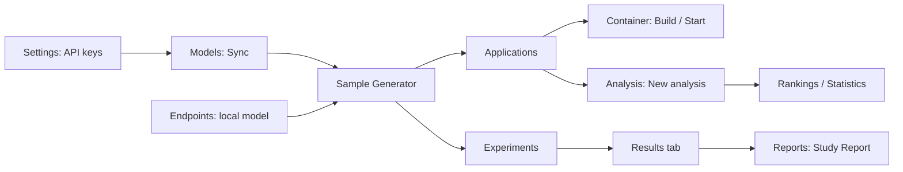

# User guide

A page-by-page tour of the LLM Lab web UI and the workflows that connect the pages.

For installing and starting the stack, see [Quickstart](/docs/QUICKSTART). This guide starts once you can sign in.

## Layout and navigation

Every signed-in page has a left sidebar, a header with breadcrumbs, a theme toggle and an account menu.

The sidebar groups pages in workflow order. The breadcrumb's first, unlinked crumb is the group name.

| Group | Pages | Purpose |
| --- | --- | --- |
| Overview | Dashboard | Activity across the lab at a glance |
| Generate | Models, Endpoints, Library, Sample Generator, Experiments | Choose models and where they run, define what to build, start runs |
| Evaluate | Applications, Analysis, Analyzers, Runtime | Inspect generated apps, run analyzers, manage containers |
| Insights | Rankings, Statistics, Reports | Compare models and export results |
| Help | Docs | This documentation |
| Admin (staff only) | System | Host, worker and database health, maintenance |

- **Collapse** at the bottom of the sidebar shrinks it to icons. On phones the sidebar opens from the menu button in the header.
- The account menu (your initial, top right) has **View profile**, **Account settings**, **Appearance**, **API keys**, **Integrations** and **Sign out**.
- **About** (`/about`) and **Privacy & data** (`/privacy`) are not in the sidebar; the footer at the bottom of every page links to **About**, **Privacy** and **Docs**. The privacy page is also linked from Settings, under **Privacy & data**. It lists the cookies and browser storage the app uses, what the server keeps and what leaves the instance (LLM providers, GitHub exports, notification channels); account deletion or a full server-side export goes through the instance administrator.

### Old links that redirect

| Old address | Lands on |
| --- | --- |
| `/dashboard` | Dashboard (`/`) |
| `/generation` | Sample Generator, Agent mode (the query string is kept) |
| `/login` | `/auth/login` |
| `/settings` | Settings (`/users/settings`) |
| `/integrations?tab=…` | The matching Settings section, for example `#github` or `#notifications` |
| `/automation` and anything under it | Experiments. Automation now lives on each experiment's **Operations** section |
| `/experiments/create` | `/experiments/new` (query kept) |
| `/sample-generator?job=<id>` | That run's application page |

## Typical workflows

### First app: keys, models, generate, run, analyze, compare

1. **Add your keys.** Open Settings → **API keys** and click **Add key** for OpenRouter (and optionally Hugging Face, for model metadata). Keys are checked with the provider, stored encrypted and never shown again. Until you add one, jobs use the deployment-wide key if there is one. The Sample Generator shows a banner when no usable OpenRouter key exists.
2. **Sync the model catalog.** On **Models**, click **Sync**. Staff also find **Sync models** in the Dashboard's maintenance menu.
3. **Generate an app.** Open **Sample Generator**, keep the **Agent** mode, pick one or more app specs under **Task**, pick models, keep the default harness preset and click **Start N runs**. Every combination of task, model, harness and trial becomes one run in a batch.
4. **Follow the batch.** You land on the batch page. Its **Results** matrix fills in as runs finish. Open a run to get its application page.
5. **Run the app.** On the application page, click **Build**, then **Open** to preview it. **Container** shows ports and status, and **Tools** sends HTTP requests to the running app.
6. **Analyze it.** Install analyzers once on **Analyzers** → **Shop**. Then click **New Analysis** on the application's **Analyses** tab, or go to **Analysis** → **New analysis**.
7. **Compare.** Select models on **Models** and click **Compare**. You can also check **Rankings** and **Statistics**, or generate a report.

More detail: [Generation process](/docs/GENERATION_PROCESS), [Execution](/docs/EXECUTION), [Analysis pipeline](/docs/ANALYSIS_PIPELINE).

### Designing and running an experiment

1. **Experiments** → **New experiment**. Work through the numbered sections: **Basics**, **Method**, **Models**, **Harness presets** (or **Prompt profiles** for scaffolding), **Apps**, **Replication**, **Sampling & budget**, **Ablations**, **Execution**, **Automation**.
2. Watch the **Plan** rail on the right. It shows conditions, cells, where they run, cost, bottleneck and a **Comparability** table. Problems that block launch are listed there.
3. Pick the **Pre-registered baseline** in the **Harness presets** (or **Prompt profiles**) section. Results compare every condition against it.
4. Click **Save draft** to keep the design, or **Launch** once the plan is ready.
5. The experiment page reads like a paper. **Abstract** summarises the design, the progress of data collection and the key findings (with limitations), and plots the pass rate per condition. **Method** lists the factors, conditions, what is held constant and the comparability check. **Results** has the leaderboard, the comparison with the baseline (forest plot) and the per-app table. **Data** lists every run (open or retry one) and downloads the dataset. **Operations** shows endpoints, activity, execution limits and automation.
6. When it finishes, you can **Top up failed** cells, **Clone** the design, **Archive** it, or click **Generate report** in the Results section.

More detail: [Experiments](/docs/EXPERIMENTS).

### Adding a local model endpoint

1. **Endpoints** → **Add endpoint**. The wizard has three steps: **Server**, **Settings**, **Connect**.
2. **Server**: choose the **Server kind** (**Ollama** or **OpenAI-compatible**) and the **Connection** (**Relay**, recommended, or **Direct**, staff only).
3. **Settings**: name, slug (it cannot be changed later), capacity (**Max active jobs**, **Max resident models**, **Request timeout (s)**, **num_ctx cap**, **Keep-alive**), tool calling, and sharing (**Private** or **Shared**; only staff can set **Shared**).
4. **Connect**: for a relay, copy the relay token from the dialog (it is shown once). Run the install commands on the model machine and wait for "Waiting for the relay to connect…" to turn green. For a direct endpoint, use **Test connection**.
5. Open the endpoint and go to **Models**. Select discovered models and click **Use N in new experiment**. They also appear in the Sample Generator's model picker.

To add a cloud provider instead (Anthropic, OpenAI, Groq, Mistral and others), use Settings → **LLM providers**. LLM Lab then creates an endpoint and imports its models.

More detail: [Local models](/docs/LOCAL_MODELS).

### Building a study report

1. Run an experiment to completion with **Evaluate every run** on. Optionally turn on **Static analysis when the experiment completes** under its **Operations → Automation** section.
2. **Reports** → **New report** → **Study Report**.
3. Optionally choose an **Experiment** (default **All my apps**). With an experiment, its pre-registered analysis plan decides which comparisons are confirmatory.
4. Set a **Random seed** so the report regenerates identically. Optionally tick **Bootstrap rank intervals over apps (slower)** and **Count AI-reviewer findings as issues**.
5. Click **Generate report**. When it completes, download it as **Markdown**, **LaTeX** or **JSON**.

More detail: [Study tables](/docs/STUDY_TABLES).

## Overview

### Dashboard (`/`)

Shows lab-wide activity.

- **Header stats**: models in use, apps, analyses and findings. Each one links to its page.
- **Buttons**: **Generate app**, **New analysis**, **Refresh dashboard**, and, for staff only, a **Maintenance** menu with **Sync models**, **Clear caches**, **Clear stuck jobs** and **Open system panel**.
- **Panels**:
  - **Analysis Activity** (trend) and **Finding Severity**.
  - **Analyzer Health**: one tile per analyzer.
  - **Recent Analyses** and **Recent Generation Jobs**, each with **View all**.
  - **Recent Activity** feed.

## Generate

### Models (`/models`)

The catalog of models you can generate with.

- **Filters**:
  - **Quick** filters: **Free**, **Vision**, **Functions**, **128K+ Context**, **Efficient**, **Used in Apps**.
  - Capability, **Price**, **Context** and **Provider** filters, and **Sort**.
- **Actions**: **Sync** refreshes the catalog from OpenRouter, **Export** downloads it, **Import** opens the import page, **Rankings** opens Rankings.
- **Compare**: tick models in the table, then click **Compare (N)**.

**Model detail** (`/models/<slug>`) has these tabs:

- **Overview**: about, links to OpenRouter, models.dev and Hugging Face, and how this model has done on this platform.
- **Results**: ranking, resource use, code findings by tool, results per app spec, and the experiments it was part of.
- **Benchmarks** and **Capabilities**.
- **Pricing & providers**.
- **Applications**: apps generated with this model, and usage.
- **Raw data**: **Copy JSON** and **Export**.

The header has **Copy model ID**, a link to OpenRouter, export as JSON, **Refresh metadata from OpenRouter** (staff only), **Compare** and **Generate app**. A notice appears when OpenRouter plans to retire the model.

**Compare** (`/models/compare`) puts the selected models side by side.

- **Sections**: **Core Metrics**, **Pricing Deltas** and **Capabilities Comparison**.
- **Baseline**: **First Selected**, **Average** or **Median**.
- **Other controls**: **Highlight** marks the best value in each row, **Share Link** copies a link to this comparison.

**Import** (`/models/import`) uploads a model JSON file. It accepts this app's own model export or a raw OpenRouter model payload.

Reference: [Models reference](/docs/MODELS_REFERENCE).

### Endpoints (`/endpoints`)

Shows where models run: OpenRouter, plus your own Ollama or OpenAI-compatible servers.

- **Capacity card**: the shared execution slots. Staff also see **Drain** and **Slot settings**.
- **Endpoint cards**: active jobs, queued requests, tokens/s and loaded models, with **Open** for details.
- **Add endpoint**: opens the three-step wizard described in [Adding a local model endpoint](#adding-a-local-model-endpoint).

**Endpoint detail** (`/endpoints/<id>`) has these tabs. Which ones you see depends on the endpoint type and on whether you can edit it.

- **Overview**: live numbers (active jobs, queued requests, tokens/s), **Loaded models** with **Unload**, **Relay sessions** and **Recent errors**.
- **Models**: the discovered models. Use **Refresh models**, **Show hidden**, **Test** or **Unload** a model, hide a model from pickers, override num_ctx per model, and **Use N in new experiment**.
- **Tokens** (relay endpoints only): relay tokens with **New token**, **Rotate** (the old token keeps working for a grace period) and **Revoke**. **Install the relay** shows the setup commands.
- **Settings**: edit the endpoint, and **Disable or delete**. An endpoint that has runs cannot be deleted, only disabled.

Reference: [Local models](/docs/LOCAL_MODELS).

### Library (`/templates`)

The Generation Library holds everything a sample run is assembled from. A side menu groups its sections.

| Group | Section | What it holds |
| --- | --- | --- |
| What to build | **App specs** | Requirements, data model and API contract. Agent runs on a spec are graded by a hidden conformance suite. |
| Where it runs | **Stacks** | Project skeletons (Dockerfile, port, entry point). Stacks you create need an admin's approval before others can run them. |
| How agents run | **Harness**, **Sampling**, **Budget** | Versioned presets. Changing one saves a new version, and every job records the version it used. **Show archived** lists older ones. |
| Template prompts | **Profiles**, **Blocks** | Used only by template scaffolding. Profiles are ordered prompt blocks for one stack. Blocks are versioned prompt text. |

- Each section has a search box and a **New …** button (for example **New app spec**, **New stack**, **New profile**, **New block**).
- Catalog app specs are read-only for non-staff users. Use **Duplicate to edit** to make your own copy.
- **Packages** (header button) has three tabs:
  - **Starter packages**.
  - **Export**: bundles app specs, profiles, blocks, user stacks and presets into one file.
  - **Import**: accepts a package as JSON or YAML.

Reference: [Template packages](/docs/TEMPLATE_PACKAGES).

### Sample Generator (`/sample-generator`)

Starts generation runs. The **Generation mode** switch has three options.

| Mode | What it does |
| --- | --- |
| **Agent** (Recommended) | An agent harness builds each app in a sandbox. Runs on app specs are graded by hidden tests. |
| **Template scaffolding** | A prompt profile fills a stack template in one pass, per app spec and model. |
| **Single prompt** | One raw system and user prompt sent to one model. Nothing is added and nothing is graded. |

- **Agent** sections:
  - **Task**: **App specs**, or **Free-form task (not graded)**, plus optional **Additional context**.
  - **Models** and **Harnesses**.
  - **Model settings**: sampling settings, with **Overrides for this batch** and **Save as preset…**.
  - **Budget & repeats**: **Trials per cell** and **Base seed**.
- **Template scaffolding** sections: **Task & prompts** (app specs, **Stack**, **Profile**), **Models**, **Model settings** and **Repeats**.
- **Single prompt** sections: **Prompt** (**System prompt**, **User prompt**), **Model** and **Model settings** (with an optional **Seed**). Start it with **Start generation**.
- **Run summary** (right-hand panel) resolves every run before anything starts: models, harness presets, sampling, budget per run, per-model parameter support and **Max cost**.
- **Header buttons**: **Batches** and **Library**. The **?** help explains the terms App spec, Harness, Preset and Stack.

**Batches** (`/sample-generator/batches`) lists every generation batch with **Status**, **Progress**, **Design**, **Pass rate**, **Cost** and **Created**. You can filter by **Mode** and **Source**.

**Batch detail** (`/sample-generator/batches/<id>`):

- **Results**: a matrix of task × condition, with a dot per trial. It warns when trials ran under different configurations.
- **Runs**: every run in trial order.
- **Actions**: **Cancel**, **New batch like this** (same grid, new seed) and **Open experiment** (when the batch belongs to one).

Reference: [Generation process](/docs/GENERATION_PROCESS).

### Experiments (`/experiments`)

Designed model comparisons, run in parallel across your endpoints.

- **List**: search, filter by **Status**, **Method** and **Endpoint**.
- **Header buttons**: **Endpoints** and **New experiment**.

**New experiment** (`/experiments/new`) is the composer described in [Designing and running an experiment](#designing-and-running-an-experiment).

- **Section notes**:
  - **Method**: generation method and stack.
  - **Replication**: **Repeats per cell** and **Base seed**.
  - **Ablations**: **Add ablation**, one model with deliberately different sampling.
  - **Execution**: **Run order** (**Auto**, **Interleaved**, **Per repeat**, **Grouped**), **Priority** (**Low**, **Normal**, **High**; High is staff only), **Max concurrent runs**, **Infra retries**, **Max resident models** and **Preload Ollama models before their runs**.
  - **Automation**: **After the run** settings and a **Schedule**.
- **Buttons**: **Start over** resets the draft. Opening the composer from **Clone** or **Edit** pre-fills it, and **Edit** shows **Save changes**.

**Experiment detail** (`/experiments/<id>`):

- **Header actions** depend on status:
  - Draft: **Edit**, **Delete**, **Launch**.
  - Running: **Pause**, **Cancel**.
  - Paused: **Resume**, **Cancel**.
  - Completed or cancelled: **Archive**, **Clone**, **Top up failed**.
  - Any status: export as **JSON** or **CSV**.
- **Live strip**: done, in flight and failed cells, cells/h, ETA, tok/s, cost and bottleneck.
- **Overview**: endpoint lanes, a cell grid (one square per run), and **Activity**.
- **Results**:
  - Choose a **Baseline**. Picking one other than the pre-registered baseline is labelled exploratory.
  - Toggles: **Common cells only**, **Exclude invalid**, **Exclude truncated**.
  - Views: **Leaderboard**, **Against the baseline**, **Per app**.
  - **Generate report**.
- **Runs**: every run with filters (**Current attempts only**, **Retried only**), plus **Launch history**.
- **Design**: the frozen design, conditions grouped by endpoint, **Comparability** and **Execution**.
- **Automation**: **Post-run** (analysis and report after all cells finish, with history) and **Schedules** (**Add schedule** with the actions **Top up failed cells**, **Add replicates** or **Clone and run** on a cron expression).

> [!NOTE]
> If a model's weights change on its endpoint after launch, the experiment pauses. You can choose **Clone with current digest** or **Resume anyway**.

Reference: [Experiments](/docs/EXPERIMENTS), [Execution](/docs/EXECUTION).

## Evaluate

### Applications (`/applications`)

Every generated application (generation job).

- **Filters**:
  - **Status**.
  - **Mode**: **Agent**, **Custom**, **Scaffolding**, **Copilot (legacy)**.
  - **Container**: **Running**, **Stopped**, **Building**, **None**.
  - **Model**, **Sort**, and page size.
- **Header buttons**: **Refresh**, **Batches** and **Generate New**.

**Application detail** (`/applications/<id>`):

- **Header actions**: **Cancel**, **Retry**, **Re-generate** (a new batch with this run's settings), download code, export the run as JSON, **Export to GitHub**, delete, **Copy job ID**.
- **Container controls**: **Build**, **Open**, **Start**, **Stop**, **Restart**, **Rebuild**, **Remove**.
- **Tabs**:
  - **Overview**.
  - **Agent Run** (agent jobs): wall time, calls, cost, platform evaluation with **Evaluate** or **Re-evaluate**, validity notes and reproducibility data.
  - **Prompts**.
  - **Files & Code**: file explorer and key artifacts.
  - **Container**: status, image and ports.
  - **Tools**: **API Tester**, **Quick Commands**, **Environment**.
  - **Analyses**: this app's runs, with **New Analysis**.
  - **Logs**.
  - **API Scan** (scaffolding jobs with a backend scan).
  - **Dependencies**.
  - **Artifacts**: stored LLM requests and responses.
  - **Copilot Iterations** (legacy copilot jobs).
  - **Cost & Metrics**.

A failed job links to **Failure Details** (`/applications/<id>/failure`). It shows the error message, generation errors, build output, request artifacts, a timeline, and **Re-generate**.

Reference: [Execution](/docs/EXECUTION).

### Analysis (`/analysis`)

Runs your analyzer workspace's tools on generated apps and shows their results live.

- **List**: every run with what it analyzed (app · model · stack), **Status** (with a progress bar and the running tool while active), **Findings** (total, plus the levels the tools reported), **Tools** (measured / total), **Duration** and **Created**. Filter by status (counts on each chip), search by name, app, model, stack or ID, and sort by findings, duration or date. Select rows to cancel or delete them in bulk; re-run a finished run from its row. Links scope the list to a batch (`?batch=`), an app (`?job=`) or a tool (`?tool=`). Active runs update live.
- **Header buttons**: **Analyzers** and **New analysis**.

**New analysis** (`/analysis/create`) is one page:

1. **What to analyze**: **Generated apps** (search, an **App running** filter, multi-select; each app gets its own run, queued one after another) or **Paste code** as named files (names decide which tools apply).
2. **Tools**: installed tools by category, with quick sets (**All installed**, **Static only**, **Security & deps**). Each selected tool says where it would run ("Runs on all 3 apps", "Nothing to read — would be skipped", "App not running"). Tools that aren't installed are listed but disabled. The selection is remembered.
3. **Name**: optional.

The **Run summary** shows apps × tools = tool runs, how many would be skipped, files and lines to scan, and warnings. Linking `/analysis/create?generation_job_id=<id>` preselects an app.

**Run detail** (`/analysis/<id>`):

- While running: a progress strip (one segment per tool, the running tool and its clock, findings so far, live-connection state) and **Cancel run**.
- **Overview**: findings, tools measured, code size and duration; what needs attention (failed tools, dynamic tools skipped because the app was down, truncated generated code); findings by the level each tool reported and by tool; most affected files and most frequent rules (each opens the filtered findings); metrics of complexity and duplication tools.
- **Findings**: filters by tool, level as reported, category, file and rule, plus search and sort. A row expands into everything the tool said: description, its suggested fix, code, location, rule documentation, CWE / OWASP, references, the vulnerable package and fixed versions, the HTTP request a scanner flagged, duplicates. **CSV** / **JSON** export the filtered findings.
- **Tools**: each tool in execution order with state, time, version, findings, warnings and errors; **Output** shows the command, exit code and raw output.
- **Re-run**: all tools, or only those that measured nothing.

Levels are shown only as the tools printed them. A tool that rates nothing (ruff, flake8, pip-audit, …) gets no level; the normalized severity used by statistics is never displayed here.

Reference: [Analysis pipeline](/docs/ANALYSIS_PIPELINE).

### Analyzers (`/analyzers`)

Choose the tools that measure your apps. Their findings feed analysis runs, experiments, reports and rankings.

- **Coverage panel** ("What your generated apps contain"): technologies in your apps, and which ones no tool measures.
- **Shop**: the full catalog.
  - Filters: category, technology, **Static** or **Dynamic** mode, install state (**Installed**, **Not installed**, **Updates**), and fit to your apps.
  - Actions: **Install** a tool, or **Install N shown** for everything in the current view.
- **Installed**: your tools.
  - **Configure & test** opens the tool's options, **Test** runs it on a sample, **Save** keeps the options.
  - Also **Log**, **Update** or **Update all**, and **Uninstall**.
  - Dynamic tools need the app's container running when the analysis starts.
- **Workspace**: your private analyzer container, with **Stop**, **Repair tools** and **Tear down**.

Reference: [Analyzer guide](/docs/ANALYZER_GUIDE).

### Runtime (`/runtime`)

Lists the Docker containers of your generation jobs (staff see every user's). A dot shows whether the Docker daemon is online.

- **List**: filter by status (**Pending**, **Building**, **Running**, **Stopped**, **Failed**, **Removed**). Each row has **Start**, **Stop**, **Restart** and **Remove**. **Remove** keeps the generated code.
- **Container detail** (`/runtime/<id>`): the same actions, plus **Logs** and **Actions** (lifecycle history) tabs.

Reference: [Execution](/docs/EXECUTION).

## Insights

### Rankings (`/rankings`)

Puts empirical quality measured on this platform next to the metadata-based **MSS** decision aid.

- **Columns**: **Rank**, **Model**, **Measured** (empirical score with its n), **MSS decision aid**, **Public benchmarks** and **Apps**.
- **Ranked by**: **MSS**, **Empirical**, **Composite**, **Benchmark**, **Cost**, **Accessibility** or **Adoption**.
- **Filters**: **Provider**, **Paid only** and **Has Benchmarks**.
- **Actions**: select up to 10 models and click **Compare**. **Export CSV** downloads the table.
- **Methodology** explains what is measured and what is opinion. **Sensitivity** shows how stable the ranking is under alternative severity weights (Kendall's τ).

### Statistics (`/statistics`)

Platform-wide analytics.

- **Analysis Trends** and **Severity Distribution**.
- **Model Comparison**: apps, success %, smoke pass, empirical score, MSS and composite.
- **Tool Effectiveness**: scans, findings, average per scan and top rule.
- **Top Findings**, **Code Generation Stats** and **Recent Activity**.

### Reports (`/reports`)

Lists generated reports, with filters for **Type** and **Status**, **Sort**, and **Export** (**Reports CSV** or **Reports JSON**).

**New report** (`/reports/create`): pick a type, configure it, then click **Generate report**.

| Type | Configure |
| --- | --- |
| **Model Analysis** | Model |
| **Template Comparison** | Template |
| **Tool Analysis** | Tool name (blank aggregates all tools) |
| **Generation Analytics** / **Comprehensive** | Window (days) |
| **Experiment Report** | Experiment: leaderboard and paired comparisons against its baseline |
| **Study Report** | Optional experiment, random seed, bootstrap and AI-finding options. Produces paper-ready tables. |

**Report detail** (`/reports/<id>`) shows a **Summary**, **Details** and one card per data section. A completed report downloads as **Markdown**, **LaTeX** or **JSON**.

Reference: [Study tables](/docs/STUDY_TABLES).

## Help

### Docs (`/docs`)

The in-app viewer for these pages. The landing page groups documents by category and has a **Start here** link.

- **Find a page**: press ⌘K (Ctrl+K) or use **Search docs…** to search every page. The sidebar has **Overview**, **Browse** and **Search**.
- **On a page**: **On this page** lists the headings, and **Copy link** copies a permalink.

The REST API is documented in the [API reference](/docs/api-reference).

## Admin

### System (`/system`), staff only

The System Monitor refreshes every 10 seconds. Other users see "Staff access required".

- **Health panels**:
  - **Host Metrics**: CPU, memory, uptime, load and disk.
  - **Containers**.
  - **Redis**.
  - **Celery**: workers, active, scheduled and reserved tasks, and queue lengths.
  - **Database**: connections, commits, deadlocks and the top tables by size.
- **Application Stats**: counts by status and in the last 24 hours.
- **Maintenance Actions**: **Clear Stuck Analysis Tasks**, **Clear Stuck Generation Jobs**, **Purge Orphan Containers** and **Clear All Caches**. Each one asks for confirmation.

## Account

### Settings (`/users/settings`)

One page with a section menu and search. Each section has a deep link, `/users/settings#<id>`.

| Group | Section | What you do there |
| --- | --- | --- |
| Account | **Profile** (`#account`) | Display name. Email is read-only. |
| Account | **Security** (`#security`) | Change password |
| Preferences | **Appearance** (`#appearance`) | Theme and avatar color |
| Preferences | **Workspace** (`#workspace`) | **Collapsed sidebar**, **Compact tables** |
| Preferences | **Privacy & data** (`#privacy`) | What this browser stores. **Export**, **Import** or **Reset** your preferences. |
| Connections | **API keys** (`#credentials`) | Personal OpenRouter and Hugging Face keys |
| Connections | **LLM providers** (`#providers`) | Connect a cloud provider with a key. This creates an endpoint and imports its models. |
| Connections | **GitHub** (`#github`) | Personal access token for **Export to GitHub** (repository or Gist, optional SARIF upload) |
| Connections | **MCP server** (`#mcp`) | Server URL, a connection token and client snippets, so an AI assistant can drive LLM Lab |
| Connections | **Notifications** (`#notifications`) | **Add channel** for Slack, Discord, Teams, Telegram, ntfy or a signed webhook, with **Recent deliveries** |
| Connections | **Personal tokens** (`#tokens`) | Bearer tokens for scripts, CI and MCP clients, with **New token** and **Revoke** |

Preferences are saved in this browser only. Keys and tokens are stored encrypted and shown only once.

Reference: [Integrations](/docs/INTEGRATIONS).

### Profile (`/users/<id>`)

Your profile shows account details (role, join date, last sign-in), connections, and **Your work**: applications, analyses, experiments and reports, plus recent activity. Profiles are visible only to their owner.

### Sign-in pages

The sign-in pages live under `/auth/`:

- **Log In**, with **Stay logged in** and **Forgot your password?**.
- **Sign Up**. The first account becomes the administrator and does not need an email address.
- **Reset Password**.
- **Verify Your Email**.
- **Two-Factor Authentication**.

In local development, verification and reset emails arrive in Mailpit.

If something does not work as described, see [Troubleshooting](/docs/TROUBLESHOOTING).
