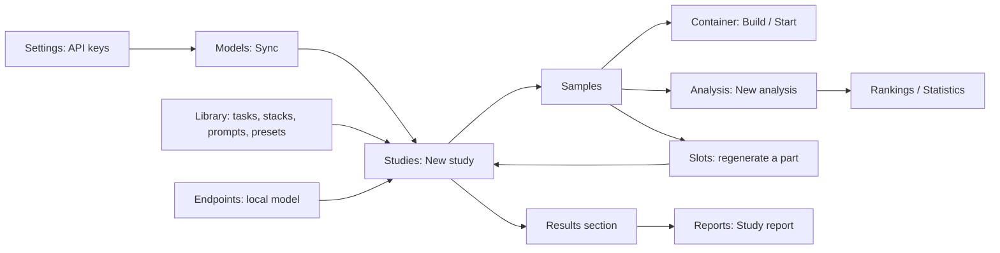

# User guide

A page-by-page tour of the LLM Lab web UI and the workflows that connect the pages.

For installing and starting the stack, see [Quickstart](/docs/QUICKSTART). This guide starts once you can sign in.

## Layout and navigation

Every signed-in page has a left sidebar, a header with breadcrumbs, a theme toggle and an account menu.

The sidebar groups pages in workflow order. The breadcrumb's first, unlinked crumb is the group name.

| Group | Pages | Purpose |
| --- | --- | --- |
| Overview | Dashboard | Activity across the lab at a glance |
| Generate | Models, Endpoints, Library, Studies, Slots, Budget | Choose models and where they run, curate the versioned library, design and launch studies, regenerate parts of apps, watch spend |
| Evaluate | Applications, Analysis, Human eval, Analyzers, Runtime | Inspect generated apps, run analyzers, run studies with human testers, manage containers |
| Insights | Rankings, Statistics, Reports | Compare models and export results |
| Help | Docs | This documentation |
| Admin (staff only) | System | Host, worker and database health, maintenance |

- **Collapse** at the bottom of the sidebar shrinks it to icons. On phones the sidebar opens from the menu button in the header.
- The account menu (your initial, top right) has **View profile**, **Account settings**, **Appearance**, **API keys**, **Integrations** and **Sign out**.
- **About** (`/about`) and **Privacy & data** (`/privacy`) are not in the sidebar; the footer at the bottom of every page links to **About**, **Privacy** and **Docs**. The privacy page is also linked from Settings, under **Privacy & data**. It lists the cookies and browser storage the app uses, what the server keeps and what leaves the instance (LLM providers, GitHub exports, notification channels); account deletion or a full server-side export goes through the instance administrator.

### Old links that redirect

| Old address | Lands on |
| --- | --- |
| `/dashboard` | Dashboard (`/`) |
| `/login` | `/auth/login` |
| `/settings` | Settings (`/users/settings`) |
| `/integrations?tab=…` | The matching Settings section, for example `#github` or `#notifications` |
| `/automation` and anything under it | Studies. Schedules and post-runs live in each study's **Operations** section |
| `/applications/<id>` | That run's sample page (`/samples/<id>`) |
| `/templates` | Library (`/library`) |

## Typical workflows

### First study: keys, models, design, preview, launch, inspect

1. **Add your keys.** Open Settings → **API keys** and click **Add key** for OpenRouter (and optionally Hugging Face: when a staff user syncs or refreshes the catalog, their Hugging Face key fetches the model metadata). Keys are checked with the provider, stored encrypted and never shown again.
2. **Sync the model catalog.** On **Models**, click **Sync**.
3. **Design a study.** **Studies** → **New study**. Keep **Agentic app** and **Exploratory**, pick a task under **Units**, then fill the **factor table**: one or more models and a stack profile (every other factor has a default: harness `opencode-native`, style `model-choice`, auth `contract_bearer`, prose `standard`, ...). Keep the **Frugal** budget preset and the `security` evaluation level.
4. **Preview the plan.** The right rail resolves the design live: conditions × units × repeats = cells, the cost estimate against the cap, and the issues. Click any cell to read the exact rendered brief with every span attributed to the library entity that owns it; **Edit** on a span saves a new version of that entity for this study.
5. **Launch.** **Freeze plan** (optional), then **Start**. A frugal preset starts with a pilot; when the pilot gates pass, **Expand** runs the main cells.
6. **Inspect a sample.** Open a run from the study's **Data** section: the sample page shows its outcome, manifest, files with their origin, trajectory, evaluation and analyses. **Build** and **Open** preview the app.
7. **Read the results.** The study's **Results** section has the leaderboard, paired comparisons (with the method used), attrition per condition and by-factor estimates; every figure is intention-to-treat.

More detail: [Studies](/docs/STUDIES), [Generation process](/docs/GENERATION_PROCESS), [Execution](/docs/EXECUTION), [Analysis pipeline](/docs/ANALYSIS_PIPELINE).

### Designing and running a confirmatory study

1. In the builder, choose **Confirmatory**. The **Analysis plan** step becomes required: primary metric, research questions, alpha, correction and multiplicity, the pre-registered baseline, estimand and (optionally) a sequential design. Intention-to-treat is the default; excluding truncated runs is a listed sensitivity analysis.
2. Resolve until the rail shows no error: confirmatory studies need passing oracles for every (task, stack) and a passing tester conformance kit for every backend framework.
3. Launch locks the study: the design, analysis plan and budget preset can no longer change (the record shows the lock and the `prereg_hash`). Pilot cells are never part of the confirmatory analysis.
4. The **Results** gate says whether the p-values are confirmatory. A stopped-early design, a different truncation rule, a fingerprint filter that dropped cells, excessive or differential attrition, or a post-hoc baseline makes them exploratory, and the gate lists why.

### Adding a local model endpoint

1. **Endpoints** → **Add endpoint**. The wizard has three steps: **Server**, **Settings**, **Connect**.
2. **Server**: choose the **Server kind** (**Ollama** or **OpenAI-compatible**) and the **Connection** (**Relay**, recommended, or **Direct**, staff only).
3. **Settings**: name, slug (it cannot be changed later), capacity (**Max active jobs**, **Max resident models**, **Request timeout (s)**, **num_ctx cap**, **Keep-alive**), tool calling, and sharing (**Private** or **Shared**; only staff can set **Shared**).
4. **Connect**: for a relay, copy the relay token from the dialog (it is shown once). Run the install commands on the model machine and wait for "Waiting for the relay to connect…" to turn green. For a direct endpoint, use **Test connection**.
5. Open the endpoint and go to **Models**. Select discovered models and click **Use N in new study**. They also appear in the study builder's model picker.

To add a cloud provider instead (Anthropic, OpenAI, Groq, Mistral and others), use Settings → **LLM providers**. LLM Lab then creates an endpoint and imports its models.

More detail: [Local models](/docs/LOCAL_MODELS).

### Building a study report

1. Run a study to completion (its evaluation level decides what is measured). Optionally add an `analysis` post-run with **completed** trigger in its **Operations** section.
2. **Reports** → **New report** → **Study report**.
3. Optionally choose a **Study** (default **All my apps**). With a locked study, its pre-registered analysis plan decides which comparisons are confirmatory.
4. Set a **Random seed** so the report regenerates identically. Optionally tick **Bootstrap rank intervals over apps (slower)** and **Count AI-reviewer findings as issues**.
5. Click **Generate report**. When it completes, download it as **Markdown**, **LaTeX** or **JSON**.

More detail: [Study tables](/docs/STUDY_TABLES).

### Running a human evaluation

1. Make sure apps are reachable for participants: the instance needs subdomain routing. The task's **Overview** warns when it is missing.
2. **Human eval** → **New task**. Pick a preset under **Start from** (for example **App grading** or **A/B comparison**), write the title and the participant instructions, and choose the apps under **App pool**: a study's current runs or single completed runs.
3. Check the **Design** (blocks, consent, questions and the pre-registered primary metric) and the **Settings**. Decide isolation and per-assignment reset now: they freeze when the task opens. Click **Create draft**.
4. On the task page, fix anything under **Before this task can open**, then click **Open**. The design is frozen, the apps get blinded labels and the items are built.
5. Click **Preview** and go through one app as a participant, then reset the preview from **Overview**.
6. On **Participants**, create an invite link, generate access codes or add evaluator accounts, and send them out. On **Apps**, **Start all** pre-starts the apps; otherwise they start when a participant opens them.
7. Watch progress on **Overview** and the answers on **Responses**. Exclude participants or assignments only for reasons you set out in advance.
8. Click **Close** when data collection ends. **Results** then shows the final, non-provisional numbers, and **Export** downloads the CSVs, the codebook and the de-blinding key.

More detail: [Human evaluation](/docs/HUMAN_EVALUATION).

## Overview

### Dashboard (`/`)

Shows lab-wide activity.

- **Header stats**: models in use, apps, analyses and findings. Each one links to its page.
- **Buttons**: **Generate app**, **New analysis**, **Refresh dashboard**, and, for staff only, a **Maintenance** menu with **Sync models**, **Clear caches**, **Clear stuck jobs** and **Open system panel**.
- **Panels**:
  - **Analysis Activity** (trend) and **Finding Severity**.
  - **Analyzer Health**: one tile per analyzer.
  - **Recent Analyses** and **Recent Generation Jobs**, each with **View all**.
  - **Recent Activity** feed.

## Generate

### Models (`/models`)

The catalog of models you can generate with.

- **Filters**:
  - **Quick** filters: **Free**, **Vision**, **Functions**, **128K+ Context**, **Efficient**, **Used in Apps**.
  - Capability, **Price**, **Context** and **Provider** filters, and **Sort**.
- **Actions**: **Sync** refreshes the catalog from OpenRouter, **Export** downloads it, **Covariates CSV** downloads one row of research covariates per model used in your runs, **Import** opens the import page, **Rankings** opens Rankings.
- **Compare**: tick models in the table, then click **Compare (N)**.

**Model detail** (`/models/<slug>`) has these tabs:

- **Overview**: about, links to OpenRouter, models.dev and Hugging Face, and how this model has done on this platform. The facts list separates **Checkpoint parameters** (every tensor in the linked repo), **Reported total** and **Active parameters**, each with its source; an API model that models.dev lists as closed weights says the linked repo may differ from what is served. The **Hugging Face** card shows the repo as an ecosystem: downloads (30 days and all time), likes, trending, Spaces, derived repos and the base-model relation, license and gating, weight size and format, native quantization, Hugging Face inference providers, papers, and the commit and date fetched.
- **Results**: ranking, resource use, code findings by tool, results per task (the **By app spec** card), and the studies it was part of (the **Experiments** card).
- **Generation data**: what this platform recorded about how the model generates, over your runs: **Agent behaviour** per harness, **Providers and calls** (per-provider latency, throughput, cache hits, retries and errors), and **Same-setup variability** between runs that share a setup. Every figure shows its n; `—` or n/a means not measured.
- **Benchmarks**: Artificial Analysis and Design Arena scores, then **external covariates** from Epoch AI (reported and active parameters, training compute and data, with Epoch's notes) and LMArena (rating with its interval on the leaderboard's range, rank of n, votes; the agent arena is a score, not Elo), each with a match badge (exact, variant, assumed), the curator's note and CC-BY attribution, and **Self-reported evaluations** from the Hugging Face repo, labelled self-reported and never normalized or ranked.
- **Capabilities**: besides the capability flags, **Sampling defaults** (the authors' recommended sampling from `generation_config.json`, OpenRouter's defaults, and what your runs actually sent, with n) and **Architecture & size** (dense or MoE, layers, width, heads and KV heads, attention variant, experts per token, native and extended context, vocabulary, native precision, the parameter counts with their sources, and the weight files).
- **Pricing & providers**.
- **Applications**: apps generated with this model, and usage.
- **Raw data**: **Copy JSON** and **Export**.

For a model on your own endpoint, cards that show its catalog twin's data (Hugging Face, architecture, external covariates) say "inherited from <twin>": the weights are assumed to be the same, and the twin's runs are never mixed into this model's statistics.

The header has **Copy model ID**, a link to OpenRouter, export as JSON, **Refresh metadata from OpenRouter** (staff only), **Compare** and **Generate app**. Its size stat reads active / total parameters, with their sources in the tooltip. A notice appears when OpenRouter plans to retire the model.

**Compare** (`/models/compare`) puts the selected models side by side.

- **Sections**: **Core Metrics**, **Pricing Deltas** and **Capabilities Comparison**.
- **Baseline**: **First Selected**, **Average** or **Median**.
- **Other controls**: **Highlight** marks the best value in each row, **Share Link** copies a link to this comparison.

**Import** (`/models/import`) uploads a model JSON file. It accepts this app's own model export or a raw OpenRouter model payload.

Reference: [Models reference](/docs/MODELS_REFERENCE).

### Endpoints (`/endpoints`)

Shows where models run: OpenRouter, plus your own Ollama or OpenAI-compatible servers.

- **Capacity card**: the shared execution slots. Staff also see **Drain** and **Slot settings**.
- **Endpoint cards**: active jobs, queued requests, tokens/s and loaded models, with **Open** for details.
- **Add endpoint**: opens the three-step wizard described in [Adding a local model endpoint](#adding-a-local-model-endpoint).

**Endpoint detail** (`/endpoints/<id>`) has these tabs. Which ones you see depends on the endpoint type and on whether you can edit it.

- **Overview**: live numbers (active jobs, queued requests, tokens/s), **Loaded models** with **Unload**, **Relay sessions** and **Recent errors**.
- **Models**: the discovered models. Use **Refresh models**, **Show hidden**, **Test** or **Unload** a model, hide a model from pickers, override num_ctx per model, and **Use N in new study**.
- **Tokens** (relay endpoints only): relay tokens with **New token**, **Rotate** (the old token keeps working for a grace period) and **Revoke**. **Install the relay** shows the setup commands.
- **Settings**: edit the endpoint, and **Disable or delete**. An endpoint that has runs cannot be deleted, only disabled.

Reference: [Local models](/docs/LOCAL_MODELS).

### Library (`/library`)

Every instrument a sample depends on is a versioned library entity: task specs (with their three prose variants), stack profiles, starters, styles, guidance, prompt templates and prompt sets, harness presets, sampling presets, budget presets, evaluation suites and pattern detectors. A version is immutable (`slug@version` plus a content hash); editing creates the next version, archiving replaces deleting, and studies pin exact versions. **Library** shows one card per kind; each entity page has its versions, a usage list and an editor. See [Library](/docs/LIBRARY).

- **Prompts are editable.** Every prompt template and prompt set is a library entity: edit it in the library (a new version), try it in the **prompt playground** (render a prompt set with any context and diff two renders), or edit a span of a rendered brief in the study builder's cell drawer, which forks the owning template and prompt set as new versions for that study only. Budget numbers never appear in a prompt.
- **Harness presets** pick the coding-agent harness (opencode, mini-swe-agent and aider are enabled; goose, qwen-code, claude-code, codex and gemini-cli stay disabled until their open questions close, and `GET /api/generation/harnesses/` says why) and its profile: `<harness>-native` runs the harness as shipped, `<harness>-controlled` equalises a few knobs (command timeout, web tools denied, subagents off, a pinned system prompt where possible); harnesses still differ in prompts and tools, so results label a harness factor a "harness bundle". See [Harnesses](/docs/HARNESSES).
- **Budget presets** (`frugal`, the default; `standard`; `generous`) hold about 75 knobs: run, call and context caps, reasoning, caching, provider routing and serving tier, time limits and retries, sandbox size, concurrency, cell and study caps, stop rules, the pilot and its gates. The editor shows each knob's validity class: C and R knobs (what the model sees, or what can truncate a run) enter the run's `config_fingerprint`, O knobs are operational, S knobs are stopping rules frozen by a confirmatory lock. Editing a knob in the builder saves a custom version derived from the preset. See [Budget](/docs/BUDGET).

### Studies (`/studies`)

- **List**: every study with mode (app or slot), kind (exploratory or confirmatory), status, progress, spend against the cap, exclusion rate and a lock badge for locked confirmatory studies. Filter by status, mode and kind.
- **New study** (`/studies/new`) is the builder: **Mode & kind**, **Units** (tasks, or slot targets across parents of one task), the **factor table** (role and levels per factor: model, harness preset, stack, starter level, style, auth mode, guidance, prompt set, prose variant, sampling preset, budget preset, network policy, and in slot mode the executor, hole mode and context policy; price per Mtok and capability filters for models and "edit prompt" for prompt sets), **Replicates & seeds** (with a power helper), **Budget preset** (the key limits always visible, every knob one click away), **Evaluation**, the **Analysis plan** (confirmatory only) and **Schedules / post-run**. The **plan rail** resolves the design on every change: counts, the estimate with a cost-by-level bar and the fit under the cap, the issues with quick fixes, and a cell sampler whose drawer shows the rendered stimuli with their source spans, the effective roles per harness, the effective parameters with their knob classes and a diff against another cell. **Freeze plan** persists the plan; **Start** opens the launch dialog (expected / p90 / worst case, the resolved cap, pilot information, typed confirmation above the threshold). Drafts autosave.
- **Study record** (`/studies/<id>`) reads like a paper: **Abstract** (hypothesis, kind, lock and `prereg_hash`, headline results), **Method** (the design, the factor table, the evaluation level, the analysis plan and the cells table with the cell inspector; **Clone**), **Results** (gate, paired comparisons with the method used, the truncation sensitivity, attrition per condition, the condition × unit matrix, by-factor estimated marginal means, stated vs unstated pass rate per prose variant, test-retest agreement), **Patterns** (slot studies), **Data** (export zip, every run with its attempts, manifests) and **Operations** (endpoint lanes, the condition grid, live spend, pilot gates with **Expand**, pause / resume / cancel, top-up, schedules and post-runs).
- A cell's current run is its **first usable** attempt: a top-up never replaces a usable run, and runs created beyond the plan are shown but never analysed.

### Slots (`/slots/new`)

Slot mode regenerates one part of frozen parent apps many times, to find the patterns models produce for the same part. Choose parents (draw k at random among tested runs, or pick by hand; or **Generate a parent app**), freeze them, pick parts in the three-pane code view (file, region, symbol, endpoint handler or UI component), preview the holed text, the resolved context and the leak report, and **Create slot study**. Targets must be validated (their linked checks must discriminate) before a study can launch. A slot study's factors add the executor (`single_shot`: one structured call per variant; `restricted_agent`: a harness limited to the target's files), the hole mode and the context policy; a `patterns` post-run clusters the variants and measures detector prevalence when the study completes. See [Slot mode](/docs/SLOT_MODE) and [Pattern analysis](/docs/PATTERNS).

### Budget (`/budget`)

Your spend against your caps (user, endpoint and provider spend caps in USD, list-price USD or tokens, including the 5 h and weekly quota caps of subscription endpoints), billed and list-price totals, and the burn per study. The header's spend chip shows the period spend and turns into a badge when a study is paused for budget, quota or a spend cap.

## Evaluate

### Applications and samples (`/applications`, `/samples/<id>`)

**Applications** lists every agentic app run (filters: status, outcome, model, study, container). A run's page is its **sample** (`/samples/<id>`; `/applications/<id>` redirects there):

- **Header**: kind, outcome (`output_invalid`, `build_fail`, `start_fail`, `tested`, `infra_error`, `excluded`), usable, model, labels, cost and wall time, and a `beyond plan` badge for runs created on a cell that already had a usable run.
- **Overview**: the outcome explained, the termination, validity notes, and the attempts table (OOM, request classes, truncations, time split).
- **Manifest**: the frozen manifest as a tree, pinned refs linking to their library versions, and the rendered stimuli with their source spans.
- **Files**: the file tree with origin badges (starter, authored, modified, slot; parent files of a slot variant) and an origin filter (model / app / slot), the code viewer and the resolved lock.
- **Trajectory**: every step of the harness run, live while it runs.
- **Evaluation**: checks by category (infra and agent separated, the starter baseline shown, stated/unstated marks, flaky checks excluded), probes (exploited / not exploited / skipped with the reason), adherence, reuse and retest markers. Anything the evaluation level skipped reads "not measured", never a pass or a 0.
- **Calls**: per-call telemetry (request class, finish reason, served provider, tokens/s).
- **Analyses** and **Runtime**: the analyses of this sample and the container controls (**Build**, **Open**, **Start**, **Stop**).

A completed, usable app run offers **Regenerate a part…** (the slot picker) and, in study tables, **Use as parent**.

Reference: [Generation process](/docs/GENERATION_PROCESS), [Execution](/docs/EXECUTION).

### Analysis (`/analysis`)

Runs your analyzer workspace's tools on generated apps and shows their results live.

- **List**: every run with what it analyzed (app · model · stack), **Status** (with a progress bar and the running tool while active), **Findings** (total, plus the levels the tools reported; — when no tool measured anything), **Tools** (measured / total, with how many were n/a, failed or not measured), **Duration** and **Created**. Filter by status (counts on each chip), search by name, app, model, stack or ID, and sort by findings, duration or date. Select rows to cancel or delete them in bulk; re-run a finished run from its row. Links scope the list to a launch (`?launch_id=`), a run (`?job=`) or a tool (`?tool=`). Active runs update live.
- **Header buttons**: **Analyzers** and **New analysis**.

**New analysis** (`/analysis/create`) is one page:

1. **What to analyze**: **Generated apps** (search, an **App running** filter, multi-select; each app gets its own run, queued one after another) or **Paste code** as named files (names decide which tools apply).
2. **Tools**: installed tools by category, with quick sets (**All installed**, **Static only**, **Security & deps**). Each selected tool says where it would run ("Runs on all 3 apps", "Nothing to read — would be skipped", "App not running"). Tools that aren't installed are listed but disabled. The selection is remembered.
3. **Name**: optional.

The **Run summary** shows apps × tools = tool runs, how many would be skipped, files and lines to scan, and warnings. Linking `/analysis/create?generation_job_id=<id>` preselects an app.

**Run detail** (`/analysis/<id>`):

- Under the title, the **setup line** of the analyzed app: study › condition › repeat k/N · model · harness · task, linked to the study, model and sample pages.
- While running: a progress strip (one segment per tool, the running tool and its clock, findings so far, live-connection state) and **Cancel run**.
- **Overview**: findings (split into code findings, dependency advisories and runtime findings), tools measured, code size and duration; what needs attention (failed tools, dynamic tools skipped because the app was down, truncated generated code); findings by the level each tool reported and by tool; most affected files and most frequent rules (each opens the filtered findings); metrics of complexity and duplication tools.
  - **Code** is the app's source LOC by the study's definition (backend, frontend, tests apart). A note lists stored files in dependency, cache or scratch directories that the analysis leaves out; for a run from before that rule it says how many findings lie in them.
  - **Code findings** counts the app's own source; findings in test files are listed apart (+ N in test files). Clicking it filters to the app's source.
  - **Most frequent rules** shows each rule's prevalence: in how many analyzed apps that tool reported it, out of the apps the tool measured, and the same for this model ("12/12 apps · 4/4 of this model"). A switch picks the corpus (**Study** or **All my apps**), and the card states n and any caveats (interim while the study runs; this run's results that are not the ones counted).
  - **Same setup**: for a finished run, the runs that share its configuration, findings first ([Studies](/docs/STUDIES#results)).
- **Findings**: filters by tool, level as reported, category, file and rule, a **Scope** facet (Code, with **App source** and **Test files** under it / Dependency advisories / Runtime) when the run has advisories, dynamic-tool or test-file findings, plus search and sort. Test-file rows get a **test file** chip, merged rows show their issue class, and a finding's detail shows its code part, issue class and prevalence. A row expands into everything the tool said: description, its suggested fix, code, location, rule documentation, CWE / OWASP, references, the vulnerable package and fixed versions, the HTTP request a scanner flagged, duplicates. **CSV** / **JSON** export the filtered findings. Levels are ordered by the tool's own word; a CVSS score printed as the level ranks by its band. The CSV export prefixes an apostrophe to text that a spreadsheet would run as a formula (starting with =, +, -, @, tab or CR), leaves numbers alone, and writes an empty level as unrated. A trivy advisory link is shown as rule documentation, not as a flagged request.
- **Tools**: each tool in execution order with state, time, version, findings, warnings and errors; **Output** shows the command, exit code and raw output.
- **Re-run**: all tools, or only those that measured nothing.

Levels are shown only as the tools printed them. A tool that rates nothing (ruff, flake8, pip-audit, …) gets no level; the normalized severity used by statistics is never displayed here.

Reference: [Analysis pipeline](/docs/ANALYSIS_PIPELINE).

### Human eval (`/human-eval`)

Manual testing studies in which human participants use and grade your generated apps on a separate evaluation portal.

- **List**: your tasks with mode, status, apps, participants and progress toward the target number of ratings. Filter by status or search; **New task** opens the wizard.
- **New task** (`/human-eval/new`) has six numbered sections:
  1. **Start from**: a preset (App grading, Requirements audit, Security assessment, Usability test, A/B comparison, Full evaluation), or **From scratch**.
  2. **Basics**: title, description, instructions in Markdown, and the mode (single app or A/B pairs).
  3. **App pool**: a study and/or completed runs.
  4. **Design**: blocks, consent, pre/post questions and the analysis plan.
  5. **Settings**: blinding, allocation, pairing, access, hosting and quality.
  6. **Review and create**: saves a private draft.

  The design is checked as you type.
- **Task page** (`/human-eval/<id>`): **Open**, **Pause**, **Close**, **Reopen**, **Archive**, **Preview** (once open), **Duplicate** and **Delete** in the header. Seven tabs:
  - **Overview**: blockers, validity warnings, progress, the record and the protocol log.
  - **Design**: frozen after the first open.
  - **Apps**: the de-blinded pool and hosting: start, stop, pin, rebuild, open, **Start all** / **Stop all**.
  - **Participants**: invite links, **Generate codes**, **Add accounts**, and the participant table with quality flags and exclusion.
  - **Responses**: assignments, reports with screenshots, and the HTTP log.
  - **Results**: group by condition, model or app; include excluded data.
  - **Export**: CSVs, the bundle and the results JSON.
- **Evaluation portal** (`/eval`): what participants see. It has no sidebar. Participants join from an invite link (`/eval/join/<token>`, which shows their access code once), continue with an access code, or sign in with an evaluator account. The task page has instructions, consent, the "About you" questions, **Evaluate apps** and **Finish** (completion code). The workbench shows the app beside the form, which saves as they go. Evaluator accounts only ever see the portal.

Reference: [Human evaluation](/docs/HUMAN_EVALUATION).

### Analyzers (`/analyzers`)

Choose the tools that measure your apps. Their findings feed analysis runs, studies, reports and rankings.

- **Coverage panel** ("What your generated apps contain"): technologies in your apps, and which ones no tool measures.
- **Shop**: the full catalog.
  - Filters: category, technology, **Static** or **Dynamic** mode, install state (**Installed**, **Not installed**, **Updates**), and fit to your apps.
  - Actions: **Install** a tool, or **Install N shown** for everything in the current view.
- **Installed**: your tools.
  - **Configure & test** opens the tool's options, **Test** runs it on a sample, **Save** keeps the options.
  - Also **Log**, **Update** or **Update all**, and **Uninstall**.
  - Dynamic tools need the app's container running when the analysis starts.
- **Workspace**: your private analyzer container, with **Stop**, **Repair tools** and **Tear down**.

Reference: [Analyzer guide](/docs/ANALYZER_GUIDE).

### Runtime (`/runtime`)

Lists the Docker containers of your generated apps (staff see every user's). A dot shows whether the Docker daemon is online.

- **List**: filter by status (**Pending**, **Building**, **Running**, **Stopped**, **Failed**, **Removed**). Each row has **Start**, **Stop**, **Restart** and **Remove**. **Remove** keeps the generated code.
- **Container detail** (`/runtime/<id>`): the same actions, plus **Logs** and **Actions** (lifecycle history) tabs.

Reference: [Execution](/docs/EXECUTION).

## Insights

### Rankings (`/rankings`)

Puts empirical quality measured on this platform next to the metadata-based **MSS** decision aid.

- **Columns**: **Rank**, **Model**, **Measured** (empirical score with its n), **MSS decision aid**, **Public benchmarks** and **Apps**.
- **Ranked by**: **MSS**, **Empirical**, **Composite**, **Benchmark**, **Cost**, **Accessibility** or **Adoption**.
- **Filters**: **Provider**, **Paid only** and **Has Benchmarks**.
- **Actions**: select up to 10 models and click **Compare**. **Export CSV** downloads the table.
- **Methodology** explains what is measured and what is opinion. **Sensitivity** shows how stable the ranking is under alternative severity weights (Kendall's τ).

### Statistics (`/statistics`)

Platform-wide analytics.

- **Analysis Trends** and **Severity Distribution**.
- **Model Comparison**: apps, success % (completed of finished runs; pending, running and cancelled runs are not outcomes), **Smoke pass** (the evaluation's functional pass rate, `agent_pass_rate`, over usable runs; the preview smoke probe never feeds it), empirical score, MSS and composite.
- **Tool Effectiveness**: scans (executions that measured the app: completed or not applicable), not measured (failed, cancelled, app not running), findings, average per measured scan (empty when none) and top rule.
- **Top Findings** (one row per title, tool and the level that tool printed, `unrated` when it prints none; dependency advisories are marked dependency advisory, since they are package vulnerabilities, not code issues), **Code Generation Stats** (success rate over finished runs; Source lines is source LOC; average times show — until something completed) and **Recent Activity**.
- **Severity Distribution** is the platform's normalized level, labelled "normalized (heuristic)", not the tools' own labels.

### Reports (`/reports`)

Lists generated reports, with filters for **Type** and **Status**, **Sort**, and **Export** (**Reports CSV** or **Reports JSON**).

**New report** (`/reports/create`): pick a type, configure it, then click **Generate report**.

| Type | Configure |
| --- | --- |
| **Model analysis** | Model |
| **Task comparison** | A library task and optionally one task version (versions are different stimuli); one row per model and treatment |
| **Tool analysis** | Tool name (blank aggregates all tools; an unknown name is rejected) and an optional window in days (blank: all runs) |
| **Generation analytics** / **Comprehensive** | Window (days) |
| **Study conditions** | A study: per-condition summaries and the study results (leaderboard, paired comparisons, gate) |
| **Study report** | Optional study, random seed, bootstrap and AI-finding options. Produces paper-ready tables. |

Reports cover your own runs and analyses (staff: everyone's). In **Comprehensive**, generation and tool analytics cover the window; the ranking sensitivity and platform totals are all-time.

**Report detail** (`/reports/<id>`) shows a **Summary** and the report's curated tables, one card per table, exactly as the Markdown and LaTeX downloads have them. Tables have labelled columns, condition names, p-values with their interim/withheld/untested state, and '—' for values that were not measured. Reports with more than three tables get a table index. In the Summary a study conditions report whose conditions tie for the top mean pass rate, or a study report whose models (or conditions) tie for TOPSIS rank 1, names no leader and reads 'Tie: N … share the top' (re-read from the report's leaderboard or ranking, so reports stored before ties were detected read right too), and unmeasured values read '—', never 0. The tables come from `GET /api/reports/<id>/tables/`, the same tables as the Markdown and LaTeX downloads; a table cut at 500 rows says so in its note. A completed report downloads as **Markdown**, **LaTeX** or **JSON**. Reports without curated tables render every field: nested objects become their own tables, wide tables are split into parts, and severity buckets are labelled as the platform's normalized severity (a heuristic), not the tools' own levels. Fields holding the levels the tools printed (`reported_levels`) are shown as printed, in one cell, and never labelled normalized.

Reference: [Study tables](/docs/STUDY_TABLES).

## Help

### Docs (`/docs`)

The in-app viewer for these pages. The landing page groups documents by category and has a **Start here** link.

- **Find a page**: press ⌘K (Ctrl+K) or use **Search docs…** to search every page. The sidebar has **Overview**, **Browse** and **Search**.
- **On a page**: **On this page** lists the headings, and **Copy link** copies a permalink.

The REST API is documented in the [API reference](/docs/api-reference).

## Admin

### System (`/system`), staff only

The System Monitor refreshes every 10 seconds. Other users see "Staff access required".

- **Health panels**:
  - **Host Metrics**: CPU, memory, uptime, load and disk.
  - **Containers**.
  - **Redis**.
  - **Celery**: workers, active, scheduled and reserved tasks, and queue lengths.
  - **Database**: connections, commits, deadlocks and the top tables by size.
- **Application Stats**: counts by status and in the last 24 hours.
- **Maintenance Actions**: **Clear Stuck Analysis Tasks**, **Clear Stuck Generation Jobs**, **Purge Orphan Containers** and **Clear All Caches**. Each one asks for confirmation.

## Account

### Settings (`/users/settings`)

One page with a section menu and search. Each section has a deep link, `/users/settings#<id>`.

| Group | Section | What you do there |
| --- | --- | --- |
| Account | **Profile** (`#account`) | Display name. Email is read-only. |
| Account | **Security** (`#security`) | Change password |
| Preferences | **Appearance** (`#appearance`) | Theme and avatar color |
| Preferences | **Workspace** (`#workspace`) | **Collapsed sidebar**, **Compact tables** |
| Preferences | **Privacy & data** (`#privacy`) | What this browser stores. **Export**, **Import** or **Reset** your preferences. |
| Connections | **API keys** (`#credentials`) | Personal OpenRouter and Hugging Face keys |
| Connections | **LLM providers** (`#providers`) | Connect a cloud provider with a key. This creates an endpoint and imports its models. |
| Connections | **GitHub** (`#github`) | Personal access token for **Export to GitHub** (repository or Gist, optional SARIF upload) |
| Connections | **MCP server** (`#mcp`) | Server URL, a connection token and client snippets, so an AI assistant can drive LLM Lab |
| Connections | **Notifications** (`#notifications`) | **Add channel** for Slack, Discord, Teams, Telegram, ntfy or a signed webhook, with **Recent deliveries** |
| Connections | **Personal tokens** (`#tokens`) | Bearer tokens for scripts, CI and MCP clients, with **New token** and **Revoke** |

Preferences are saved in this browser only. Keys and tokens are stored encrypted and shown only once.

Reference: [Integrations](/docs/INTEGRATIONS).

### Profile (`/users/<id>`)

Your profile shows account details (role, join date, last sign-in), connections, and **Your work**: samples, analyses, studies and reports, plus recent activity. Profiles are visible only to their owner.

### Sign-in pages

The sign-in pages live under `/auth/`:

- **Log In**, with **Stay logged in** and **Forgot your password?**.
- **Sign Up**. The first account becomes the administrator and does not need an email address.
- **Reset Password**.
- **Verify Your Email**.
- **Two-Factor Authentication**.

In local development, verification and reset emails arrive in Mailpit.

If something does not work as described, see [Troubleshooting](/docs/TROUBLESHOOTING).
